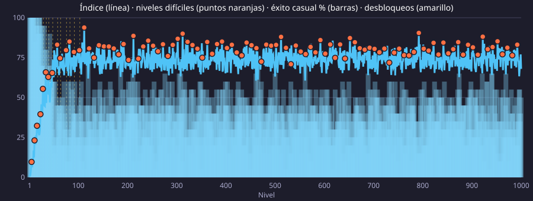

# Análisis de dificultad

Generado con `npm run analizar` (niveles 1–1000, 5 niveles por número, 4 partidas
de jugador casual por nivel; semilla fija). No editar a mano: vuelve a ejecutar el script.

## Resumen

- **Resolubles sin habilidades**: 5000/5000 (100 %). Con un jugador perfecto, `npm run simular`.
- **Tendencia**: correlación de Spearman nivel ↔ índice **ρ = 0,18** (1 = sube siempre);
  nivel ↔ éxito del jugador casual ρ = -0,14 (negativa = cada vez gana menos).
- **Retrocesos** (el índice baja más de 5 puntos respecto al nivel anterior): 19, 26, 37, 43, 45, 53, 61, 62, 65, 70, 73, 77, 80, 84, 86, 96, 101, 106, 110, 121, 124, 126, 128, 130, 136, 138, 139, 144, 147, 148, 156, 158, 161, 166, 167, 169, 177, 184, 185, 192, 194, 198, 204, 210, 215, 216, 218, 224, 227, 229, 235, 237, 241, 245, 248, 258, 261, 268, 275, 280, 292, 296, 304, 305, 307, 310, 318, 325, 330, 341, 346, 350, 355, 357, 360, 368, 385, 387, 395, 397, 399, 401, 404, 407, 409, 416, 419, 427, 429, 438, 450, 454, 457, 464, 471, 478, 481, 489, 495, 506, 517, 520, 526, 530, 534, 538, 540, 544, 546, 554, 556, 558, 561, 567, 576, 578, 581, 585, 587, 597, 600, 602, 605, 610, 619, 624, 636, 645, 657, 658, 665, 668, 671, 675, 677, 685, 687, 689, 691, 695, 698, 700, 704, 706, 708, 720, 725, 730, 735, 740, 744, 748, 751, 754, 755, 757, 761, 764, 765, 768, 777, 784, 790, 794, 798, 801, 814, 819, 822, 828, 830, 835, 837, 840, 847, 849, 851, 854, 860, 862, 866, 869, 876, 886, 888, 892, 894, 896, 898, 900, 905, 914, 919, 921, 929, 932, 940, 949, 951, 956, 960, 964, 967, 971, 974, 978, 980, 984, 986, 987, 990, 994, 998, 999.
- **Mesetas** (tramos de 10 niveles con pendiente casi nula): 51–100, 101–150, 151–200, 201–250, 251–300, 301–350, 351–400, 401–450, 451–500, 501–550, 551–600, 601–650, 651–700, 701–750, 751–800, 801–850, 851–900, 901–950, 951–1000.
- **Por bloque** (de un desbloqueo al siguiente): bloque ↔ índice medio de sus niveles normales
  ρ = 0,34. El **nivel difícil** supera a la media de su bloque en
  83/103 bloques, de media por **5,1 puntos**.

Índice = 30 % movimientos de la solución + 20 % esfuerzo de búsqueda + 35 % fracaso del jugador
casual + 15 % niebla (la lluvia está desactivada) (cada medida normalizada entre el
mínimo y el máximo de los niveles analizados).

## Por bloques

| Bloque | Niveles | Índice niveles normales | Éxito casual normales | Nivel difícil | Índice difícil | Éxito casual difícil |
| --- | --- | --- | --- | --- | --- | --- |
| 0 | 1–5 | 2,6 | 100 % | 5 | 11,9 | 100 % |
| 1 | 6–11 | 10,8 | 100 % | 11 | 21,1 | 100 % |
| 2 | 12–16 | 24,2 | 99 % | 16 | 28,9 | 100 % |
| 3 | 17–23 | 31,7 | 91 % | 23 | 39,7 | 85 % |
| 4 | 24–28 | 45,3 | 75 % | 28 | 57,8 | 60 % |
| 5 | 29–34 | 55,3 | 64 % | 34 | 71,6 | 35 % |
| 6 | 35–39 | 54,4 | 66 % | 39 | 62,5 | 55 % |
| 7 | 40–47 | 54,2 | 69 % | 47 | 64,4 | 55 % |
| 8 | 48–57 | 73,6 | 36 % | 57 | 84,0 | 25 % |
| 9 | 58–63 | 70,5 | 41 % | 63 | 72,5 | 45 % |
| 10 | 64–75 | 71,4 | 42 % | 75 | 75,9 | 25 % |
| 11 | 76–82 | 76,6 | 28 % | 82 | 79,3 | 35 % |
| 12 | 83–91 | 73,9 | 38 % | 91 | 83,3 | 15 % |
| 13 | 92–102 | 70,5 | 47 % | 102 | 84,0 | 15 % |
| 14 | 103–112 | 73,3 | 38 % | 112 | 88,3 | 20 % |
| 15 | 113–122 | 73,3 | 37 % | 122 | 87,0 | 5 % |
| 16 | 123–132 | 73,7 | 38 % | 132 | 84,3 | 20 % |
| 17 | 133–142 | 74,9 | 39 % | 142 | 74,3 | 35 % |
| 18 | 143–152 | 75,1 | 37 % | 152 | 83,8 | 10 % |
| 19 | 153–162 | 77,0 | 33 % | 162 | 78,5 | 30 % |
| 20 | 163–172 | 74,1 | 38 % | 172 | 71,5 | 45 % |
| 21 | 173–182 | 75,5 | 34 % | 182 | 80,4 | 30 % |
| 22 | 183–192 | 75,4 | 37 % | 192 | 75,7 | 30 % |
| 23 | 193–202 | 77,4 | 30 % | 202 | 76,5 | 30 % |
| 24 | 203–212 | 74,3 | 37 % | 212 | 77,3 | 35 % |
| 25 | 213–222 | 74,6 | 34 % | 222 | 80,4 | 25 % |
| 26 | 223–232 | 75,1 | 35 % | 232 | 77,9 | 45 % |
| 27 | 233–242 | 75,0 | 35 % | 242 | 79,5 | 35 % |
| 28 | 243–252 | 73,8 | 39 % | 252 | 82,8 | 30 % |
| 29 | 253–262 | 76,9 | 31 % | 262 | 79,9 | 35 % |
| 30 | 263–272 | 77,4 | 33 % | 272 | 73,4 | 45 % |
| 31 | 273–282 | 75,2 | 35 % | 282 | 74,9 | 35 % |
| 32 | 283–292 | 74,9 | 36 % | 292 | 71,8 | 45 % |
| 33 | 293–302 | 76,5 | 33 % | 302 | 83,2 | 20 % |
| 34 | 303–312 | 74,2 | 34 % | 312 | 78,9 | 25 % |
| 35 | 313–322 | 75,8 | 34 % | 322 | 76,6 | 35 % |
| 36 | 323–332 | 75,0 | 41 % | 332 | 83,2 | 10 % |
| 37 | 333–342 | 75,4 | 35 % | 342 | 81,2 | 30 % |
| 38 | 343–352 | 75,7 | 34 % | 352 | 80,2 | 30 % |
| 39 | 353–362 | 76,3 | 34 % | 362 | 84,8 | 20 % |
| 40 | 363–372 | 75,1 | 36 % | 372 | 83,5 | 20 % |
| 41 | 373–382 | 73,5 | 39 % | 382 | 81,6 | 20 % |
| 42 | 383–392 | 73,5 | 41 % | 392 | 80,1 | 25 % |
| 43 | 393–402 | 74,3 | 38 % | 402 | 72,5 | 45 % |
| 44 | 403–412 | 73,8 | 35 % | 412 | 86,9 | 20 % |
| 45 | 413–422 | 75,1 | 36 % | 422 | 84,5 | 20 % |
| 46 | 423–432 | 71,7 | 42 % | 432 | 78,0 | 35 % |
| 47 | 433–442 | 77,1 | 31 % | 442 | 81,0 | 25 % |
| 48 | 443–452 | 75,0 | 34 % | 452 | 77,9 | 25 % |
| 49 | 453–462 | 75,3 | 34 % | 462 | 75,5 | 25 % |
| 50 | 463–472 | 75,7 | 34 % | 472 | 75,9 | 30 % |
| 51 | 473–482 | 74,7 | 39 % | 482 | 79,5 | 25 % |
| 52 | 483–492 | 77,1 | 34 % | 492 | 71,9 | 45 % |
| 53 | 493–502 | 72,2 | 39 % | 502 | 87,7 | 15 % |
| 54 | 503–512 | 73,9 | 36 % | 512 | 85,2 | 10 % |
| 55 | 513–522 | 75,7 | 37 % | 522 | 82,1 | 15 % |
| 56 | 523–532 | 74,1 | 37 % | 532 | 76,7 | 40 % |
| 57 | 533–542 | 74,8 | 38 % | 542 | 89,4 | 5 % |
| 58 | 543–552 | 74,5 | 35 % | 552 | 72,4 | 40 % |
| 59 | 553–562 | 75,7 | 36 % | 562 | 80,5 | 30 % |
| 60 | 563–572 | 77,1 | 32 % | 572 | 87,1 | 10 % |
| 61 | 573–582 | 76,3 | 28 % | 582 | 77,5 | 25 % |
| 62 | 583–592 | 76,7 | 31 % | 592 | 75,2 | 40 % |
| 63 | 593–602 | 77,1 | 34 % | 602 | 65,3 | 70 % |
| 64 | 603–612 | 74,9 | 37 % | 612 | 87,1 | 15 % |
| 65 | 613–622 | 76,7 | 33 % | 622 | 69,8 | 55 % |
| 66 | 623–632 | 73,7 | 43 % | 632 | 84,2 | 15 % |
| 67 | 633–642 | 76,9 | 33 % | 642 | 76,0 | 25 % |
| 68 | 643–652 | 77,6 | 34 % | 652 | 89,3 | 5 % |
| 69 | 653–662 | 74,8 | 36 % | 662 | 82,9 | 20 % |
| 70 | 663–672 | 71,8 | 43 % | 672 | 73,4 | 45 % |
| 71 | 673–682 | 75,8 | 36 % | 682 | 82,0 | 30 % |
| 72 | 683–692 | 73,9 | 42 % | 692 | 79,2 | 30 % |
| 73 | 693–702 | 72,9 | 42 % | 702 | 78,4 | 25 % |
| 74 | 703–712 | 77,6 | 29 % | 712 | 79,9 | 25 % |
| 75 | 713–722 | 71,8 | 45 % | 722 | 83,1 | 20 % |
| 76 | 723–732 | 79,0 | 28 % | 732 | 77,7 | 25 % |
| 77 | 733–742 | 75,7 | 34 % | 742 | 73,9 | 40 % |
| 78 | 743–752 | 75,6 | 36 % | 752 | 80,8 | 30 % |
| 79 | 753–762 | 79,3 | 27 % | 762 | 77,7 | 35 % |
| 80 | 763–772 | 73,2 | 41 % | 772 | 73,0 | 40 % |
| 81 | 773–782 | 73,8 | 40 % | 782 | 77,8 | 40 % |
| 82 | 783–792 | 77,0 | 33 % | 792 | 86,6 | 10 % |
| 83 | 793–802 | 76,5 | 34 % | 802 | 79,4 | 25 % |
| 84 | 803–812 | 74,8 | 36 % | 812 | 75,3 | 35 % |
| 85 | 813–822 | 75,4 | 36 % | 822 | 80,8 | 25 % |
| 86 | 823–832 | 72,7 | 42 % | 832 | 73,4 | 35 % |
| 87 | 833–842 | 74,7 | 35 % | 842 | 85,1 | 10 % |
| 88 | 843–852 | 72,7 | 41 % | 852 | 75,3 | 40 % |
| 89 | 853–862 | 79,9 | 26 % | 862 | 71,6 | 45 % |
| 90 | 863–872 | 75,0 | 34 % | 872 | 75,5 | 35 % |
| 91 | 873–882 | 75,4 | 37 % | 882 | 82,3 | 25 % |
| 92 | 883–892 | 76,7 | 34 % | 892 | 71,5 | 55 % |
| 93 | 893–902 | 71,8 | 46 % | 902 | 76,9 | 35 % |
| 94 | 903–912 | 75,6 | 34 % | 912 | 85,4 | 15 % |
| 95 | 913–922 | 73,6 | 39 % | 922 | 85,5 | 20 % |
| 96 | 923–932 | 78,5 | 27 % | 932 | 77,9 | 25 % |
| 97 | 933–942 | 76,6 | 34 % | 942 | 89,1 | 5 % |
| 98 | 943–952 | 75,8 | 33 % | 952 | 92,9 | 5 % |
| 99 | 953–962 | 72,4 | 39 % | 962 | 75,3 | 35 % |
| 100 | 963–972 | 75,8 | 36 % | 972 | 86,1 | 20 % |
| 101 | 973–982 | 72,4 | 43 % | 982 | 75,2 | 30 % |
| 102 | 983–992 | 74,5 | 39 % | 992 | 85,9 | 25 % |
| 103 | 993–1000 | 77,7 | 29 % | — | — | — |

## Por tramos

| Niveles | Índice (media ± desv.) | Pendiente (puntos/nivel) | Éxito casual | Movimientos |
| --- | --- | --- | --- | --- |
| 1–50 | 39,6 ± 20,9 | 1,36 | 78 % | 24,5 |
| 51–100 | 73,3 ± 6,3 | -0,01 | 38 % | 36,9 |
| 101–150 | 74,9 ± 5,9 | 0,01 | 36 % | 37,2 |
| 151–200 | 76,2 ± 5,6 | -0,00 | 34 % | 37,4 |
| 201–250 | 74,9 ± 4,8 | -0,00 | 36 % | 37,0 |
| 251–300 | 76,0 ± 4,3 | -0,07 | 35 % | 37,4 |
| 301–350 | 75,8 ± 4,9 | -0,02 | 34 % | 37,2 |
| 351–400 | 75,5 ± 5,2 | -0,06 | 36 % | 37,3 |
| 401–450 | 75,0 ± 4,8 | 0,04 | 35 % | 37,1 |
| 451–500 | 75,1 ± 4,7 | -0,05 | 36 % | 37,1 |
| 501–550 | 75,6 ± 5,3 | -0,02 | 34 % | 37,2 |
| 551–600 | 76,7 ± 5,4 | 0,03 | 32 % | 37,4 |
| 601–650 | 76,0 ± 5,0 | 0,05 | 36 % | 37,7 |
| 651–700 | 74,8 ± 5,7 | -0,07 | 38 % | 37,3 |
| 701–750 | 76,2 ± 5,4 | 0,02 | 34 % | 37,1 |
| 751–800 | 76,3 ± 5,5 | 0,02 | 34 % | 37,5 |
| 801–850 | 74,5 ± 5,3 | 0,00 | 37 % | 36,9 |
| 851–900 | 75,5 ± 6,1 | -0,10 | 36 % | 37,4 |
| 901–950 | 76,8 ± 5,2 | 0,04 | 32 % | 37,4 |
| 951–1000 | 75,3 ± 6,3 | 0,04 | 36 % | 37,4 |

## Cómo pierde el jugador casual

«Sin solución» = tras una jugada suya la partida ya no se puede ganar (el juego lo comprueba del
todo y lo cuenta como derrota) aunque **le queden jugadas**; «sin movimientos» = no le queda
ninguna; «tiempo» = 300 jugadas sin ganar. «Jugada» = mediana de la jugada en la
que la partida quedó sin solución.

| Niveles | Gana | Sin solución | … con jugadas | Jugada | Sin movimientos | Tiempo |
| --- | --- | --- | --- | --- | --- | --- |
| 1–50 | 78 % | 22 % | 79 % | 8 | 0 % | 0 % |
| 51–100 | 38 % | 62 % | 79 % | 10 | 0 % | 0 % |
| 101–150 | 36 % | 64 % | 82 % | 10 | 0 % | 0 % |
| 151–200 | 34 % | 66 % | 78 % | 10 | 0 % | 0 % |
| 201–250 | 36 % | 64 % | 83 % | 10 | 0 % | 0 % |
| 251–300 | 35 % | 65 % | 81 % | 10 | 0 % | 0 % |
| 301–350 | 34 % | 66 % | 80 % | 10 | 0 % | 0 % |
| 351–400 | 36 % | 64 % | 81 % | 10 | 0 % | 0 % |
| 401–450 | 35 % | 65 % | 80 % | 10 | 0 % | 0 % |
| 451–500 | 36 % | 64 % | 79 % | 10 | 0 % | 0 % |
| 501–550 | 34 % | 66 % | 79 % | 10 | 0 % | 0 % |
| 551–600 | 32 % | 68 % | 81 % | 10 | 0 % | 0 % |
| 601–650 | 36 % | 64 % | 82 % | 10 | 0 % | 0 % |
| 651–700 | 38 % | 62 % | 80 % | 10 | 0 % | 0 % |
| 701–750 | 34 % | 66 % | 80 % | 10 | 0 % | 0 % |
| 751–800 | 34 % | 66 % | 79 % | 9 | 0 % | 0 % |
| 801–850 | 37 % | 63 % | 78 % | 10 | 0 % | 0 % |
| 851–900 | 36 % | 64 % | 77 % | 9 | 0 % | 0 % |
| 901–950 | 32 % | 68 % | 82 % | 10 | 0 % | 0 % |
| 951–1000 | 36 % | 64 % | 78 % | 9 | 0 % | 0 % |

## Por nivel

| Nivel | Bloque | Colores | Paleta | Tubos | Fusiones | Lluvia | Intervalo | Movimientos | log₁₀ nodos | Ramificación | Éxito casual | Niebla | Índice |
| --- | --- | --- | --- | --- | --- | --- | --- | --- | --- | --- | --- | --- | --- |
| 1 | 0 | 3 | 4 | 5 | 0 | 0 | 5,85 s | 10,6 ± 0,5 | 1,02 | 3,9 | 100 % | 0 % | 2,6 |
| 2 | 0 | 3 | 4 | 5 | 0 | 0 | 5,70 s | 9,2 ± 1,0 | 0,96 | 3,7 | 100 % | 8 % | 1,8 |
| 3 | 0 | 3 | 4 | 5 | 0 | 0 | 5,55 s | 9,6 ± 1,4 | 0,98 | 4,0 | 100 % | 5 % | 1,8 |
| 4 | 0 | 3 | 4 | 5 | 0 | 0 | 5,40 s | 10,4 ± 1,9 | 1,01 | 3,7 | 100 % | 10 % | 4,3 |
| **5** ⚠ | 0 | 3 | 4 | 5 | 0 | 0 | 4,20 s | 12,2 ± 1,0 | 1,09 | 3,6 | 100 % | 30 % | 11,9 |
| 6 | 1 | 3 | 5 (+naranja) | 5 | 1 | 0 | 5,10 s | 11,8 ± 1,6 | 1,07 | 4,3 | 100 % | 15 % | 7,9 |
| 7 | 1 | 3 | 5 | 5 | 1 | 0 | 4,95 s | 11,4 ± 0,8 | 1,06 | 4,8 | 100 % | 20 % | 8,4 |
| 8 | 1 | 3 | 5 | 5 | 1 | 0 | 4,80 s | 11,2 ± 0,7 | 1,05 | 4,7 | 100 % | 20 % | 8,0 |
| 9 | 1 | 3 | 5 | 5 | 2 | 0 | 4,65 s | 13,6 ± 2,2 | 1,13 | 5,5 | 100 % | 30 % | 14,0 |
| 10 | 1 | 3 | 5 | 5 | 2 | 0 | 4,50 s | 14,2 ± 1,6 | 1,15 | 5,0 | 100 % | 33 % | 15,7 |
| **11** ⚠ | 1 | 3 | 5 | 5 | 3 | 0 | 3,48 s | 16,4 ± 2,0 | 1,21 | 5,3 | 100 % | 43 % | 21,1 |
| 12 | 2 | 4 | 6 (+morado) | 6 | 2 | 0 | 4,20 s | 17,8 ± 1,2 | 1,25 | 5,4 | 100 % | 40 % | 22,6 |
| 13 | 2 | 4 | 6 | 6 | 2 | 0 | 4,05 s | 17,8 ± 1,6 | 1,25 | 6,1 | 100 % | 43 % | 23,3 |
| 14 | 2 | 4 | 6 | 6 | 2 | 0 | 3,90 s | 18,4 ± 1,2 | 1,27 | 5,4 | 95 % | 46 % | 26,5 |
| 15 | 2 | 4 | 6 | 6 | 2 | 0 | 3,75 s | 17,8 ± 0,7 | 1,25 | 5,4 | 100 % | 49 % | 24,5 |
| **16** ⚠ | 2 | 4 | 6 | 6 | 3 | 0 | 2,88 s | 19,4 ± 1,7 | 1,29 | 5,3 | 100 % | 59 % | 28,9 |
| 17 | 3 | 5 | 7 (+rosa) | 7 | 2 | 0 | 3,45 s | 20,4 ± 1,0 | 1,31 | 5,1 | 90 % | 52 % | 32,2 |
| 18 | 3 | 5 | 7 | 7 | 2 | 0 | 3,30 s | 22,6 ± 1,4 | 1,35 | 6,4 | 90 % | 45 % | 33,7 |
| 19 | 3 | 5 | 7 | 7 | 2 | 0 | 3,15 s | 20,4 ± 1,0 | 1,31 | 5,2 | 100 % | 45 % | 27,3 |
| 20 | 3 | 5 | 7 | 7 | 2 | 0 | 3,00 s | 21,6 ± 2,2 | 1,34 | 4,9 | 85 % | 41 % | 33,2 |
| 21 | 3 | 5 | 7 | 7 | 2 | 0 | 2,85 s | 21,2 ± 1,0 | 1,33 | 5,7 | 95 % | 46 % | 30,5 |
| 22 | 3 | 5 | 7 | 7 | 2 | 0 | 2,70 s | 21,4 ± 1,0 | 1,33 | 5,4 | 85 % | 42 % | 33,1 |
| **23** ⚠ | 3 | 5 | 7 | 7 | 3 | 0 | 2,04 s | 24,4 ± 2,2 | 1,39 | 6,0 | 85 % | 54 % | 39,7 |
| 24 | 4 | 6 | 8 (+cian) | 8 | 3 | 0 | 2,40 s | 26,4 ± 2,0 | 1,46 | 5,6 | 65 % | 39 % | 46,9 |
| 25 | 4 | 6 | 8 | 8 | 3 | 0 | 2,25 s | 27,6 ± 2,1 | 1,45 | 5,2 | 70 % | 51 % | 48,6 |
| 26 | 4 | 6 | 8 | 8 | 3 | 0 | 2,24 s | 26,6 ± 2,0 | 1,43 | 5,3 | 85 % | 49 % | 41,5 |
| 27 | 4 | 6 | 8 | 8 | 3 | 0 | 2,24 s | 27,4 ± 2,1 | 1,47 | 4,6 | 80 % | 47 % | 44,3 |
| **28** ⚠ | 4 | 6 | 8 | 8 | 4 | 0 | 1,79 s | 29,8 ± 1,7 | 1,50 | 5,0 | 60 % | 64 % | 57,8 |
| 29 | 5 | 7 | 9 (+lima) | 9 | 3 | 0 | 2,17 s | 32,4 ± 4,0 | 1,51 | 7,3 | 75 % | 52 % | 52,6 |
| 30 | 5 | 7 | 9 | 9 | 3 | 0 | 2,17 s | 32,4 ± 2,1 | 1,52 | 5,3 | 60 % | 48 % | 57,1 |
| 31 | 5 | 7 | 9 | 9 | 3 | 0 | 2,17 s | 29,6 ± 5,2 | 1,50 | 5,0 | 60 % | 52 % | 55,0 |
| 32 | 5 | 7 | 9 | 9 | 3 | 0 | 2,17 s | 30,8 ± 1,6 | 1,52 | 5,7 | 70 % | 50 % | 52,7 |
| 33 | 5 | 7 | 9 | 9 | 3 | 0 | 2,17 s | 31,8 ± 1,5 | 1,53 | 5,4 | 55 % | 50 % | 58,9 |
| **34** ⚠ | 5 | 7 | 9 | 9 | 4 | 0 | 1,74 s | 33,6 ± 2,6 | 1,61 | 4,6 | 35 % | 61 % | 71,6 |
| 35 | 6 | 7 | 10 (+marron) | 9 | 3 | 0 | 2,11 s | 31,8 ± 2,6 | 1,50 | 6,1 | 70 % | 51 % | 53,3 |
| 36 | 6 | 7 | 10 | 9 | 3 | 0 | 2,11 s | 31,8 ± 3,2 | 1,56 | 5,2 | 50 % | 53 % | 62,0 |
| 37 | 6 | 7 | 10 | 9 | 3 | 0 | 2,11 s | 29,4 ± 1,9 | 1,47 | 6,3 | 70 % | 54 % | 51,1 |
| 38 | 6 | 7 | 10 | 9 | 3 | 0 | 2,11 s | 31,6 ± 2,1 | 1,55 | 5,3 | 75 % | 46 % | 51,3 |
| **39** ⚠ | 6 | 7 | 10 | 9 | 4 | 0 | 1,69 s | 33,2 ± 3,4 | 1,53 | 5,7 | 55 % | 60 % | 62,5 |
| 40 | 7 | 7 | 11 (+blanco) | 9 | 3 | 0 | 2,04 s | 30,8 ± 2,8 | 1,49 | 5,2 | 60 % | 55 % | 56,5 |
| 41 | 7 | 7 | 11 | 9 | 3 | 0 | 2,04 s | 31,6 ± 2,7 | 1,55 | 5,6 | 75 % | 52 % | 52,5 |
| 42 | 7 | 7 | 11 | 9 | 3 | 0 | 2,04 s | 30,2 ± 1,9 | 1,49 | 5,6 | 40 % | 49 % | 61,8 |
| 43 | 7 | 7 | 11 | 9 | 3 | 0 | 2,04 s | 31,2 ± 2,2 | 1,52 | 6,0 | 95 % | 53 % | 44,9 |
| 44 | 7 | 7 | 11 | 9 | 3 | 0 | 2,04 s | 31,4 ± 2,9 | 1,53 | 5,9 | 55 % | 53 % | 59,3 |
| 45 | 7 | 7 | 11 | 9 | 3 | 0 | 2,04 s | 34,8 ± 2,8 | 1,55 | 6,6 | 80 % | 52 % | 53,8 |
| 46 | 7 | 7 | 11 | 9 | 3 | 0 | 2,04 s | 31,8 ± 1,2 | 1,51 | 6,4 | 80 % | 54 % | 50,6 |
| **47** ⚠ | 7 | 7 | 11 | 9 | 4 | 0 | 1,64 s | 32,4 ± 1,0 | 1,57 | 5,2 | 55 % | 68 % | 64,4 |
| 48 | 8 | 8 | 12 (+azulDivino) | 10 | 4 | 0 | 1,98 s | 38,6 ± 2,1 | 1,64 | 4,3 | 40 % | 51 % | 72,8 |
| 49 | 8 | 8 | 12 | 10 | 4 | 0 | 1,98 s | 36,2 ± 3,1 | 1,57 | 5,4 | 45 % | 53 % | 67,9 |
| 50 | 8 | 8 | 12 | 10 | 4 | 0 | 1,98 s | 37,2 ± 1,5 | 1,62 | 5,5 | 35 % | 55 % | 73,9 |
| 51 | 8 | 8 | 12 | 10 | 4 | 0 | 1,98 s | 36,2 ± 3,4 | 1,69 | 4,6 | 45 % | 57 % | 71,3 |
| 52 | 8 | 8 | 12 | 10 | 4 | 0 | 1,98 s | 36,2 ± 2,9 | 1,59 | 5,7 | 30 % | 55 % | 73,9 |
| 53 | 8 | 8 | 12 | 10 | 4 | 0 | 1,98 s | 39,4 ± 2,6 | 1,61 | 5,4 | 55 % | 57 % | 68,9 |
| 54 | 8 | 8 | 12 | 10 | 4 | 0 | 1,98 s | 39,2 ± 3,2 | 1,68 | 5,6 | 25 % | 53 % | 80,1 |
| 55 | 8 | 8 | 12 | 10 | 4 | 0 | 1,98 s | 35,8 ± 3,7 | 1,61 | 5,8 | 25 % | 53 % | 75,5 |
| 56 | 8 | 8 | 12 | 10 | 4 | 0 | 1,98 s | 36,4 ± 3,2 | 1,65 | 4,6 | 20 % | 51 % | 78,1 |
| **57** ⚠ | 8 | 8 | 12 | 10 | 4 | 0 | 1,58 s | 40,4 ± 3,3 | 1,67 | 5,5 | 25 % | 67 % | 84,0 |
| 58 | 9 | 8 | 13 (+jade) | 10 | 4 | 0 | 1,92 s | 37,4 ± 2,2 | 1,61 | 4,1 | 40 % | 50 % | 70,9 |
| 59 | 9 | 8 | 13 | 10 | 4 | 0 | 1,92 s | 36,2 ± 1,9 | 1,63 | 4,9 | 30 % | 54 % | 74,6 |
| 60 | 9 | 8 | 13 | 10 | 4 | 0 | 1,92 s | 37,0 ± 4,0 | 1,62 | 5,3 | 30 % | 54 % | 75,3 |
| 61 | 9 | 8 | 13 | 10 | 4 | 0 | 1,92 s | 36,6 ± 2,6 | 1,59 | 6,2 | 45 % | 55 % | 69,2 |
| 62 | 9 | 8 | 13 | 10 | 4 | 0 | 1,92 s | 35,8 ± 2,3 | 1,57 | 5,4 | 60 % | 54 % | 62,5 |
| **63** ⚠ | 9 | 8 | 13 | 10 | 4 | 0 | 1,53 s | 37,4 ± 2,3 | 1,65 | 5,4 | 45 % | 61 % | 72,5 |
| 64 | 10 | 8 | 14 (+plata) | 10 | 4 | 0 | 1,85 s | 38,4 ± 5,5 | 1,64 | 5,7 | 55 % | 53 % | 67,8 |
| 65 | 10 | 8 | 14 | 10 | 4 | 0 | 1,85 s | 37,0 ± 3,0 | 1,59 | 5,9 | 65 % | 52 % | 62,0 |
| 66 | 10 | 8 | 14 | 10 | 4 | 0 | 1,85 s | 36,0 ± 1,5 | 1,59 | 5,0 | 45 % | 53 % | 68,3 |
| 67 | 10 | 8 | 14 | 10 | 4 | 0 | 1,85 s | 35,4 ± 2,3 | 1,59 | 5,9 | 60 % | 60 % | 63,9 |
| 68 | 10 | 8 | 14 | 10 | 4 | 0 | 1,85 s | 41,0 ± 3,3 | 1,67 | 5,7 | 40 % | 54 % | 76,3 |
| 69 | 10 | 8 | 14 | 10 | 4 | 0 | 1,85 s | 35,4 ± 1,7 | 1,80 | 5,3 | 15 % | 53 % | 82,4 |
| 70 | 10 | 8 | 14 | 10 | 4 | 0 | 1,85 s | 35,8 ± 1,2 | 1,57 | 4,3 | 35 % | 56 % | 71,7 |
| 71 | 10 | 8 | 14 | 10 | 4 | 0 | 1,85 s | 33,6 ± 2,0 | 1,67 | 4,5 | 45 % | 59 % | 68,9 |
| 72 | 10 | 8 | 14 | 10 | 4 | 0 | 1,85 s | 38,0 ± 2,8 | 1,70 | 5,2 | 30 % | 56 % | 78,1 |
| 73 | 10 | 8 | 14 | 10 | 4 | 0 | 1,85 s | 35,0 ± 1,4 | 1,58 | 5,6 | 40 % | 57 % | 69,7 |
| 74 | 10 | 8 | 14 | 10 | 4 | 0 | 1,85 s | 37,0 ± 3,2 | 1,71 | 6,0 | 30 % | 50 % | 76,2 |
| **75** ⚠ | 10 | 8 | 14 | 10 | 4 | 0 | 1,48 s | 35,0 ± 1,3 | 1,57 | 5,6 | 25 % | 63 % | 75,9 |
| 76 | 11 | 8 | 15 (+amatista) | 10 | 4 | 0 | 1,78 s | 36,4 ± 2,7 | 1,58 | 5,4 | 15 % | 58 % | 80,0 |
| 77 | 11 | 8 | 15 | 10 | 4 | 0 | 1,78 s | 38,0 ± 2,8 | 1,65 | 5,8 | 40 % | 59 % | 74,4 |
| 78 | 11 | 8 | 15 | 10 | 4 | 0 | 1,78 s | 35,0 ± 3,5 | 1,62 | 4,6 | 20 % | 53 % | 76,7 |
| 79 | 11 | 8 | 15 | 10 | 4 | 0 | 1,78 s | 38,6 ± 3,1 | 1,73 | 5,4 | 15 % | 56 % | 84,4 |
| 80 | 11 | 8 | 15 | 10 | 4 | 0 | 1,78 s | 34,8 ± 1,9 | 1,56 | 6,5 | 45 % | 54 % | 66,7 |
| 81 | 11 | 8 | 15 | 10 | 4 | 0 | 1,78 s | 38,2 ± 2,3 | 1,66 | 4,6 | 30 % | 53 % | 77,0 |
| **82** ⚠ | 11 | 8 | 15 | 10 | 4 | 0 | 1,43 s | 39,2 ± 5,2 | 1,66 | 4,9 | 35 % | 68 % | 79,3 |
| 83 | 12 | 8 | 16 (+esmeralda) | 10 | 4 | 0 | 1,72 s | 37,0 ± 2,7 | 1,68 | 5,1 | 15 % | 56 % | 81,9 |
| 84 | 12 | 8 | 16 | 10 | 4 | 0 | 1,72 s | 38,2 ± 1,7 | 1,60 | 4,4 | 70 % | 59 % | 63,0 |
| 85 | 12 | 8 | 16 | 10 | 4 | 0 | 1,72 s | 37,6 ± 3,0 | 1,79 | 5,2 | 20 % | 57 % | 83,4 |
| 86 | 12 | 8 | 16 | 10 | 4 | 0 | 1,72 s | 36,0 ± 2,8 | 1,60 | 5,5 | 60 % | 63 % | 65,5 |
| 87 | 12 | 8 | 16 | 10 | 4 | 0 | 1,72 s | 35,6 ± 2,2 | 1,58 | 5,6 | 40 % | 61 % | 71,1 |
| 88 | 12 | 8 | 16 | 10 | 4 | 0 | 1,72 s | 34,8 ± 2,3 | 1,56 | 5,4 | 20 % | 57 % | 76,2 |
| 89 | 12 | 8 | 16 | 10 | 4 | 0 | 1,72 s | 38,2 ± 4,6 | 1,77 | 5,6 | 40 % | 60 % | 77,3 |
| 90 | 12 | 8 | 16 | 10 | 4 | 0 | 1,72 s | 36,6 ± 2,9 | 1,61 | 6,2 | 40 % | 62 % | 73,0 |
| **91** ⚠ | 12 | 8 | 16 | 10 | 4 | 0 | 1,38 s | 38,2 ± 1,7 | 1,63 | 5,3 | 15 % | 61 % | 83,3 |
| 92 | 13 | 8 | 17 (+carmesi) | 10 | 4 | 0 | 1,66 s | 35,8 ± 0,7 | 1,61 | 5,1 | 55 % | 60 % | 66,5 |
| 93 | 13 | 8 | 17 | 10 | 4 | 0 | 1,66 s | 37,8 ± 3,3 | 1,58 | 5,6 | 35 % | 60 % | 74,6 |
| 94 | 13 | 8 | 17 | 10 | 4 | 0 | 1,66 s | 35,4 ± 2,1 | 1,56 | 6,3 | 40 % | 62 % | 70,7 |
| 95 | 13 | 8 | 17 | 10 | 4 | 0 | 1,66 s | 36,0 ± 1,1 | 1,59 | 4,9 | 40 % | 58 % | 71,0 |
| 96 | 13 | 8 | 17 | 10 | 4 | 0 | 1,66 s | 37,0 ± 3,9 | 1,57 | 6,2 | 75 % | 56 % | 58,8 |
| 97 | 13 | 8 | 17 | 10 | 4 | 0 | 1,66 s | 34,6 ± 1,6 | 1,62 | 5,6 | 40 % | 58 % | 70,4 |
| 98 | 13 | 8 | 17 | 10 | 4 | 0 | 1,66 s | 37,6 ± 2,2 | 1,59 | 5,1 | 60 % | 64 % | 66,8 |
| 99 | 13 | 8 | 17 | 10 | 4 | 0 | 1,66 s | 37,6 ± 3,6 | 1,64 | 4,7 | 45 % | 63 % | 72,7 |
| 100 | 13 | 8 | 17 | 10 | 4 | 0 | 1,66 s | 37,8 ± 2,8 | 1,73 | 4,7 | 20 % | 61 % | 83,3 |
| 101 | 13 | 8 | 17 | 10 | 4 | 0 | 1,66 s | 37,8 ± 3,5 | 1,68 | 5,5 | 55 % | 62 % | 70,1 |
| **102** ⚠ | 13 | 8 | 17 | 10 | 4 | 0 | 1,32 s | 38,6 ± 1,9 | 1,61 | 5,5 | 15 % | 65 % | 84,0 |
| 103 | 14 | 8 | 18 (+oro) | 10 | 4 | 0 | 1,60 s | 39,4 ± 2,6 | 1,67 | 5,2 | 55 % | 58 % | 70,5 |
| 104 | 14 | 8 | 18 | 10 | 4 | 0 | 1,60 s | 37,0 ± 2,2 | 1,66 | 5,3 | 40 % | 62 % | 74,2 |
| 105 | 14 | 8 | 18 | 10 | 4 | 0 | 1,60 s | 35,8 ± 1,9 | 1,58 | 5,0 | 25 % | 58 % | 75,8 |
| 106 | 14 | 8 | 18 | 10 | 4 | 0 | 1,60 s | 37,6 ± 3,2 | 1,60 | 5,2 | 50 % | 61 % | 69,8 |
| 107 | 14 | 8 | 18 | 10 | 4 | 0 | 1,60 s | 37,6 ± 2,9 | 1,63 | 5,4 | 40 % | 63 % | 74,4 |
| 108 | 14 | 8 | 18 | 10 | 4 | 0 | 1,60 s | 35,6 ± 1,5 | 1,57 | 5,0 | 30 % | 61 % | 74,3 |
| 109 | 14 | 8 | 18 | 10 | 4 | 0 | 1,60 s | 36,8 ± 1,9 | 1,59 | 5,6 | 25 % | 59 % | 77,2 |
| 110 | 14 | 8 | 18 | 10 | 4 | 0 | 1,60 s | 36,2 ± 3,0 | 1,57 | 6,4 | 50 % | 65 % | 68,8 |
| 111 | 14 | 8 | 18 | 10 | 4 | 0 | 1,60 s | 35,4 ± 3,0 | 1,59 | 5,2 | 30 % | 62 % | 74,7 |
| **112** ⚠ | 14 | 8 | 18 | 10 | 4 | 0 | 1,30 s | 41,0 ± 6,4 | 1,81 | 5,7 | 20 % | 63 % | 88,3 |
| 113 | 15 | 8 | 18 | 10 | 4 | 0 | 1,60 s | 34,8 ± 2,2 | 1,56 | 4,6 | 40 % | 54 % | 68,6 |
| 114 | 15 | 8 | 18 | 10 | 4 | 0 | 1,60 s | 36,6 ± 3,5 | 1,61 | 4,8 | 40 % | 56 % | 71,6 |
| 115 | 15 | 8 | 18 | 10 | 4 | 0 | 1,60 s | 35,8 ± 1,6 | 1,59 | 5,2 | 35 % | 59 % | 72,8 |
| 116 | 15 | 8 | 18 | 10 | 4 | 0 | 1,60 s | 36,4 ± 1,9 | 1,70 | 5,1 | 50 % | 54 % | 69,3 |
| 117 | 15 | 8 | 18 | 10 | 4 | 0 | 1,60 s | 37,6 ± 4,0 | 1,67 | 5,5 | 35 % | 58 % | 76,0 |
| 118 | 15 | 8 | 18 | 10 | 4 | 0 | 1,60 s | 38,0 ± 3,6 | 1,60 | 5,3 | 40 % | 62 % | 73,8 |
| 119 | 15 | 8 | 18 | 10 | 4 | 0 | 1,60 s | 35,4 ± 1,5 | 1,60 | 5,0 | 35 % | 58 % | 72,4 |
| 120 | 15 | 8 | 18 | 10 | 4 | 0 | 1,60 s | 38,2 ± 2,9 | 1,62 | 6,5 | 20 % | 61 % | 81,2 |
| 121 | 15 | 8 | 18 | 10 | 4 | 0 | 1,60 s | 36,8 ± 2,5 | 1,64 | 4,9 | 40 % | 63 % | 73,7 |
| **122** ⚠ | 15 | 8 | 18 | 10 | 4 | 0 | 1,30 s | 38,2 ± 1,9 | 1,65 | 5,0 | 5 % | 60 % | 87,0 |
| 123 | 16 | 8 | 18 | 10 | 4 | 0 | 1,60 s | 38,4 ± 3,4 | 1,63 | 4,8 | 30 % | 61 % | 78,2 |
| 124 | 16 | 8 | 18 | 10 | 4 | 0 | 1,60 s | 36,6 ± 3,6 | 1,64 | 5,4 | 50 % | 59 % | 69,3 |
| 125 | 16 | 8 | 18 | 10 | 4 | 0 | 1,60 s | 36,8 ± 1,9 | 1,74 | 5,7 | 15 % | 59 % | 83,8 |
| 126 | 16 | 8 | 18 | 10 | 4 | 0 | 1,60 s | 36,6 ± 1,9 | 1,67 | 5,4 | 40 % | 58 % | 73,4 |
| 127 | 16 | 8 | 18 | 10 | 4 | 0 | 1,60 s | 39,8 ± 4,1 | 1,67 | 5,1 | 30 % | 57 % | 79,4 |
| 128 | 16 | 8 | 18 | 10 | 4 | 0 | 1,60 s | 35,4 ± 1,4 | 1,56 | 5,1 | 55 % | 61 % | 65,1 |
| 129 | 16 | 8 | 18 | 10 | 4 | 0 | 1,60 s | 35,8 ± 3,5 | 1,61 | 6,2 | 25 % | 54 % | 75,7 |
| 130 | 16 | 8 | 18 | 10 | 4 | 0 | 1,60 s | 36,6 ± 3,9 | 1,62 | 4,9 | 55 % | 58 % | 66,9 |
| 131 | 16 | 8 | 18 | 10 | 4 | 0 | 1,60 s | 37,4 ± 1,6 | 1,61 | 5,4 | 40 % | 55 % | 72,0 |
| **132** ⚠ | 16 | 8 | 18 | 10 | 4 | 0 | 1,30 s | 38,8 ± 2,3 | 1,69 | 6,2 | 20 % | 66 % | 84,3 |
| 133 | 17 | 8 | 18 | 10 | 4 | 0 | 1,60 s | 38,6 ± 3,1 | 1,77 | 5,3 | 60 % | 58 % | 70,0 |
| 134 | 17 | 8 | 18 | 10 | 4 | 0 | 1,60 s | 37,4 ± 3,4 | 1,60 | 4,8 | 55 % | 58 % | 67,2 |
| 135 | 17 | 8 | 18 | 10 | 4 | 0 | 1,60 s | 35,6 ± 2,2 | 1,71 | 5,3 | 20 % | 59 % | 80,4 |
| 136 | 17 | 8 | 18 | 10 | 4 | 0 | 1,60 s | 37,2 ± 3,4 | 1,59 | 5,5 | 35 % | 61 % | 74,5 |
| 137 | 17 | 8 | 18 | 10 | 4 | 0 | 1,60 s | 39,2 ± 3,4 | 1,72 | 5,4 | 10 % | 66 % | 88,8 |
| 138 | 17 | 8 | 18 | 10 | 4 | 0 | 1,60 s | 38,0 ± 2,1 | 1,62 | 4,7 | 30 % | 63 % | 78,1 |
| 139 | 17 | 8 | 18 | 10 | 4 | 0 | 1,60 s | 39,6 ± 2,1 | 1,68 | 5,0 | 50 % | 60 % | 73,1 |
| 140 | 17 | 8 | 18 | 10 | 4 | 0 | 1,60 s | 36,8 ± 2,5 | 1,63 | 5,4 | 45 % | 61 % | 71,5 |
| 141 | 17 | 8 | 18 | 10 | 4 | 0 | 1,60 s | 36,4 ± 3,4 | 1,59 | 6,1 | 45 % | 63 % | 70,6 |
| **142** ⚠ | 17 | 8 | 18 | 10 | 4 | 0 | 1,30 s | 36,6 ± 2,2 | 1,59 | 4,8 | 35 % | 62 % | 74,3 |
| 143 | 18 | 8 | 18 | 10 | 4 | 0 | 1,60 s | 37,4 ± 4,8 | 1,72 | 4,9 | 20 % | 57 % | 81,7 |
| 144 | 18 | 8 | 18 | 10 | 4 | 0 | 1,60 s | 36,2 ± 2,2 | 1,63 | 5,0 | 35 % | 56 % | 73,2 |
| 145 | 18 | 8 | 18 | 10 | 4 | 0 | 1,60 s | 42,0 ± 1,8 | 1,77 | 5,5 | 35 % | 62 % | 82,7 |
| 146 | 18 | 8 | 18 | 10 | 4 | 0 | 1,60 s | 37,0 ± 2,7 | 1,66 | 4,6 | 15 % | 53 % | 81,1 |
| 147 | 18 | 8 | 18 | 10 | 4 | 0 | 1,60 s | 35,2 ± 3,1 | 1,64 | 4,8 | 45 % | 62 % | 70,4 |
| 148 | 18 | 8 | 18 | 10 | 4 | 0 | 1,60 s | 37,0 ± 3,2 | 1,61 | 6,0 | 70 % | 62 % | 62,7 |
| 149 | 18 | 8 | 18 | 10 | 4 | 0 | 1,60 s | 34,8 ± 1,3 | 1,59 | 5,1 | 35 % | 59 % | 71,9 |
| 150 | 18 | 8 | 18 | 10 | 4 | 0 | 1,60 s | 36,2 ± 1,3 | 1,65 | 5,1 | 35 % | 64 % | 75,5 |
| 151 | 18 | 8 | 18 | 10 | 4 | 0 | 1,60 s | 39,4 ± 2,2 | 1,70 | 5,4 | 40 % | 60 % | 76,8 |
| **152** ⚠ | 18 | 8 | 18 | 10 | 4 | 0 | 1,30 s | 36,6 ± 2,2 | 1,64 | 4,9 | 10 % | 61 % | 83,8 |
| 153 | 19 | 8 | 18 | 10 | 4 | 0 | 1,60 s | 37,8 ± 3,1 | 1,65 | 5,1 | 45 % | 64 % | 73,4 |
| 154 | 19 | 8 | 18 | 10 | 4 | 0 | 1,60 s | 36,6 ± 1,9 | 1,61 | 5,4 | 25 % | 61 % | 77,8 |
| 155 | 19 | 8 | 18 | 10 | 4 | 0 | 1,60 s | 39,6 ± 2,7 | 1,76 | 5,0 | 10 % | 58 % | 88,3 |
| 156 | 19 | 8 | 18 | 10 | 4 | 0 | 1,60 s | 37,4 ± 4,5 | 1,59 | 5,0 | 25 % | 60 % | 77,9 |
| 157 | 19 | 8 | 18 | 10 | 4 | 0 | 1,60 s | 38,8 ± 4,9 | 1,80 | 5,3 | 30 % | 64 % | 82,6 |
| 158 | 19 | 8 | 18 | 10 | 4 | 0 | 1,60 s | 37,6 ± 3,0 | 1,60 | 4,9 | 50 % | 60 % | 69,5 |
| 159 | 19 | 8 | 18 | 10 | 4 | 0 | 1,60 s | 35,8 ± 2,0 | 1,69 | 5,7 | 25 % | 57 % | 77,9 |
| 160 | 19 | 8 | 18 | 10 | 4 | 0 | 1,60 s | 37,6 ± 3,6 | 1,60 | 5,2 | 30 % | 60 % | 76,5 |
| 161 | 19 | 8 | 18 | 10 | 4 | 0 | 1,60 s | 37,8 ± 3,5 | 1,61 | 5,6 | 55 % | 63 % | 69,0 |
| **162** ⚠ | 19 | 8 | 18 | 10 | 4 | 0 | 1,30 s | 35,4 ± 2,1 | 1,73 | 4,8 | 30 % | 65 % | 78,5 |
| 163 | 20 | 8 | 18 | 10 | 4 | 0 | 1,60 s | 35,0 ± 3,8 | 1,59 | 5,2 | 40 % | 59 % | 70,5 |
| 164 | 20 | 8 | 18 | 10 | 4 | 0 | 1,60 s | 35,4 ± 1,9 | 1,57 | 5,0 | 50 % | 54 % | 65,7 |
| 165 | 20 | 8 | 18 | 10 | 4 | 0 | 1,60 s | 38,8 ± 4,0 | 1,80 | 4,5 | 10 % | 60 % | 88,9 |
| 166 | 20 | 8 | 18 | 10 | 4 | 0 | 1,60 s | 37,2 ± 2,5 | 1,70 | 5,2 | 25 % | 58 % | 79,7 |
| 167 | 20 | 8 | 18 | 10 | 4 | 0 | 1,60 s | 34,8 ± 1,7 | 1,63 | 5,7 | 40 % | 60 % | 71,2 |
| 168 | 20 | 8 | 18 | 10 | 4 | 0 | 1,60 s | 38,4 ± 2,4 | 1,69 | 6,6 | 30 % | 62 % | 79,8 |
| 169 | 20 | 8 | 18 | 10 | 4 | 0 | 1,60 s | 36,8 ± 1,6 | 1,59 | 5,5 | 45 % | 62 % | 71,0 |
| 170 | 20 | 8 | 18 | 10 | 4 | 0 | 1,60 s | 38,2 ± 2,4 | 1,73 | 5,3 | 55 % | 57 % | 70,5 |
| 171 | 20 | 8 | 18 | 10 | 4 | 0 | 1,60 s | 37,0 ± 2,6 | 1,59 | 6,4 | 45 % | 57 % | 69,9 |
| **172** ⚠ | 20 | 8 | 18 | 10 | 4 | 0 | 1,30 s | 37,6 ± 1,4 | 1,62 | 5,8 | 45 % | 59 % | 71,5 |
| 173 | 21 | 8 | 18 | 10 | 4 | 0 | 1,60 s | 37,4 ± 2,1 | 1,58 | 6,1 | 40 % | 61 % | 72,6 |
| 174 | 21 | 8 | 18 | 10 | 4 | 0 | 1,60 s | 37,2 ± 2,8 | 1,73 | 4,9 | 40 % | 59 % | 75,3 |
| 175 | 21 | 8 | 18 | 10 | 4 | 0 | 1,60 s | 37,0 ± 2,9 | 1,75 | 5,4 | 15 % | 62 % | 85,0 |
| 176 | 21 | 8 | 18 | 10 | 4 | 0 | 1,60 s | 39,0 ± 3,0 | 1,60 | 5,6 | 25 % | 63 % | 80,3 |
| 177 | 21 | 8 | 18 | 10 | 4 | 0 | 1,60 s | 36,8 ± 2,7 | 1,67 | 5,0 | 40 % | 62 % | 74,3 |
| 178 | 21 | 8 | 18 | 10 | 4 | 0 | 1,60 s | 35,0 ± 1,4 | 1,59 | 4,9 | 35 % | 51 % | 70,4 |
| 179 | 21 | 8 | 18 | 10 | 4 | 0 | 1,60 s | 35,8 ± 2,9 | 1,59 | 4,9 | 25 % | 57 % | 75,9 |
| 180 | 21 | 8 | 18 | 10 | 4 | 0 | 1,60 s | 37,0 ± 2,6 | 1,63 | 4,8 | 45 % | 63 % | 72,1 |
| 181 | 21 | 8 | 18 | 10 | 4 | 0 | 1,60 s | 37,0 ± 0,9 | 1,67 | 5,2 | 40 % | 57 % | 73,5 |
| **182** ⚠ | 21 | 8 | 18 | 10 | 4 | 0 | 1,30 s | 39,2 ± 4,0 | 1,66 | 5,4 | 30 % | 65 % | 80,4 |
| 183 | 22 | 8 | 18 | 10 | 4 | 0 | 1,60 s | 40,2 ± 3,3 | 1,68 | 5,0 | 30 % | 64 % | 81,5 |
| 184 | 22 | 8 | 18 | 10 | 4 | 0 | 1,60 s | 36,8 ± 4,5 | 1,69 | 5,1 | 50 % | 62 % | 71,3 |
| 185 | 22 | 8 | 18 | 10 | 4 | 0 | 1,60 s | 35,6 ± 1,9 | 1,60 | 5,1 | 60 % | 57 % | 63,6 |
| 186 | 22 | 8 | 18 | 10 | 4 | 0 | 1,60 s | 38,6 ± 4,8 | 1,63 | 4,8 | 60 % | 58 % | 67,2 |
| 187 | 22 | 8 | 18 | 10 | 4 | 0 | 1,60 s | 38,4 ± 2,7 | 1,80 | 4,6 | 40 % | 58 % | 77,6 |
| 188 | 22 | 8 | 18 | 10 | 4 | 0 | 1,60 s | 37,2 ± 3,2 | 1,59 | 4,8 | 40 % | 62 % | 73,0 |
| 189 | 22 | 8 | 18 | 10 | 4 | 0 | 1,60 s | 38,4 ± 2,9 | 1,63 | 4,8 | 15 % | 61 % | 83,4 |
| 190 | 22 | 8 | 18 | 10 | 4 | 0 | 1,60 s | 36,2 ± 1,5 | 1,60 | 4,9 | 20 % | 62 % | 79,3 |
| 191 | 22 | 8 | 18 | 10 | 4 | 0 | 1,60 s | 38,6 ± 2,3 | 1,62 | 5,4 | 20 % | 62 % | 81,7 |
| **192** ⚠ | 22 | 8 | 18 | 10 | 4 | 0 | 1,30 s | 37,0 ± 1,1 | 1,58 | 5,1 | 30 % | 60 % | 75,7 |
| 193 | 23 | 8 | 18 | 10 | 4 | 0 | 1,60 s | 39,2 ± 3,7 | 1,65 | 4,3 | 30 % | 59 % | 78,9 |
| 194 | 23 | 8 | 18 | 10 | 4 | 0 | 1,60 s | 38,6 ± 1,9 | 1,63 | 4,6 | 40 % | 57 % | 73,8 |
| 195 | 23 | 8 | 18 | 10 | 4 | 0 | 1,60 s | 37,0 ± 1,7 | 1,68 | 5,9 | 30 % | 58 % | 77,3 |
| 196 | 23 | 8 | 18 | 10 | 4 | 0 | 1,60 s | 39,8 ± 2,9 | 1,79 | 5,0 | 20 % | 61 % | 86,2 |
| 197 | 23 | 8 | 18 | 10 | 4 | 0 | 1,60 s | 35,6 ± 1,0 | 1,60 | 4,8 | 5 % | 57 % | 82,9 |
| 198 | 23 | 8 | 18 | 10 | 4 | 0 | 1,60 s | 37,4 ± 1,2 | 1,63 | 4,7 | 35 % | 62 % | 75,7 |
| 199 | 23 | 8 | 18 | 10 | 4 | 0 | 1,60 s | 38,8 ± 1,2 | 1,71 | 5,0 | 45 % | 60 % | 74,8 |
| 200 | 23 | 8 | 18 | 10 | 4 | 0 | 1,60 s | 35,4 ± 1,5 | 1,63 | 4,8 | 35 % | 60 % | 73,5 |
| 201 | 23 | 8 | 18 | 10 | 4 | 0 | 1,60 s | 34,8 ± 1,9 | 1,57 | 5,1 | 30 % | 61 % | 73,5 |
| **202** ⚠ | 23 | 8 | 18 | 10 | 4 | 0 | 1,30 s | 36,0 ± 1,7 | 1,60 | 4,7 | 30 % | 66 % | 76,5 |
| 203 | 24 | 8 | 18 | 10 | 4 | 0 | 1,60 s | 35,8 ± 2,0 | 1,67 | 5,4 | 15 % | 61 % | 81,8 |
| 204 | 24 | 8 | 18 | 10 | 4 | 0 | 1,60 s | 36,8 ± 3,6 | 1,64 | 6,6 | 60 % | 61 % | 66,3 |
| 205 | 24 | 8 | 18 | 10 | 4 | 0 | 1,60 s | 38,2 ± 2,1 | 1,65 | 5,9 | 30 % | 57 % | 77,5 |
| 206 | 24 | 8 | 18 | 10 | 4 | 0 | 1,60 s | 37,4 ± 2,2 | 1,65 | 5,6 | 40 % | 61 % | 74,1 |
| 207 | 24 | 8 | 18 | 10 | 4 | 0 | 1,60 s | 35,8 ± 2,9 | 1,61 | 4,6 | 40 % | 65 % | 72,7 |
| 208 | 24 | 8 | 18 | 10 | 4 | 0 | 1,60 s | 36,4 ± 2,6 | 1,62 | 5,5 | 40 % | 63 % | 73,1 |
| 209 | 24 | 8 | 18 | 10 | 4 | 0 | 1,60 s | 36,4 ± 1,2 | 1,65 | 5,0 | 25 % | 56 % | 77,3 |
| 210 | 24 | 8 | 18 | 10 | 4 | 0 | 1,60 s | 35,6 ± 2,4 | 1,61 | 4,7 | 45 % | 59 % | 69,5 |
| 211 | 24 | 8 | 18 | 10 | 4 | 0 | 1,60 s | 37,6 ± 2,7 | 1,65 | 5,4 | 35 % | 61 % | 76,0 |
| **212** ⚠ | 24 | 8 | 18 | 10 | 4 | 0 | 1,30 s | 36,8 ± 4,7 | 1,68 | 5,7 | 35 % | 67 % | 77,3 |
| 213 | 25 | 8 | 18 | 10 | 4 | 0 | 1,60 s | 38,2 ± 3,5 | 1,61 | 5,1 | 35 % | 59 % | 75,3 |
| 214 | 25 | 8 | 18 | 10 | 4 | 0 | 1,60 s | 38,4 ± 4,2 | 1,62 | 5,2 | 10 % | 61 % | 85,0 |
| 215 | 25 | 8 | 18 | 10 | 4 | 0 | 1,60 s | 35,6 ± 2,1 | 1,63 | 5,3 | 25 % | 59 % | 77,1 |
| 216 | 25 | 8 | 18 | 10 | 4 | 0 | 1,60 s | 35,2 ± 3,1 | 1,66 | 5,5 | 50 % | 62 % | 69,2 |
| 217 | 25 | 8 | 18 | 10 | 4 | 0 | 1,60 s | 35,0 ± 1,9 | 1,56 | 5,1 | 30 % | 60 % | 73,5 |
| 218 | 25 | 8 | 18 | 10 | 4 | 0 | 1,60 s | 34,0 ± 1,1 | 1,54 | 5,0 | 55 % | 56 % | 62,5 |
| 219 | 25 | 8 | 18 | 10 | 4 | 0 | 1,60 s | 36,6 ± 2,6 | 1,59 | 5,5 | 30 % | 59 % | 75,4 |
| 220 | 25 | 8 | 18 | 10 | 4 | 0 | 1,60 s | 36,4 ± 1,4 | 1,66 | 4,7 | 40 % | 64 % | 74,3 |
| 221 | 25 | 8 | 18 | 10 | 4 | 0 | 1,60 s | 38,8 ± 1,7 | 1,66 | 5,6 | 30 % | 61 % | 79,2 |
| **222** ⚠ | 25 | 8 | 18 | 10 | 4 | 0 | 1,30 s | 39,0 ± 5,0 | 1,62 | 5,5 | 25 % | 62 % | 80,4 |
| 223 | 26 | 8 | 18 | 10 | 4 | 0 | 1,60 s | 38,0 ± 2,1 | 1,73 | 5,0 | 35 % | 60 % | 77,8 |
| 224 | 26 | 8 | 18 | 10 | 4 | 0 | 1,60 s | 35,4 ± 2,4 | 1,58 | 5,3 | 45 % | 61 % | 69,0 |
| 225 | 26 | 8 | 18 | 10 | 4 | 0 | 1,60 s | 37,6 ± 2,8 | 1,73 | 5,1 | 40 % | 57 % | 75,2 |
| 226 | 26 | 8 | 18 | 10 | 4 | 0 | 1,60 s | 39,4 ± 3,5 | 1,68 | 5,4 | 15 % | 63 % | 85,9 |
| 227 | 26 | 8 | 18 | 10 | 4 | 0 | 1,60 s | 37,8 ± 5,0 | 1,67 | 6,2 | 50 % | 54 % | 70,1 |
| 228 | 26 | 8 | 18 | 10 | 4 | 0 | 1,60 s | 38,0 ± 1,3 | 1,65 | 4,8 | 20 % | 54 % | 80,1 |
| 229 | 26 | 8 | 18 | 10 | 4 | 0 | 1,60 s | 34,6 ± 2,1 | 1,60 | 4,9 | 35 % | 59 % | 72,0 |
| 230 | 26 | 8 | 18 | 10 | 4 | 0 | 1,60 s | 35,6 ± 1,7 | 1,59 | 5,3 | 30 % | 58 % | 74,2 |
| 231 | 26 | 8 | 18 | 10 | 4 | 0 | 1,60 s | 36,8 ± 1,2 | 1,63 | 5,4 | 45 % | 61 % | 71,4 |
| **232** ⚠ | 26 | 8 | 18 | 10 | 4 | 0 | 1,30 s | 39,6 ± 2,6 | 1,77 | 5,9 | 45 % | 66 % | 77,9 |
| 233 | 27 | 8 | 18 | 10 | 4 | 0 | 1,60 s | 37,2 ± 2,5 | 1,66 | 6,0 | 25 % | 57 % | 78,6 |
| 234 | 27 | 8 | 18 | 10 | 4 | 0 | 1,60 s | 37,4 ± 3,1 | 1,62 | 4,8 | 20 % | 62 % | 80,7 |
| 235 | 27 | 8 | 18 | 10 | 4 | 0 | 1,60 s | 34,2 ± 2,8 | 1,56 | 5,0 | 30 % | 57 % | 72,1 |
| 236 | 27 | 8 | 18 | 10 | 4 | 0 | 1,60 s | 36,2 ± 2,6 | 1,62 | 5,4 | 40 % | 65 % | 73,4 |
| 237 | 27 | 8 | 18 | 10 | 4 | 0 | 1,60 s | 36,2 ± 1,9 | 1,61 | 5,8 | 50 % | 59 % | 68,4 |
| 238 | 27 | 8 | 18 | 10 | 4 | 0 | 1,60 s | 36,4 ± 2,6 | 1,59 | 5,0 | 50 % | 63 % | 69,0 |
| 239 | 27 | 8 | 18 | 10 | 4 | 0 | 1,60 s | 38,0 ± 4,6 | 1,63 | 5,3 | 35 % | 57 % | 75,2 |
| 240 | 27 | 8 | 18 | 10 | 4 | 0 | 1,60 s | 39,6 ± 3,4 | 1,68 | 5,4 | 30 % | 65 % | 81,2 |
| 241 | 27 | 8 | 18 | 10 | 4 | 0 | 1,60 s | 39,0 ± 2,7 | 1,62 | 5,7 | 35 % | 58 % | 76,2 |
| **242** ⚠ | 27 | 8 | 18 | 10 | 4 | 0 | 1,30 s | 39,8 ± 2,4 | 1,65 | 4,7 | 35 % | 67 % | 79,5 |
| 243 | 28 | 8 | 18 | 10 | 4 | 0 | 1,60 s | 37,8 ± 3,9 | 1,59 | 5,6 | 50 % | 58 % | 69,2 |
| 244 | 28 | 8 | 18 | 10 | 4 | 0 | 1,60 s | 38,6 ± 4,0 | 1,65 | 4,8 | 25 % | 59 % | 80,1 |
| 245 | 28 | 8 | 18 | 10 | 4 | 0 | 1,60 s | 36,4 ± 1,0 | 1,61 | 5,6 | 60 % | 65 % | 66,4 |
| 246 | 28 | 8 | 18 | 10 | 4 | 0 | 1,60 s | 35,8 ± 2,3 | 1,63 | 4,9 | 35 % | 58 % | 73,4 |
| 247 | 28 | 8 | 18 | 10 | 4 | 0 | 1,60 s | 37,6 ± 2,7 | 1,62 | 5,6 | 35 % | 64 % | 76,1 |
| 248 | 28 | 8 | 18 | 10 | 4 | 0 | 1,60 s | 36,2 ± 2,0 | 1,62 | 4,7 | 45 % | 62 % | 70,8 |
| 249 | 28 | 8 | 18 | 10 | 4 | 0 | 1,60 s | 39,4 ± 2,1 | 1,62 | 5,0 | 35 % | 57 % | 76,2 |
| 250 | 28 | 8 | 18 | 10 | 4 | 0 | 1,60 s | 37,4 ± 1,0 | 1,66 | 5,1 | 30 % | 63 % | 78,5 |
| 251 | 28 | 8 | 18 | 10 | 4 | 0 | 1,60 s | 37,8 ± 2,9 | 1,60 | 5,6 | 40 % | 63 % | 74,0 |
| **252** ⚠ | 28 | 8 | 18 | 10 | 4 | 0 | 1,30 s | 40,4 ± 4,3 | 1,74 | 5,5 | 30 % | 64 % | 82,8 |
| 253 | 29 | 8 | 18 | 10 | 4 | 0 | 1,60 s | 34,4 ± 1,4 | 1,59 | 5,8 | 20 % | 59 % | 76,8 |
| 254 | 29 | 8 | 18 | 10 | 4 | 0 | 1,60 s | 35,2 ± 3,9 | 1,64 | 6,1 | 40 % | 62 % | 72,1 |
| 255 | 29 | 8 | 18 | 10 | 4 | 0 | 1,60 s | 37,2 ± 2,8 | 1,73 | 4,7 | 40 % | 59 % | 75,4 |
| 256 | 29 | 8 | 18 | 10 | 4 | 0 | 1,60 s | 37,0 ± 3,2 | 1,62 | 5,3 | 25 % | 64 % | 79,1 |
| 257 | 29 | 8 | 18 | 10 | 4 | 0 | 1,60 s | 35,6 ± 2,2 | 1,61 | 4,6 | 30 % | 58 % | 74,6 |
| 258 | 29 | 8 | 18 | 10 | 4 | 0 | 1,60 s | 36,8 ± 2,1 | 1,64 | 5,3 | 55 % | 56 % | 67,1 |
| 259 | 29 | 8 | 18 | 10 | 4 | 0 | 1,60 s | 37,4 ± 3,5 | 1,65 | 4,7 | 30 % | 61 % | 77,7 |
| 260 | 29 | 8 | 18 | 10 | 4 | 0 | 1,60 s | 40,2 ± 3,8 | 1,72 | 4,9 | 10 % | 62 % | 89,0 |
| 261 | 29 | 8 | 18 | 10 | 4 | 0 | 1,60 s | 38,8 ± 4,7 | 1,74 | 6,2 | 30 % | 58 % | 80,1 |
| **262** ⚠ | 29 | 8 | 18 | 10 | 4 | 0 | 1,30 s | 37,4 ± 4,0 | 1,78 | 4,6 | 35 % | 66 % | 79,9 |
| 263 | 30 | 8 | 18 | 10 | 4 | 0 | 1,60 s | 36,4 ± 3,5 | 1,60 | 5,8 | 35 % | 63 % | 74,5 |
| 264 | 30 | 8 | 18 | 10 | 4 | 0 | 1,60 s | 38,8 ± 2,2 | 1,82 | 4,6 | 35 % | 58 % | 80,2 |
| 265 | 30 | 8 | 18 | 10 | 4 | 0 | 1,60 s | 40,0 ± 3,2 | 1,62 | 5,3 | 35 % | 63 % | 78,1 |
| 266 | 30 | 8 | 18 | 10 | 4 | 0 | 1,60 s | 42,6 ± 6,3 | 1,83 | 5,6 | 50 % | 61 % | 79,1 |
| 267 | 30 | 8 | 18 | 10 | 4 | 0 | 1,60 s | 36,6 ± 3,8 | 1,65 | 5,5 | 20 % | 59 % | 80,2 |
| 268 | 30 | 8 | 18 | 10 | 4 | 0 | 1,60 s | 35,6 ± 1,4 | 1,62 | 4,6 | 35 % | 63 % | 74,2 |
| 269 | 30 | 8 | 18 | 10 | 4 | 0 | 1,60 s | 38,0 ± 2,7 | 1,63 | 5,0 | 20 % | 58 % | 80,6 |
| 270 | 30 | 8 | 18 | 10 | 4 | 0 | 1,60 s | 36,4 ± 3,1 | 1,61 | 5,3 | 30 % | 65 % | 76,8 |
| 271 | 30 | 8 | 18 | 10 | 4 | 0 | 1,60 s | 37,0 ± 3,2 | 1,60 | 5,3 | 35 % | 56 % | 73,3 |
| **272** ⚠ | 30 | 8 | 18 | 10 | 4 | 0 | 1,30 s | 38,2 ± 2,5 | 1,67 | 4,7 | 45 % | 60 % | 73,4 |
| 273 | 31 | 8 | 18 | 10 | 4 | 0 | 1,60 s | 37,0 ± 2,9 | 1,59 | 5,7 | 30 % | 60 % | 75,9 |
| 274 | 31 | 8 | 18 | 10 | 4 | 0 | 1,60 s | 37,6 ± 2,3 | 1,67 | 4,7 | 15 % | 62 % | 83,7 |
| 275 | 31 | 8 | 18 | 10 | 4 | 0 | 1,60 s | 36,2 ± 1,9 | 1,60 | 5,0 | 35 % | 57 % | 73,1 |
| 276 | 31 | 8 | 18 | 10 | 4 | 0 | 1,60 s | 38,0 ± 3,5 | 1,65 | 5,5 | 40 % | 59 % | 74,3 |
| 277 | 31 | 8 | 18 | 10 | 4 | 0 | 1,60 s | 37,2 ± 2,9 | 1,59 | 5,5 | 35 % | 55 % | 73,2 |
| 278 | 31 | 8 | 18 | 10 | 4 | 0 | 1,60 s | 38,6 ± 4,8 | 1,62 | 5,1 | 30 % | 62 % | 78,3 |
| 279 | 31 | 8 | 18 | 10 | 4 | 0 | 1,60 s | 39,6 ± 2,6 | 1,70 | 6,6 | 40 % | 59 % | 76,7 |
| 280 | 31 | 8 | 18 | 10 | 4 | 0 | 1,60 s | 35,6 ± 2,1 | 1,61 | 4,6 | 50 % | 58 % | 67,5 |
| 281 | 31 | 8 | 18 | 10 | 4 | 0 | 1,60 s | 37,8 ± 1,9 | 1,63 | 5,9 | 40 % | 59 % | 73,9 |
| **282** ⚠ | 31 | 8 | 18 | 10 | 4 | 0 | 1,30 s | 37,2 ± 2,8 | 1,60 | 5,4 | 35 % | 62 % | 74,9 |
| 283 | 32 | 8 | 18 | 10 | 4 | 0 | 1,60 s | 37,6 ± 3,8 | 1,64 | 4,2 | 45 % | 60 % | 72,2 |
| 284 | 32 | 8 | 18 | 10 | 4 | 0 | 1,60 s | 38,2 ± 4,7 | 1,68 | 5,3 | 25 % | 56 % | 79,7 |
| 285 | 32 | 8 | 18 | 10 | 4 | 0 | 1,60 s | 37,2 ± 1,3 | 1,68 | 4,7 | 30 % | 58 % | 77,6 |
| 286 | 32 | 8 | 18 | 10 | 4 | 0 | 1,60 s | 36,0 ± 1,8 | 1,58 | 4,7 | 30 % | 61 % | 74,8 |
| 287 | 32 | 8 | 18 | 10 | 4 | 0 | 1,60 s | 36,2 ± 2,6 | 1,58 | 5,5 | 40 % | 62 % | 71,9 |
| 288 | 32 | 8 | 18 | 10 | 4 | 0 | 1,60 s | 35,6 ± 2,1 | 1,63 | 4,9 | 50 % | 62 % | 68,9 |
| 289 | 32 | 8 | 18 | 10 | 4 | 0 | 1,60 s | 35,6 ± 1,2 | 1,64 | 4,7 | 40 % | 61 % | 72,3 |
| 290 | 32 | 8 | 18 | 10 | 4 | 0 | 1,60 s | 36,6 ± 3,5 | 1,63 | 5,5 | 40 % | 64 % | 73,8 |
| 291 | 32 | 8 | 18 | 10 | 4 | 0 | 1,60 s | 36,8 ± 2,3 | 1,68 | 5,1 | 20 % | 66 % | 82,4 |
| **292** ⚠ | 32 | 8 | 18 | 10 | 4 | 0 | 1,30 s | 36,6 ± 2,4 | 1,62 | 4,8 | 45 % | 64 % | 71,8 |
| 293 | 33 | 8 | 18 | 10 | 4 | 0 | 1,60 s | 36,6 ± 2,1 | 1,60 | 4,9 | 35 % | 59 % | 73,6 |
| 294 | 33 | 8 | 18 | 10 | 4 | 0 | 1,60 s | 39,0 ± 2,3 | 1,67 | 5,7 | 45 % | 62 % | 74,6 |
| 295 | 33 | 8 | 18 | 10 | 4 | 0 | 1,60 s | 36,4 ± 1,7 | 1,60 | 6,1 | 30 % | 63 % | 76,3 |
| 296 | 33 | 8 | 18 | 10 | 4 | 0 | 1,60 s | 36,2 ± 3,1 | 1,66 | 5,2 | 60 % | 61 % | 66,3 |
| 297 | 33 | 8 | 18 | 10 | 4 | 0 | 1,60 s | 37,0 ± 2,0 | 1,69 | 6,0 | 30 % | 62 % | 78,3 |
| 298 | 33 | 8 | 18 | 10 | 4 | 0 | 1,60 s | 38,2 ± 3,7 | 1,65 | 4,6 | 35 % | 64 % | 77,3 |
| 299 | 33 | 8 | 18 | 10 | 4 | 0 | 1,60 s | 39,6 ± 2,9 | 1,67 | 5,2 | 25 % | 54 % | 80,5 |
| 300 | 33 | 8 | 18 | 10 | 4 | 0 | 1,60 s | 36,2 ± 1,2 | 1,61 | 5,8 | 30 % | 62 % | 75,9 |
| 301 | 33 | 8 | 18 | 10 | 4 | 0 | 1,60 s | 37,4 ± 2,4 | 1,66 | 5,6 | 10 % | 64 % | 85,6 |
| **302** ⚠ | 33 | 8 | 18 | 10 | 4 | 0 | 1,30 s | 37,8 ± 2,3 | 1,75 | 4,2 | 20 % | 59 % | 83,2 |
| 303 | 34 | 8 | 18 | 10 | 4 | 0 | 1,60 s | 38,0 ± 2,9 | 1,74 | 5,3 | 30 % | 60 % | 79,9 |
| 304 | 34 | 8 | 18 | 10 | 4 | 0 | 1,60 s | 37,0 ± 2,5 | 1,63 | 6,1 | 40 % | 53 % | 71,5 |
| 305 | 34 | 8 | 18 | 10 | 4 | 0 | 1,60 s | 33,6 ± 2,1 | 1,54 | 5,8 | 60 % | 61 % | 61,3 |
| 306 | 34 | 8 | 18 | 10 | 4 | 0 | 1,60 s | 36,8 ± 3,6 | 1,60 | 4,8 | 35 % | 61 % | 74,3 |
| 307 | 34 | 8 | 18 | 10 | 4 | 0 | 1,60 s | 36,0 ± 1,7 | 1,56 | 5,6 | 45 % | 60 % | 69,2 |
| 308 | 34 | 8 | 18 | 10 | 4 | 0 | 1,60 s | 36,2 ± 3,4 | 1,61 | 5,7 | 20 % | 57 % | 78,4 |
| 309 | 34 | 8 | 18 | 10 | 4 | 0 | 1,60 s | 36,4 ± 3,3 | 1,64 | 5,4 | 20 % | 59 % | 79,7 |
| 310 | 34 | 8 | 18 | 10 | 4 | 0 | 1,60 s | 37,6 ± 3,3 | 1,61 | 5,9 | 40 % | 58 % | 72,9 |
| 311 | 34 | 8 | 18 | 10 | 4 | 0 | 1,60 s | 36,2 ± 2,5 | 1,67 | 6,2 | 20 % | 62 % | 80,8 |
| **312** ⚠ | 34 | 8 | 18 | 10 | 4 | 0 | 1,30 s | 37,4 ± 3,9 | 1,61 | 5,0 | 25 % | 62 % | 78,9 |
| 313 | 35 | 8 | 18 | 10 | 4 | 0 | 1,60 s | 35,6 ± 2,9 | 1,56 | 5,4 | 30 % | 62 % | 74,4 |
| 314 | 35 | 8 | 18 | 10 | 4 | 0 | 1,60 s | 35,8 ± 1,9 | 1,66 | 6,0 | 35 % | 61 % | 74,6 |
| 315 | 35 | 8 | 18 | 10 | 4 | 0 | 1,60 s | 39,0 ± 3,3 | 1,76 | 4,5 | 40 % | 59 % | 77,4 |
| 316 | 35 | 8 | 18 | 10 | 4 | 0 | 1,60 s | 35,8 ± 3,0 | 1,68 | 5,3 | 30 % | 60 % | 76,6 |
| 317 | 35 | 8 | 18 | 10 | 4 | 0 | 1,60 s | 38,2 ± 2,4 | 1,63 | 5,2 | 25 % | 62 % | 79,9 |
| 318 | 35 | 8 | 18 | 10 | 4 | 0 | 1,60 s | 35,6 ± 2,7 | 1,70 | 4,9 | 45 % | 58 % | 71,1 |
| 319 | 35 | 8 | 18 | 10 | 4 | 0 | 1,60 s | 37,0 ± 0,9 | 1,64 | 5,1 | 55 % | 62 % | 68,4 |
| 320 | 35 | 8 | 18 | 10 | 4 | 0 | 1,60 s | 37,4 ± 3,0 | 1,65 | 5,3 | 15 % | 59 % | 82,4 |
| 321 | 35 | 8 | 18 | 10 | 4 | 0 | 1,60 s | 38,4 ± 2,7 | 1,68 | 4,1 | 35 % | 62 % | 77,7 |
| **322** ⚠ | 35 | 8 | 18 | 10 | 4 | 0 | 1,30 s | 38,0 ± 2,8 | 1,63 | 5,7 | 35 % | 63 % | 76,6 |
| 323 | 36 | 8 | 18 | 10 | 4 | 0 | 1,60 s | 39,6 ± 2,1 | 1,74 | 5,7 | 35 % | 61 % | 79,8 |
| 324 | 36 | 8 | 18 | 10 | 4 | 0 | 1,60 s | 36,4 ± 0,5 | 1,59 | 6,0 | 10 % | 57 % | 81,6 |
| 325 | 36 | 8 | 18 | 10 | 4 | 0 | 1,60 s | 39,8 ± 6,6 | 1,63 | 5,7 | 50 % | 65 % | 73,4 |
| 326 | 36 | 8 | 18 | 10 | 4 | 0 | 1,60 s | 39,6 ± 2,9 | 1,64 | 6,1 | 45 % | 58 % | 73,7 |
| 327 | 36 | 8 | 18 | 10 | 4 | 0 | 1,60 s | 42,4 ± 4,1 | 1,75 | 5,4 | 60 % | 63 % | 74,3 |
| 328 | 36 | 8 | 18 | 10 | 4 | 0 | 1,60 s | 35,8 ± 1,7 | 1,58 | 5,0 | 30 % | 56 % | 73,7 |
| 329 | 36 | 8 | 18 | 10 | 4 | 0 | 1,60 s | 37,6 ± 2,7 | 1,76 | 5,1 | 40 % | 59 % | 76,4 |
| 330 | 36 | 8 | 18 | 10 | 4 | 0 | 1,60 s | 37,8 ± 3,2 | 1,61 | 6,0 | 55 % | 61 % | 68,4 |
| 331 | 36 | 8 | 18 | 10 | 4 | 0 | 1,60 s | 39,2 ± 1,7 | 1,63 | 5,7 | 45 % | 60 % | 73,5 |
| **332** ⚠ | 36 | 8 | 18 | 10 | 4 | 0 | 1,30 s | 35,8 ± 2,4 | 1,63 | 5,1 | 10 % | 63 % | 83,2 |
| 333 | 37 | 8 | 18 | 10 | 4 | 0 | 1,60 s | 35,0 ± 3,4 | 1,60 | 4,9 | 55 % | 61 % | 65,6 |
| 334 | 37 | 8 | 18 | 10 | 4 | 0 | 1,60 s | 38,4 ± 4,1 | 1,66 | 5,5 | 50 % | 58 % | 71,2 |
| 335 | 37 | 8 | 18 | 10 | 4 | 0 | 1,60 s | 36,2 ± 2,7 | 1,73 | 4,6 | 35 % | 59 % | 76,2 |
| 336 | 37 | 8 | 18 | 10 | 4 | 0 | 1,60 s | 37,0 ± 2,6 | 1,72 | 5,2 | 25 % | 63 % | 81,0 |
| 337 | 37 | 8 | 18 | 10 | 4 | 0 | 1,60 s | 37,2 ± 3,3 | 1,62 | 5,3 | 30 % | 59 % | 76,5 |
| 338 | 37 | 8 | 18 | 10 | 4 | 0 | 1,60 s | 36,6 ± 2,5 | 1,68 | 5,2 | 30 % | 58 % | 76,8 |
| 339 | 37 | 8 | 18 | 10 | 4 | 0 | 1,60 s | 37,0 ± 1,4 | 1,74 | 6,0 | 30 % | 60 % | 79,1 |
| 340 | 37 | 8 | 18 | 10 | 4 | 0 | 1,60 s | 37,2 ± 1,7 | 1,67 | 5,2 | 25 % | 59 % | 79,4 |
| 341 | 37 | 8 | 18 | 10 | 4 | 0 | 1,60 s | 36,4 ± 2,9 | 1,61 | 4,9 | 35 % | 56 % | 73,2 |
| **342** ⚠ | 37 | 8 | 18 | 10 | 4 | 0 | 1,30 s | 38,0 ± 2,8 | 1,76 | 4,6 | 30 % | 64 % | 81,2 |
| 343 | 38 | 8 | 18 | 10 | 4 | 0 | 1,60 s | 37,6 ± 4,1 | 1,61 | 5,2 | 35 % | 61 % | 75,3 |
| 344 | 38 | 8 | 18 | 10 | 4 | 0 | 1,60 s | 35,6 ± 1,9 | 1,58 | 6,1 | 35 % | 63 % | 73,3 |
| 345 | 38 | 8 | 18 | 10 | 4 | 0 | 1,60 s | 37,8 ± 2,5 | 1,65 | 5,5 | 20 % | 57 % | 80,6 |
| 346 | 38 | 8 | 18 | 10 | 4 | 0 | 1,60 s | 36,8 ± 1,0 | 1,62 | 5,5 | 50 % | 58 % | 68,9 |
| 347 | 38 | 8 | 18 | 10 | 4 | 0 | 1,60 s | 36,4 ± 1,4 | 1,69 | 5,1 | 35 % | 59 % | 75,5 |
| 348 | 38 | 8 | 18 | 10 | 4 | 0 | 1,60 s | 38,8 ± 2,6 | 1,67 | 5,1 | 40 % | 61 % | 75,8 |
| 349 | 38 | 8 | 18 | 10 | 4 | 0 | 1,60 s | 38,4 ± 3,7 | 1,66 | 4,9 | 25 % | 58 % | 79,9 |
| 350 | 38 | 8 | 18 | 10 | 4 | 0 | 1,60 s | 35,6 ± 2,7 | 1,60 | 5,2 | 40 % | 53 % | 69,8 |
| 351 | 38 | 8 | 18 | 10 | 4 | 0 | 1,60 s | 41,0 ± 3,7 | 1,66 | 4,4 | 25 % | 58 % | 82,2 |
| **352** ⚠ | 38 | 8 | 18 | 10 | 4 | 0 | 1,30 s | 37,6 ± 4,2 | 1,74 | 5,4 | 30 % | 63 % | 80,2 |
| 353 | 39 | 8 | 18 | 10 | 4 | 0 | 1,60 s | 37,4 ± 3,6 | 1,74 | 5,5 | 45 % | 62 % | 74,7 |
| 354 | 39 | 8 | 18 | 10 | 4 | 0 | 1,60 s | 35,4 ± 2,6 | 1,60 | 4,9 | 25 % | 61 % | 76,5 |
| 355 | 39 | 8 | 18 | 10 | 4 | 0 | 1,60 s | 37,0 ± 4,1 | 1,63 | 5,7 | 50 % | 56 % | 68,7 |
| 356 | 39 | 8 | 18 | 10 | 4 | 0 | 1,60 s | 37,6 ± 2,9 | 1,77 | 5,3 | 35 % | 60 % | 78,4 |
| 357 | 39 | 8 | 18 | 10 | 4 | 0 | 1,60 s | 35,8 ± 1,2 | 1,65 | 5,3 | 40 % | 62 % | 73,0 |
| 358 | 39 | 8 | 18 | 10 | 4 | 0 | 1,60 s | 34,8 ± 1,7 | 1,63 | 4,9 | 15 % | 63 % | 80,5 |
| 359 | 39 | 8 | 18 | 10 | 4 | 0 | 1,60 s | 38,8 ± 4,3 | 1,67 | 4,9 | 15 % | 63 % | 85,0 |
| 360 | 39 | 8 | 18 | 10 | 4 | 0 | 1,60 s | 40,0 ± 3,5 | 1,68 | 5,6 | 40 % | 58 % | 76,4 |
| 361 | 39 | 8 | 18 | 10 | 4 | 0 | 1,60 s | 36,2 ± 1,6 | 1,64 | 5,5 | 40 % | 62 % | 73,1 |
| **362** ⚠ | 39 | 8 | 18 | 10 | 4 | 0 | 1,30 s | 39,4 ± 3,7 | 1,68 | 4,5 | 20 % | 66 % | 84,8 |
| 363 | 40 | 8 | 18 | 10 | 4 | 0 | 1,60 s | 35,8 ± 0,7 | 1,62 | 4,3 | 25 % | 58 % | 76,6 |
| 364 | 40 | 8 | 18 | 10 | 4 | 0 | 1,60 s | 38,2 ± 2,6 | 1,67 | 5,4 | 35 % | 61 % | 77,0 |
| 365 | 40 | 8 | 18 | 10 | 4 | 0 | 1,60 s | 37,2 ± 3,1 | 1,60 | 4,9 | 30 % | 59 % | 76,0 |
| 366 | 40 | 8 | 18 | 10 | 4 | 0 | 1,60 s | 36,4 ± 1,4 | 1,64 | 5,4 | 35 % | 63 % | 75,4 |
| 367 | 40 | 8 | 18 | 10 | 4 | 0 | 1,60 s | 38,0 ± 1,7 | 1,75 | 5,6 | 30 % | 60 % | 80,1 |
| 368 | 40 | 8 | 18 | 10 | 4 | 0 | 1,60 s | 37,4 ± 3,5 | 1,62 | 5,6 | 60 % | 57 % | 65,7 |
| 369 | 40 | 8 | 18 | 10 | 4 | 0 | 1,60 s | 37,4 ± 2,8 | 1,65 | 4,9 | 30 % | 62 % | 78,0 |
| 370 | 40 | 8 | 18 | 10 | 4 | 0 | 1,60 s | 35,4 ± 3,2 | 1,58 | 5,0 | 30 % | 67 % | 75,6 |
| 371 | 40 | 8 | 18 | 10 | 4 | 0 | 1,60 s | 39,2 ± 1,9 | 1,62 | 5,7 | 50 % | 60 % | 71,4 |
| **372** ⚠ | 40 | 8 | 18 | 10 | 4 | 0 | 1,30 s | 38,0 ± 2,3 | 1,67 | 4,6 | 20 % | 67 % | 83,5 |
| 373 | 41 | 8 | 18 | 10 | 4 | 0 | 1,60 s | 36,8 ± 3,8 | 1,59 | 5,2 | 40 % | 57 % | 71,6 |
| 374 | 41 | 8 | 18 | 10 | 4 | 0 | 1,60 s | 38,8 ± 3,1 | 1,62 | 5,5 | 55 % | 56 % | 68,4 |
| 375 | 41 | 8 | 18 | 10 | 4 | 0 | 1,60 s | 35,6 ± 1,9 | 1,57 | 5,4 | 50 % | 62 % | 67,6 |
| 376 | 41 | 8 | 18 | 10 | 4 | 0 | 1,60 s | 36,2 ± 1,5 | 1,60 | 5,0 | 50 % | 63 % | 69,0 |
| 377 | 41 | 8 | 18 | 10 | 4 | 0 | 1,60 s | 36,6 ± 2,9 | 1,71 | 5,0 | 25 % | 61 % | 79,9 |
| 378 | 41 | 8 | 18 | 10 | 4 | 0 | 1,60 s | 37,2 ± 1,6 | 1,61 | 5,4 | 20 % | 58 % | 79,4 |
| 379 | 41 | 8 | 18 | 10 | 4 | 0 | 1,60 s | 38,8 ± 2,9 | 1,71 | 5,8 | 40 % | 58 % | 76,2 |
| 380 | 41 | 8 | 18 | 10 | 4 | 0 | 1,60 s | 37,6 ± 1,7 | 1,62 | 5,0 | 30 % | 56 % | 76,2 |
| 381 | 41 | 8 | 18 | 10 | 4 | 0 | 1,60 s | 37,4 ± 3,5 | 1,59 | 6,0 | 40 % | 63 % | 73,4 |
| **382** ⚠ | 41 | 8 | 18 | 10 | 4 | 0 | 1,30 s | 37,0 ± 3,9 | 1,63 | 5,6 | 20 % | 67 % | 81,6 |
| 383 | 42 | 8 | 18 | 10 | 4 | 0 | 1,60 s | 36,8 ± 3,7 | 1,59 | 5,0 | 45 % | 61 % | 70,5 |
| 384 | 42 | 8 | 18 | 10 | 4 | 0 | 1,60 s | 37,0 ± 2,3 | 1,71 | 5,2 | 45 % | 52 % | 71,2 |
| 385 | 42 | 8 | 18 | 10 | 4 | 0 | 1,60 s | 37,2 ± 3,2 | 1,57 | 6,7 | 70 % | 59 % | 61,5 |
| 386 | 42 | 8 | 18 | 10 | 4 | 0 | 1,60 s | 38,8 ± 1,6 | 1,70 | 5,1 | 25 % | 63 % | 82,3 |
| 387 | 42 | 8 | 18 | 10 | 4 | 0 | 1,60 s | 36,2 ± 2,5 | 1,59 | 5,3 | 55 % | 59 % | 66,1 |
| 388 | 42 | 8 | 18 | 10 | 4 | 0 | 1,60 s | 37,0 ± 2,2 | 1,72 | 4,9 | 30 % | 61 % | 78,7 |
| 389 | 42 | 8 | 18 | 10 | 4 | 0 | 1,60 s | 37,6 ± 2,9 | 1,68 | 5,9 | 35 % | 57 % | 75,9 |
| 390 | 42 | 8 | 18 | 10 | 4 | 0 | 1,60 s | 36,8 ± 1,2 | 1,59 | 5,7 | 20 % | 62 % | 79,7 |
| 391 | 42 | 8 | 18 | 10 | 4 | 0 | 1,60 s | 37,2 ± 2,6 | 1,73 | 5,3 | 40 % | 62 % | 75,8 |
| **392** ⚠ | 42 | 8 | 18 | 10 | 4 | 0 | 1,30 s | 36,2 ± 1,7 | 1,69 | 4,6 | 25 % | 65 % | 80,1 |
| 393 | 43 | 8 | 18 | 10 | 4 | 0 | 1,60 s | 37,8 ± 3,6 | 1,63 | 5,1 | 30 % | 61 % | 77,6 |
| 394 | 43 | 8 | 18 | 10 | 4 | 0 | 1,60 s | 34,6 ± 3,0 | 1,60 | 5,5 | 20 % | 64 % | 78,3 |
| 395 | 43 | 8 | 18 | 10 | 4 | 0 | 1,60 s | 37,2 ± 3,3 | 1,62 | 4,8 | 50 % | 59 % | 69,4 |
| 396 | 43 | 8 | 18 | 10 | 4 | 0 | 1,60 s | 38,0 ± 2,9 | 1,65 | 5,6 | 30 % | 59 % | 78,0 |
| 397 | 43 | 8 | 18 | 10 | 4 | 0 | 1,60 s | 35,4 ± 3,8 | 1,66 | 5,2 | 45 % | 54 % | 69,4 |
| 398 | 43 | 8 | 18 | 10 | 4 | 0 | 1,60 s | 41,4 ± 4,6 | 1,70 | 6,2 | 45 % | 61 % | 77,0 |
| 399 | 43 | 8 | 18 | 10 | 4 | 0 | 1,60 s | 37,2 ± 2,3 | 1,67 | 4,9 | 55 % | 62 % | 69,3 |
| 400 | 43 | 8 | 18 | 10 | 4 | 0 | 1,60 s | 37,2 ± 3,2 | 1,61 | 5,8 | 25 % | 58 % | 77,7 |
| 401 | 43 | 8 | 18 | 10 | 4 | 0 | 1,60 s | 35,2 ± 1,5 | 1,66 | 5,7 | 40 % | 57 % | 71,6 |
| **402** ⚠ | 43 | 8 | 18 | 10 | 4 | 0 | 1,30 s | 37,2 ± 2,1 | 1,63 | 5,6 | 45 % | 63 % | 72,5 |
| 403 | 44 | 8 | 18 | 10 | 4 | 0 | 1,60 s | 37,4 ± 2,6 | 1,61 | 4,7 | 25 % | 62 % | 78,9 |
| 404 | 44 | 8 | 18 | 10 | 4 | 0 | 1,60 s | 36,4 ± 3,0 | 1,59 | 5,1 | 50 % | 56 % | 67,4 |
| 405 | 44 | 8 | 18 | 10 | 4 | 0 | 1,60 s | 36,0 ± 2,8 | 1,59 | 5,4 | 40 % | 57 % | 70,8 |
| 406 | 44 | 8 | 18 | 10 | 4 | 0 | 1,60 s | 35,4 ± 1,7 | 1,59 | 5,1 | 25 % | 62 % | 76,6 |
| 407 | 44 | 8 | 18 | 10 | 4 | 0 | 1,60 s | 39,2 ± 2,3 | 1,63 | 5,8 | 55 % | 64 % | 70,8 |
| 408 | 44 | 8 | 18 | 10 | 4 | 0 | 1,60 s | 36,4 ± 1,9 | 1,59 | 5,3 | 25 % | 58 % | 76,8 |
| 409 | 44 | 8 | 18 | 10 | 4 | 0 | 1,60 s | 36,4 ± 2,4 | 1,57 | 5,4 | 50 % | 62 % | 68,3 |
| 410 | 44 | 8 | 18 | 10 | 4 | 0 | 1,60 s | 36,2 ± 0,7 | 1,58 | 4,6 | 20 % | 61 % | 78,5 |
| 411 | 44 | 8 | 18 | 10 | 4 | 0 | 1,60 s | 36,6 ± 2,2 | 1,60 | 5,7 | 25 % | 54 % | 76,0 |
| **412** ⚠ | 44 | 8 | 18 | 10 | 4 | 0 | 1,30 s | 39,4 ± 2,4 | 1,81 | 5,1 | 20 % | 64 % | 86,9 |
| 413 | 45 | 8 | 18 | 10 | 4 | 0 | 1,60 s | 38,0 ± 3,6 | 1,62 | 5,8 | 25 % | 56 % | 78,2 |
| 414 | 45 | 8 | 18 | 10 | 4 | 0 | 1,60 s | 39,4 ± 2,7 | 1,65 | 5,8 | 30 % | 64 % | 80,1 |
| 415 | 45 | 8 | 18 | 10 | 4 | 0 | 1,60 s | 36,6 ± 0,5 | 1,62 | 4,8 | 20 % | 59 % | 79,3 |
| 416 | 45 | 8 | 18 | 10 | 4 | 0 | 1,60 s | 37,2 ± 1,2 | 1,66 | 4,8 | 50 % | 62 % | 71,1 |
| 417 | 45 | 8 | 18 | 10 | 4 | 0 | 1,60 s | 36,2 ± 1,3 | 1,56 | 6,3 | 40 % | 59 % | 70,9 |
| 418 | 45 | 8 | 18 | 10 | 4 | 0 | 1,60 s | 40,2 ± 3,9 | 1,67 | 5,8 | 35 % | 56 % | 77,7 |
| 419 | 45 | 8 | 18 | 10 | 4 | 0 | 1,60 s | 35,8 ± 1,7 | 1,59 | 5,1 | 40 % | 64 % | 72,2 |
| 420 | 45 | 8 | 18 | 10 | 4 | 0 | 1,60 s | 38,4 ± 2,9 | 1,67 | 5,0 | 50 % | 57 % | 71,2 |
| 421 | 45 | 8 | 18 | 10 | 4 | 0 | 1,60 s | 37,0 ± 3,3 | 1,65 | 5,5 | 35 % | 61 % | 75,7 |
| **422** ⚠ | 45 | 8 | 18 | 10 | 4 | 0 | 1,30 s | 37,6 ± 3,2 | 1,77 | 5,1 | 20 % | 63 % | 84,5 |
| 423 | 46 | 8 | 18 | 10 | 4 | 0 | 1,60 s | 37,0 ± 2,6 | 1,62 | 4,5 | 45 % | 58 % | 70,8 |
| 424 | 46 | 8 | 18 | 10 | 4 | 0 | 1,60 s | 36,0 ± 3,4 | 1,58 | 5,5 | 35 % | 61 % | 73,3 |
| 425 | 46 | 8 | 18 | 10 | 4 | 0 | 1,60 s | 36,6 ± 2,7 | 1,59 | 5,8 | 45 % | 61 % | 70,5 |
| 426 | 46 | 8 | 18 | 10 | 4 | 0 | 1,60 s | 36,6 ± 4,0 | 1,57 | 5,5 | 30 % | 58 % | 74,7 |
| 427 | 46 | 8 | 18 | 10 | 4 | 0 | 1,60 s | 36,6 ± 3,4 | 1,63 | 6,3 | 55 % | 64 % | 68,4 |
| 428 | 46 | 8 | 18 | 10 | 4 | 0 | 1,60 s | 35,4 ± 3,0 | 1,59 | 5,3 | 35 % | 61 % | 72,7 |
| 429 | 46 | 8 | 18 | 10 | 4 | 0 | 1,60 s | 37,0 ± 3,6 | 1,63 | 5,5 | 60 % | 63 % | 66,8 |
| 430 | 46 | 8 | 18 | 10 | 4 | 0 | 1,60 s | 36,4 ± 1,6 | 1,63 | 5,1 | 50 % | 58 % | 68,7 |
| 431 | 46 | 8 | 18 | 10 | 4 | 0 | 1,60 s | 36,8 ± 2,5 | 1,67 | 4,8 | 25 % | 59 % | 79,0 |
| **432** ⚠ | 46 | 8 | 18 | 10 | 4 | 0 | 1,30 s | 38,2 ± 3,2 | 1,68 | 5,0 | 35 % | 64 % | 78,0 |
| 433 | 47 | 8 | 18 | 10 | 4 | 0 | 1,60 s | 36,2 ± 4,9 | 1,58 | 5,1 | 35 % | 57 % | 72,6 |
| 434 | 47 | 8 | 18 | 10 | 4 | 0 | 1,60 s | 36,4 ± 4,1 | 1,77 | 5,9 | 25 % | 55 % | 79,7 |
| 435 | 47 | 8 | 18 | 10 | 4 | 0 | 1,60 s | 40,4 ± 2,1 | 1,72 | 5,4 | 30 % | 63 % | 82,3 |
| 436 | 47 | 8 | 18 | 10 | 4 | 0 | 1,60 s | 38,4 ± 1,0 | 1,63 | 5,8 | 25 % | 61 % | 79,7 |
| 437 | 47 | 8 | 18 | 10 | 4 | 0 | 1,60 s | 36,6 ± 3,8 | 1,68 | 5,1 | 35 % | 56 % | 74,7 |
| 438 | 47 | 8 | 18 | 10 | 4 | 0 | 1,60 s | 35,4 ± 2,7 | 1,56 | 5,1 | 50 % | 61 % | 67,1 |
| 439 | 47 | 8 | 18 | 10 | 4 | 0 | 1,60 s | 37,6 ± 3,0 | 1,69 | 5,2 | 30 % | 61 % | 78,8 |
| 440 | 47 | 8 | 18 | 10 | 4 | 0 | 1,60 s | 37,6 ± 2,7 | 1,59 | 6,6 | 20 % | 61 % | 80,0 |
| 441 | 47 | 8 | 18 | 10 | 4 | 0 | 1,60 s | 37,6 ± 2,2 | 1,67 | 5,5 | 30 % | 65 % | 79,2 |
| **442** ⚠ | 47 | 8 | 18 | 10 | 4 | 0 | 1,30 s | 38,6 ± 3,9 | 1,63 | 5,9 | 25 % | 65 % | 81,0 |
| 443 | 48 | 8 | 18 | 10 | 4 | 0 | 1,60 s | 35,0 ± 2,8 | 1,61 | 6,3 | 40 % | 61 % | 71,2 |
| 444 | 48 | 8 | 18 | 10 | 4 | 0 | 1,60 s | 36,8 ± 2,8 | 1,58 | 5,5 | 45 % | 58 % | 69,9 |
| 445 | 48 | 8 | 18 | 10 | 4 | 0 | 1,60 s | 36,0 ± 2,1 | 1,56 | 6,4 | 35 % | 57 % | 71,7 |
| 446 | 48 | 8 | 18 | 10 | 4 | 0 | 1,60 s | 37,6 ± 3,0 | 1,69 | 5,5 | 30 % | 63 % | 79,1 |
| 447 | 48 | 8 | 18 | 10 | 4 | 0 | 1,60 s | 38,4 ± 4,3 | 1,67 | 5,3 | 35 % | 56 % | 76,1 |
| 448 | 48 | 8 | 18 | 10 | 4 | 0 | 1,60 s | 39,2 ± 3,4 | 1,63 | 4,7 | 25 % | 59 % | 80,2 |
| 449 | 48 | 8 | 18 | 10 | 4 | 0 | 1,60 s | 36,2 ± 2,7 | 1,70 | 4,9 | 30 % | 60 % | 77,5 |
| 450 | 48 | 8 | 18 | 10 | 4 | 0 | 1,60 s | 36,2 ± 3,4 | 1,59 | 6,3 | 45 % | 63 % | 70,6 |
| 451 | 48 | 8 | 18 | 10 | 4 | 0 | 1,60 s | 38,0 ± 2,8 | 1,59 | 4,6 | 25 % | 59 % | 78,4 |
| **452** ⚠ | 48 | 8 | 18 | 10 | 4 | 0 | 1,30 s | 36,2 ± 2,8 | 1,60 | 5,4 | 25 % | 63 % | 77,9 |
| 453 | 49 | 8 | 18 | 10 | 4 | 0 | 1,60 s | 39,6 ± 4,1 | 1,67 | 5,1 | 35 % | 64 % | 78,9 |
| 454 | 49 | 8 | 18 | 10 | 4 | 0 | 1,60 s | 38,2 ± 2,9 | 1,63 | 5,5 | 45 % | 59 % | 72,4 |
| 455 | 49 | 8 | 18 | 10 | 4 | 0 | 1,60 s | 36,4 ± 3,2 | 1,62 | 6,5 | 40 % | 59 % | 72,4 |
| 456 | 49 | 8 | 18 | 10 | 4 | 0 | 1,60 s | 37,4 ± 3,3 | 1,82 | 4,9 | 15 % | 62 % | 86,6 |
| 457 | 49 | 8 | 18 | 10 | 4 | 0 | 1,60 s | 35,8 ± 2,5 | 1,60 | 5,4 | 35 % | 63 % | 73,8 |
| 458 | 49 | 8 | 18 | 10 | 4 | 0 | 1,60 s | 36,4 ± 2,4 | 1,63 | 5,4 | 30 % | 60 % | 76,1 |
| 459 | 49 | 8 | 18 | 10 | 4 | 0 | 1,60 s | 37,4 ± 3,9 | 1,65 | 5,5 | 35 % | 60 % | 75,8 |
| 460 | 49 | 8 | 18 | 10 | 4 | 0 | 1,60 s | 35,8 ± 2,3 | 1,60 | 5,3 | 40 % | 60 % | 71,4 |
| 461 | 49 | 8 | 18 | 10 | 4 | 0 | 1,60 s | 34,8 ± 1,0 | 1,54 | 5,3 | 35 % | 57 % | 70,4 |
| **462** ⚠ | 49 | 8 | 18 | 10 | 4 | 0 | 1,30 s | 35,2 ± 2,9 | 1,56 | 5,3 | 25 % | 61 % | 75,5 |
| 463 | 50 | 8 | 18 | 10 | 4 | 0 | 1,60 s | 38,2 ± 4,4 | 1,64 | 5,4 | 35 % | 61 % | 76,4 |
| 464 | 50 | 8 | 18 | 10 | 4 | 0 | 1,60 s | 35,0 ± 1,4 | 1,59 | 5,5 | 40 % | 55 % | 69,4 |
| 465 | 50 | 8 | 18 | 10 | 4 | 0 | 1,60 s | 37,2 ± 3,7 | 1,58 | 5,3 | 55 % | 63 % | 67,7 |
| 466 | 50 | 8 | 18 | 10 | 4 | 0 | 1,60 s | 38,0 ± 3,2 | 1,65 | 5,5 | 30 % | 59 % | 77,7 |
| 467 | 50 | 8 | 18 | 10 | 4 | 0 | 1,60 s | 35,0 ± 0,9 | 1,59 | 5,2 | 30 % | 64 % | 74,8 |
| 468 | 50 | 8 | 18 | 10 | 4 | 0 | 1,60 s | 35,6 ± 2,0 | 1,62 | 5,0 | 25 % | 66 % | 78,1 |
| 469 | 50 | 8 | 18 | 10 | 4 | 0 | 1,60 s | 40,0 ± 4,0 | 1,69 | 6,3 | 30 % | 62 % | 81,1 |
| 470 | 50 | 8 | 18 | 10 | 4 | 0 | 1,60 s | 37,6 ± 2,2 | 1,67 | 5,2 | 20 % | 61 % | 81,7 |
| 471 | 50 | 8 | 18 | 10 | 4 | 0 | 1,60 s | 39,6 ± 2,7 | 1,66 | 5,6 | 45 % | 59 % | 74,4 |
| **472** ⚠ | 50 | 8 | 18 | 10 | 4 | 0 | 1,30 s | 36,2 ± 0,7 | 1,61 | 5,4 | 30 % | 62 % | 75,9 |
| 473 | 51 | 8 | 18 | 10 | 4 | 0 | 1,60 s | 38,2 ± 2,7 | 1,61 | 5,6 | 55 % | 58 % | 68,1 |
| 474 | 51 | 8 | 18 | 10 | 4 | 0 | 1,60 s | 37,8 ± 2,8 | 1,66 | 5,6 | 45 % | 62 % | 73,1 |
| 475 | 51 | 8 | 18 | 10 | 4 | 0 | 1,60 s | 38,8 ± 1,9 | 1,69 | 5,7 | 35 % | 58 % | 77,2 |
| 476 | 51 | 8 | 18 | 10 | 4 | 0 | 1,60 s | 38,8 ± 3,8 | 1,69 | 5,9 | 35 % | 59 % | 77,8 |
| 477 | 51 | 8 | 18 | 10 | 4 | 0 | 1,60 s | 42,2 ± 2,1 | 1,73 | 5,6 | 40 % | 59 % | 79,7 |
| 478 | 51 | 8 | 18 | 10 | 4 | 0 | 1,60 s | 36,2 ± 1,2 | 1,58 | 4,6 | 40 % | 65 % | 72,6 |
| 479 | 51 | 8 | 18 | 10 | 4 | 0 | 1,60 s | 36,4 ± 3,7 | 1,60 | 6,0 | 30 % | 62 % | 76,0 |
| 480 | 51 | 8 | 18 | 10 | 4 | 0 | 1,60 s | 38,0 ± 5,2 | 1,61 | 5,6 | 30 % | 59 % | 77,0 |
| 481 | 51 | 8 | 18 | 10 | 4 | 0 | 1,60 s | 36,0 ± 2,0 | 1,66 | 5,3 | 45 % | 58 % | 70,8 |
| **482** ⚠ | 51 | 8 | 18 | 10 | 4 | 0 | 1,30 s | 36,0 ± 2,4 | 1,68 | 4,7 | 25 % | 64 % | 79,5 |
| 483 | 52 | 8 | 18 | 10 | 4 | 0 | 1,60 s | 39,2 ± 3,4 | 1,91 | 4,9 | 50 % | 63 % | 78,2 |
| 484 | 52 | 8 | 18 | 10 | 4 | 0 | 1,60 s | 37,6 ± 1,4 | 1,63 | 5,4 | 40 % | 63 % | 74,4 |
| 485 | 52 | 8 | 18 | 10 | 4 | 0 | 1,60 s | 35,4 ± 0,8 | 1,62 | 5,3 | 45 % | 58 % | 69,5 |
| 486 | 52 | 8 | 18 | 10 | 4 | 0 | 1,60 s | 36,6 ± 3,9 | 1,73 | 5,2 | 35 % | 59 % | 76,6 |
| 487 | 52 | 8 | 18 | 10 | 4 | 0 | 1,60 s | 36,2 ± 2,0 | 1,61 | 5,5 | 35 % | 60 % | 73,8 |
| 488 | 52 | 8 | 18 | 10 | 4 | 0 | 1,60 s | 40,0 ± 1,9 | 1,82 | 5,7 | 10 % | 62 % | 90,9 |
| 489 | 52 | 8 | 18 | 10 | 4 | 0 | 1,60 s | 36,4 ± 3,6 | 1,61 | 5,9 | 20 % | 61 % | 79,4 |
| 490 | 52 | 8 | 18 | 10 | 4 | 0 | 1,60 s | 38,6 ± 1,9 | 1,62 | 5,3 | 40 % | 62 % | 74,8 |
| 491 | 52 | 8 | 18 | 10 | 4 | 0 | 1,60 s | 36,2 ± 2,5 | 1,60 | 5,7 | 30 % | 64 % | 76,2 |
| **492** ⚠ | 52 | 8 | 18 | 10 | 4 | 0 | 1,30 s | 37,6 ± 2,4 | 1,64 | 5,1 | 45 % | 59 % | 71,9 |
| 493 | 53 | 8 | 18 | 10 | 4 | 0 | 1,60 s | 35,2 ± 2,7 | 1,57 | 5,6 | 55 % | 61 % | 65,3 |
| 494 | 53 | 8 | 18 | 10 | 4 | 0 | 1,60 s | 38,8 ± 2,8 | 1,65 | 5,7 | 35 % | 58 % | 76,7 |
| 495 | 53 | 8 | 18 | 10 | 4 | 0 | 1,60 s | 36,0 ± 2,6 | 1,64 | 6,2 | 65 % | 61 % | 63,9 |
| 496 | 53 | 8 | 18 | 10 | 4 | 0 | 1,60 s | 35,2 ± 2,6 | 1,57 | 5,2 | 35 % | 59 % | 71,8 |
| 497 | 53 | 8 | 18 | 10 | 4 | 0 | 1,60 s | 36,0 ± 1,8 | 1,59 | 6,5 | 30 % | 59 % | 74,9 |
| 498 | 53 | 8 | 18 | 10 | 4 | 0 | 1,60 s | 35,0 ± 3,5 | 1,58 | 5,6 | 40 % | 62 % | 70,7 |
| 499 | 53 | 8 | 18 | 10 | 4 | 0 | 1,60 s | 36,0 ± 2,1 | 1,58 | 5,3 | 30 % | 58 % | 74,3 |
| 500 | 53 | 8 | 18 | 10 | 4 | 0 | 1,60 s | 37,8 ± 2,7 | 1,65 | 5,1 | 35 % | 56 % | 75,2 |
| 501 | 53 | 8 | 18 | 10 | 4 | 0 | 1,60 s | 36,4 ± 1,7 | 1,59 | 5,3 | 25 % | 60 % | 77,0 |
| **502** ⚠ | 53 | 8 | 18 | 10 | 4 | 0 | 1,30 s | 40,6 ± 0,8 | 1,71 | 5,3 | 15 % | 64 % | 87,7 |
| 503 | 54 | 8 | 18 | 10 | 4 | 0 | 1,60 s | 37,0 ± 2,4 | 1,60 | 5,2 | 45 % | 61 % | 70,9 |
| 504 | 54 | 8 | 18 | 10 | 4 | 0 | 1,60 s | 37,2 ± 1,6 | 1,64 | 6,2 | 40 % | 59 % | 73,5 |
| 505 | 54 | 8 | 18 | 10 | 4 | 0 | 1,60 s | 36,4 ± 1,2 | 1,60 | 5,6 | 15 % | 56 % | 79,8 |
| 506 | 54 | 8 | 18 | 10 | 4 | 0 | 1,60 s | 36,8 ± 2,0 | 1,59 | 5,1 | 45 % | 63 % | 71,0 |
| 507 | 54 | 8 | 18 | 10 | 4 | 0 | 1,60 s | 34,2 ± 1,5 | 1,58 | 5,3 | 25 % | 60 % | 74,9 |
| 508 | 54 | 8 | 18 | 10 | 4 | 0 | 1,60 s | 38,8 ± 2,5 | 1,63 | 5,3 | 45 % | 62 % | 73,5 |
| 509 | 54 | 8 | 18 | 10 | 4 | 0 | 1,60 s | 37,8 ± 2,0 | 1,65 | 4,7 | 50 % | 57 % | 70,1 |
| 510 | 54 | 8 | 18 | 10 | 4 | 0 | 1,60 s | 38,8 ± 4,6 | 1,65 | 4,8 | 35 % | 57 % | 76,3 |
| 511 | 54 | 8 | 18 | 10 | 4 | 0 | 1,60 s | 35,4 ± 1,4 | 1,57 | 5,2 | 25 % | 58 % | 75,3 |
| **512** ⚠ | 54 | 8 | 18 | 10 | 4 | 0 | 1,30 s | 36,4 ± 2,1 | 1,72 | 5,2 | 10 % | 61 % | 85,2 |
| 513 | 55 | 8 | 18 | 10 | 4 | 0 | 1,60 s | 37,6 ± 3,0 | 1,64 | 5,1 | 45 % | 58 % | 71,6 |
| 514 | 55 | 8 | 18 | 10 | 4 | 0 | 1,60 s | 37,6 ± 1,5 | 1,79 | 5,0 | 45 % | 62 % | 75,8 |
| 515 | 55 | 8 | 18 | 10 | 4 | 0 | 1,60 s | 39,0 ± 3,0 | 1,69 | 5,5 | 40 % | 59 % | 76,0 |
| 516 | 55 | 8 | 18 | 10 | 4 | 0 | 1,60 s | 36,0 ± 0,9 | 1,68 | 4,1 | 30 % | 64 % | 77,6 |
| 517 | 55 | 8 | 18 | 10 | 4 | 0 | 1,60 s | 35,6 ± 3,0 | 1,58 | 6,0 | 40 % | 61 % | 71,2 |
| 518 | 55 | 8 | 18 | 10 | 4 | 0 | 1,60 s | 36,4 ± 3,0 | 1,81 | 5,3 | 40 % | 63 % | 77,0 |
| 519 | 55 | 8 | 18 | 10 | 4 | 0 | 1,60 s | 38,8 ± 3,2 | 1,68 | 5,9 | 20 % | 65 % | 84,0 |
| 520 | 55 | 8 | 18 | 10 | 4 | 0 | 1,60 s | 35,6 ± 1,9 | 1,64 | 5,3 | 40 % | 59 % | 72,0 |
| 521 | 55 | 8 | 18 | 10 | 4 | 0 | 1,60 s | 38,6 ± 3,5 | 1,59 | 5,7 | 35 % | 63 % | 76,2 |
| **522** ⚠ | 55 | 8 | 18 | 10 | 4 | 0 | 1,30 s | 35,6 ± 2,2 | 1,64 | 5,0 | 15 % | 65 % | 82,1 |
| 523 | 56 | 8 | 18 | 10 | 4 | 0 | 1,60 s | 37,4 ± 3,0 | 1,62 | 5,4 | 20 % | 55 % | 79,3 |
| 524 | 56 | 8 | 18 | 10 | 4 | 0 | 1,60 s | 38,6 ± 2,4 | 1,64 | 5,4 | 30 % | 63 % | 79,0 |
| 525 | 56 | 8 | 18 | 10 | 4 | 0 | 1,60 s | 40,6 ± 2,2 | 1,72 | 5,1 | 30 % | 62 % | 82,3 |
| 526 | 56 | 8 | 18 | 10 | 4 | 0 | 1,60 s | 37,8 ± 2,4 | 1,60 | 6,1 | 55 % | 61 % | 68,1 |
| 527 | 56 | 8 | 18 | 10 | 4 | 0 | 1,60 s | 35,0 ± 2,9 | 1,56 | 5,4 | 45 % | 58 % | 67,6 |
| 528 | 56 | 8 | 18 | 10 | 4 | 0 | 1,60 s | 35,6 ± 4,1 | 1,58 | 4,9 | 45 % | 61 % | 69,5 |
| 529 | 56 | 8 | 18 | 10 | 4 | 0 | 1,60 s | 37,2 ± 1,6 | 1,62 | 5,0 | 25 % | 59 % | 78,2 |
| 530 | 56 | 8 | 18 | 10 | 4 | 0 | 1,60 s | 36,0 ± 1,7 | 1,57 | 5,8 | 45 % | 61 % | 69,6 |
| 531 | 56 | 8 | 18 | 10 | 4 | 0 | 1,60 s | 37,4 ± 2,2 | 1,62 | 5,4 | 40 % | 59 % | 73,1 |
| **532** ⚠ | 56 | 8 | 18 | 10 | 4 | 0 | 1,30 s | 38,8 ± 3,8 | 1,67 | 5,3 | 40 % | 64 % | 76,7 |
| 533 | 57 | 8 | 18 | 10 | 4 | 0 | 1,60 s | 38,6 ± 2,7 | 1,62 | 4,9 | 20 % | 57 % | 80,8 |
| 534 | 57 | 8 | 18 | 10 | 4 | 0 | 1,60 s | 38,6 ± 1,4 | 1,70 | 5,3 | 40 % | 59 % | 75,7 |
| 535 | 57 | 8 | 18 | 10 | 4 | 0 | 1,60 s | 38,0 ± 4,6 | 1,64 | 5,8 | 50 % | 62 % | 71,4 |
| 536 | 57 | 8 | 18 | 10 | 4 | 0 | 1,60 s | 35,0 ± 2,5 | 1,57 | 4,9 | 50 % | 61 % | 66,8 |
| 537 | 57 | 8 | 18 | 10 | 4 | 0 | 1,60 s | 37,6 ± 3,1 | 1,83 | 4,7 | 45 % | 60 % | 76,2 |
| 538 | 57 | 8 | 18 | 10 | 4 | 0 | 1,60 s | 35,0 ± 1,4 | 1,61 | 5,7 | 45 % | 61 % | 69,5 |
| 539 | 57 | 8 | 18 | 10 | 4 | 0 | 1,60 s | 39,2 ± 3,8 | 1,67 | 5,6 | 25 % | 59 % | 81,1 |
| 540 | 57 | 8 | 18 | 10 | 4 | 0 | 1,60 s | 40,0 ± 4,1 | 1,62 | 5,5 | 45 % | 58 % | 73,5 |
| 541 | 57 | 8 | 18 | 10 | 4 | 0 | 1,60 s | 36,4 ± 3,3 | 1,66 | 5,3 | 25 % | 60 % | 78,5 |
| **542** ⚠ | 57 | 8 | 18 | 10 | 4 | 0 | 1,30 s | 37,8 ± 1,7 | 1,75 | 4,8 | 5 % | 64 % | 89,4 |
| 543 | 58 | 8 | 18 | 10 | 4 | 0 | 1,60 s | 36,2 ± 2,9 | 1,59 | 5,8 | 15 % | 61 % | 80,5 |
| 544 | 58 | 8 | 18 | 10 | 4 | 0 | 1,60 s | 36,6 ± 3,2 | 1,56 | 6,6 | 65 % | 63 % | 63,3 |
| 545 | 58 | 8 | 18 | 10 | 4 | 0 | 1,60 s | 37,4 ± 2,1 | 1,74 | 4,7 | 25 % | 64 % | 82,1 |
| 546 | 58 | 8 | 18 | 10 | 4 | 0 | 1,60 s | 36,0 ± 3,5 | 1,61 | 5,2 | 35 % | 61 % | 73,9 |
| 547 | 58 | 8 | 18 | 10 | 4 | 0 | 1,60 s | 35,2 ± 4,2 | 1,62 | 6,1 | 30 % | 58 % | 74,5 |
| 548 | 58 | 8 | 18 | 10 | 4 | 0 | 1,60 s | 34,6 ± 1,5 | 1,57 | 4,9 | 30 % | 58 % | 72,9 |
| 549 | 58 | 8 | 18 | 10 | 4 | 0 | 1,60 s | 38,2 ± 3,2 | 1,61 | 5,7 | 40 % | 56 % | 73,0 |
| 550 | 58 | 8 | 18 | 10 | 4 | 0 | 1,60 s | 37,0 ± 2,8 | 1,63 | 6,0 | 30 % | 60 % | 76,6 |
| 551 | 58 | 8 | 18 | 10 | 4 | 0 | 1,60 s | 38,6 ± 3,0 | 1,66 | 4,8 | 45 % | 61 % | 73,6 |
| **552** ⚠ | 58 | 8 | 18 | 10 | 4 | 0 | 1,30 s | 36,0 ± 2,6 | 1,60 | 5,2 | 40 % | 63 % | 72,4 |
| 553 | 59 | 8 | 18 | 10 | 4 | 0 | 1,60 s | 39,8 ± 1,7 | 1,66 | 5,6 | 20 % | 59 % | 83,1 |
| 554 | 59 | 8 | 18 | 10 | 4 | 0 | 1,60 s | 36,8 ± 3,5 | 1,63 | 5,6 | 50 % | 61 % | 69,6 |
| 555 | 59 | 8 | 18 | 10 | 4 | 0 | 1,60 s | 38,2 ± 3,9 | 1,71 | 5,6 | 35 % | 57 % | 76,9 |
| 556 | 59 | 8 | 18 | 10 | 4 | 0 | 1,60 s | 39,0 ± 5,8 | 1,70 | 5,4 | 55 % | 61 % | 71,5 |
| 557 | 59 | 8 | 18 | 10 | 4 | 0 | 1,60 s | 37,4 ± 1,9 | 1,66 | 4,7 | 25 % | 58 % | 79,1 |
| 558 | 59 | 8 | 18 | 10 | 4 | 0 | 1,60 s | 35,6 ± 0,8 | 1,68 | 4,8 | 50 % | 62 % | 69,8 |
| 559 | 59 | 8 | 18 | 10 | 4 | 0 | 1,60 s | 38,0 ± 2,6 | 1,68 | 5,1 | 20 % | 59 % | 81,9 |
| 560 | 59 | 8 | 18 | 10 | 4 | 0 | 1,60 s | 39,2 ± 4,3 | 1,65 | 5,0 | 20 % | 62 % | 83,0 |
| 561 | 59 | 8 | 18 | 10 | 4 | 0 | 1,60 s | 34,2 ± 1,7 | 1,61 | 5,1 | 50 % | 58 % | 66,4 |
| **562** ⚠ | 59 | 8 | 18 | 10 | 4 | 0 | 1,30 s | 40,0 ± 4,5 | 1,64 | 4,7 | 30 % | 64 % | 80,5 |
| 563 | 60 | 8 | 18 | 10 | 4 | 0 | 1,60 s | 36,8 ± 0,7 | 1,63 | 5,9 | 30 % | 63 % | 77,2 |
| 564 | 60 | 8 | 18 | 10 | 4 | 0 | 1,60 s | 37,2 ± 2,7 | 1,67 | 5,2 | 45 % | 62 % | 72,9 |
| 565 | 60 | 8 | 18 | 10 | 4 | 0 | 1,60 s | 35,4 ± 1,7 | 1,57 | 5,0 | 30 % | 55 % | 72,8 |
| 566 | 60 | 8 | 18 | 10 | 4 | 0 | 1,60 s | 38,8 ± 1,3 | 1,61 | 6,5 | 5 % | 60 % | 86,6 |
| 567 | 60 | 8 | 18 | 10 | 4 | 0 | 1,60 s | 39,2 ± 4,1 | 1,61 | 7,2 | 50 % | 60 % | 71,3 |
| 568 | 60 | 8 | 18 | 10 | 4 | 0 | 1,60 s | 37,0 ± 2,3 | 1,73 | 4,7 | 30 % | 62 % | 79,1 |
| 569 | 60 | 8 | 18 | 10 | 4 | 0 | 1,60 s | 38,0 ± 1,7 | 1,85 | 5,4 | 30 % | 56 % | 81,3 |
| 570 | 60 | 8 | 18 | 10 | 4 | 0 | 1,60 s | 39,0 ± 2,2 | 1,71 | 5,4 | 35 % | 59 % | 78,2 |
| 571 | 60 | 8 | 18 | 10 | 4 | 0 | 1,60 s | 37,0 ± 2,5 | 1,66 | 5,0 | 35 % | 57 % | 74,8 |
| **572** ⚠ | 60 | 8 | 18 | 10 | 4 | 0 | 1,30 s | 37,8 ± 2,6 | 1,69 | 5,2 | 10 % | 67 % | 87,1 |
| 573 | 61 | 8 | 18 | 10 | 4 | 0 | 1,60 s | 35,6 ± 2,6 | 1,63 | 5,5 | 55 % | 64 % | 67,5 |
| 574 | 61 | 8 | 18 | 10 | 4 | 0 | 1,60 s | 38,4 ± 2,9 | 1,66 | 4,2 | 15 % | 59 % | 83,6 |
| 575 | 61 | 8 | 18 | 10 | 4 | 0 | 1,60 s | 36,8 ± 3,1 | 1,65 | 4,5 | 20 % | 57 % | 79,8 |
| 576 | 61 | 8 | 18 | 10 | 4 | 0 | 1,60 s | 35,2 ± 1,2 | 1,56 | 5,4 | 50 % | 62 % | 67,2 |
| 577 | 61 | 8 | 18 | 10 | 4 | 0 | 1,60 s | 36,8 ± 1,8 | 1,68 | 4,5 | 5 % | 51 % | 84,2 |
| 578 | 61 | 8 | 18 | 10 | 4 | 0 | 1,60 s | 35,6 ± 4,0 | 1,64 | 4,4 | 35 % | 57 % | 73,2 |
| 579 | 61 | 8 | 18 | 10 | 4 | 0 | 1,60 s | 35,4 ± 2,2 | 1,60 | 4,8 | 35 % | 58 % | 72,4 |
| 580 | 61 | 8 | 18 | 10 | 4 | 0 | 1,60 s | 38,0 ± 1,7 | 1,60 | 5,6 | 10 % | 62 % | 84,5 |
| 581 | 61 | 8 | 18 | 10 | 4 | 0 | 1,60 s | 35,8 ± 1,2 | 1,58 | 5,2 | 30 % | 59 % | 74,3 |
| **582** ⚠ | 61 | 8 | 18 | 10 | 4 | 0 | 1,30 s | 36,0 ± 1,7 | 1,57 | 5,5 | 25 % | 66 % | 77,5 |
| 583 | 62 | 8 | 18 | 10 | 4 | 0 | 1,60 s | 35,6 ± 2,9 | 1,64 | 5,2 | 25 % | 59 % | 77,2 |
| 584 | 62 | 8 | 18 | 10 | 4 | 0 | 1,60 s | 36,6 ± 2,7 | 1,62 | 5,4 | 40 % | 62 % | 73,1 |
| 585 | 62 | 8 | 18 | 10 | 4 | 0 | 1,60 s | 35,2 ± 1,7 | 1,57 | 5,7 | 50 % | 60 % | 66,9 |
| 586 | 62 | 8 | 18 | 10 | 4 | 0 | 1,60 s | 39,2 ± 3,4 | 1,66 | 6,2 | 30 % | 64 % | 80,2 |
| 587 | 62 | 8 | 18 | 10 | 4 | 0 | 1,60 s | 37,0 ± 3,6 | 1,65 | 5,1 | 40 % | 56 % | 72,8 |
| 588 | 62 | 8 | 18 | 10 | 4 | 0 | 1,60 s | 36,4 ± 1,4 | 1,64 | 5,4 | 15 % | 59 % | 81,5 |
| 589 | 62 | 8 | 18 | 10 | 4 | 0 | 1,60 s | 36,8 ± 1,9 | 1,61 | 5,1 | 25 % | 60 % | 77,9 |
| 590 | 62 | 8 | 18 | 10 | 4 | 0 | 1,60 s | 40,0 ± 3,7 | 1,64 | 5,9 | 25 % | 58 % | 80,9 |
| 591 | 62 | 8 | 18 | 10 | 4 | 0 | 1,60 s | 38,6 ± 2,1 | 1,65 | 4,9 | 25 % | 59 % | 80,1 |
| **592** ⚠ | 62 | 8 | 18 | 10 | 4 | 0 | 1,30 s | 37,8 ± 2,8 | 1,65 | 5,2 | 40 % | 64 % | 75,2 |
| 593 | 63 | 8 | 18 | 10 | 4 | 0 | 1,60 s | 34,6 ± 1,2 | 1,58 | 5,4 | 15 % | 59 % | 78,7 |
| 594 | 63 | 8 | 18 | 10 | 4 | 0 | 1,60 s | 37,0 ± 2,5 | 1,64 | 4,6 | 40 % | 64 % | 74,3 |
| 595 | 63 | 8 | 18 | 10 | 4 | 0 | 1,60 s | 38,6 ± 3,5 | 1,77 | 5,0 | 45 % | 63 % | 76,5 |
| 596 | 63 | 8 | 18 | 10 | 4 | 0 | 1,60 s | 39,8 ± 4,1 | 1,64 | 5,0 | 30 % | 60 % | 79,4 |
| 597 | 63 | 8 | 18 | 10 | 4 | 0 | 1,60 s | 38,2 ± 2,9 | 1,59 | 5,4 | 65 % | 65 % | 65,7 |
| 598 | 63 | 8 | 18 | 10 | 4 | 0 | 1,60 s | 38,6 ± 2,9 | 1,73 | 5,0 | 35 % | 62 % | 79,0 |
| 599 | 63 | 8 | 18 | 10 | 4 | 0 | 1,60 s | 38,2 ± 3,6 | 1,74 | 6,0 | 15 % | 59 % | 85,2 |
| 600 | 63 | 8 | 18 | 10 | 4 | 0 | 1,60 s | 37,2 ± 2,9 | 1,61 | 4,4 | 30 % | 62 % | 76,9 |
| 601 | 63 | 8 | 18 | 10 | 4 | 0 | 1,60 s | 38,2 ± 1,8 | 1,61 | 5,3 | 30 % | 64 % | 78,3 |
| **602** ⚠ | 63 | 8 | 18 | 10 | 4 | 0 | 1,30 s | 38,6 ± 2,2 | 1,61 | 4,5 | 70 % | 67 % | 65,3 |
| 603 | 64 | 8 | 18 | 10 | 4 | 0 | 1,60 s | 37,6 ± 3,8 | 1,65 | 5,2 | 35 % | 63 % | 76,7 |
| 604 | 64 | 8 | 18 | 10 | 4 | 0 | 1,60 s | 38,0 ± 2,4 | 1,65 | 5,5 | 25 % | 61 % | 80,0 |
| 605 | 64 | 8 | 18 | 10 | 4 | 0 | 1,60 s | 36,8 ± 3,3 | 1,60 | 5,0 | 50 % | 61 % | 69,1 |
| 606 | 64 | 8 | 18 | 10 | 4 | 0 | 1,60 s | 35,0 ± 1,8 | 1,55 | 6,5 | 50 % | 57 % | 65,5 |
| 607 | 64 | 8 | 18 | 10 | 4 | 0 | 1,60 s | 38,8 ± 3,2 | 1,73 | 5,1 | 30 % | 60 % | 80,4 |
| 608 | 64 | 8 | 18 | 10 | 4 | 0 | 1,60 s | 37,0 ± 2,3 | 1,72 | 4,8 | 25 % | 62 % | 80,7 |
| 609 | 64 | 8 | 18 | 10 | 4 | 0 | 1,60 s | 37,2 ± 1,5 | 1,61 | 6,2 | 25 % | 55 % | 77,1 |
| 610 | 64 | 8 | 18 | 10 | 4 | 0 | 1,60 s | 37,6 ± 2,1 | 1,64 | 4,8 | 50 % | 63 % | 71,1 |
| 611 | 64 | 8 | 18 | 10 | 4 | 0 | 1,60 s | 37,4 ± 2,9 | 1,65 | 5,2 | 40 % | 59 % | 73,9 |
| **612** ⚠ | 64 | 8 | 18 | 10 | 4 | 0 | 1,30 s | 40,4 ± 3,1 | 1,69 | 6,1 | 15 % | 64 % | 87,1 |
| 613 | 65 | 8 | 18 | 10 | 4 | 0 | 1,60 s | 39,6 ± 2,4 | 1,65 | 5,3 | 40 % | 59 % | 75,6 |
| 614 | 65 | 8 | 18 | 10 | 4 | 0 | 1,60 s | 37,0 ± 2,4 | 1,68 | 5,2 | 25 % | 61 % | 79,7 |
| 615 | 65 | 8 | 18 | 10 | 4 | 0 | 1,60 s | 36,6 ± 5,3 | 1,63 | 4,8 | 30 % | 64 % | 77,2 |
| 616 | 65 | 8 | 18 | 10 | 4 | 0 | 1,60 s | 36,8 ± 2,3 | 1,68 | 6,0 | 20 % | 60 % | 81,0 |
| 617 | 65 | 8 | 18 | 10 | 4 | 0 | 1,60 s | 39,0 ± 2,7 | 1,64 | 5,4 | 20 % | 59 % | 81,9 |
| 618 | 65 | 8 | 18 | 10 | 4 | 0 | 1,60 s | 40,0 ± 2,7 | 1,61 | 5,4 | 10 % | 58 % | 85,5 |
| 619 | 65 | 8 | 18 | 10 | 4 | 0 | 1,60 s | 37,2 ± 2,3 | 1,69 | 5,3 | 50 % | 63 % | 71,8 |
| 620 | 65 | 8 | 18 | 10 | 4 | 0 | 1,60 s | 35,6 ± 4,7 | 1,63 | 5,6 | 50 % | 61 % | 68,6 |
| 621 | 65 | 8 | 18 | 10 | 4 | 0 | 1,60 s | 36,6 ± 1,9 | 1,60 | 5,8 | 50 % | 61 % | 68,8 |
| **622** ⚠ | 65 | 8 | 18 | 10 | 4 | 0 | 1,30 s | 37,8 ± 0,7 | 1,61 | 6,0 | 55 % | 67 % | 69,8 |
| 623 | 66 | 8 | 18 | 10 | 4 | 0 | 1,60 s | 37,4 ± 3,6 | 1,60 | 4,9 | 25 % | 59 % | 78,1 |
| 624 | 66 | 8 | 18 | 10 | 4 | 0 | 1,60 s | 35,8 ± 2,5 | 1,61 | 4,8 | 45 % | 60 % | 69,8 |
| 625 | 66 | 8 | 18 | 10 | 4 | 0 | 1,60 s | 40,0 ± 3,6 | 1,74 | 4,8 | 55 % | 63 % | 73,7 |
| 626 | 66 | 8 | 18 | 10 | 4 | 0 | 1,60 s | 37,2 ± 4,4 | 1,61 | 5,7 | 35 % | 61 % | 74,9 |
| 627 | 66 | 8 | 18 | 10 | 4 | 0 | 1,60 s | 37,2 ± 2,7 | 1,70 | 5,4 | 40 % | 59 % | 74,6 |
| 628 | 66 | 8 | 18 | 10 | 4 | 0 | 1,60 s | 38,4 ± 5,6 | 1,71 | 5,6 | 50 % | 58 % | 72,2 |
| 629 | 66 | 8 | 18 | 10 | 4 | 0 | 1,60 s | 39,6 ± 3,1 | 1,63 | 4,7 | 50 % | 59 % | 71,7 |
| 630 | 66 | 8 | 18 | 10 | 4 | 0 | 1,60 s | 36,6 ± 3,1 | 1,58 | 5,3 | 30 % | 62 % | 75,8 |
| 631 | 66 | 8 | 18 | 10 | 4 | 0 | 1,60 s | 38,6 ± 1,4 | 1,74 | 5,3 | 55 % | 63 % | 72,3 |
| **632** ⚠ | 66 | 8 | 18 | 10 | 4 | 0 | 1,30 s | 38,0 ± 3,0 | 1,63 | 5,3 | 15 % | 66 % | 84,2 |
| 633 | 67 | 8 | 18 | 10 | 4 | 0 | 1,60 s | 36,2 ± 1,2 | 1,61 | 5,8 | 55 % | 62 % | 67,3 |
| 634 | 67 | 8 | 18 | 10 | 4 | 0 | 1,60 s | 36,4 ± 1,0 | 1,69 | 5,0 | 25 % | 64 % | 80,1 |
| 635 | 67 | 8 | 18 | 10 | 4 | 0 | 1,60 s | 39,0 ± 2,6 | 1,68 | 4,5 | 25 % | 63 % | 82,0 |
| 636 | 67 | 8 | 18 | 10 | 4 | 0 | 1,60 s | 35,8 ± 2,6 | 1,59 | 6,4 | 40 % | 64 % | 72,2 |
| 637 | 67 | 8 | 18 | 10 | 4 | 0 | 1,60 s | 36,6 ± 1,4 | 1,59 | 5,6 | 30 % | 59 % | 75,4 |
| 638 | 67 | 8 | 18 | 10 | 4 | 0 | 1,60 s | 39,2 ± 3,1 | 1,72 | 5,4 | 25 % | 58 % | 81,9 |
| 639 | 67 | 8 | 18 | 10 | 4 | 0 | 1,60 s | 37,6 ± 2,7 | 1,74 | 5,1 | 35 % | 59 % | 77,6 |
| 640 | 67 | 8 | 18 | 10 | 4 | 0 | 1,60 s | 37,8 ± 2,8 | 1,79 | 5,5 | 35 % | 56 % | 78,1 |
| 641 | 67 | 8 | 18 | 10 | 4 | 0 | 1,60 s | 36,4 ± 2,1 | 1,59 | 4,6 | 25 % | 63 % | 77,7 |
| **642** ⚠ | 67 | 8 | 18 | 10 | 4 | 0 | 1,30 s | 35,2 ± 1,8 | 1,57 | 5,1 | 25 % | 62 % | 76,0 |
| 643 | 68 | 8 | 18 | 10 | 4 | 0 | 1,60 s | 38,6 ± 4,9 | 1,69 | 4,9 | 40 % | 58 % | 75,5 |
| 644 | 68 | 8 | 18 | 10 | 4 | 0 | 1,60 s | 38,8 ± 4,0 | 1,76 | 5,7 | 30 % | 59 % | 80,9 |
| 645 | 68 | 8 | 18 | 10 | 4 | 0 | 1,60 s | 37,8 ± 2,2 | 1,63 | 4,8 | 45 % | 54 % | 70,8 |
| 646 | 68 | 8 | 18 | 10 | 4 | 0 | 1,60 s | 37,8 ± 3,7 | 1,75 | 4,8 | 30 % | 61 % | 80,2 |
| 647 | 68 | 8 | 18 | 10 | 4 | 0 | 1,60 s | 39,4 ± 3,2 | 1,68 | 5,1 | 30 % | 61 % | 80,2 |
| 648 | 68 | 8 | 18 | 10 | 4 | 0 | 1,60 s | 40,4 ± 3,3 | 1,68 | 5,8 | 35 % | 59 % | 78,9 |
| 649 | 68 | 8 | 18 | 10 | 4 | 0 | 1,60 s | 36,8 ± 3,2 | 1,61 | 5,6 | 30 % | 61 % | 76,1 |
| 650 | 68 | 8 | 18 | 10 | 4 | 0 | 1,60 s | 36,2 ± 3,3 | 1,59 | 5,7 | 30 % | 62 % | 75,7 |
| 651 | 68 | 8 | 18 | 10 | 4 | 0 | 1,60 s | 38,8 ± 2,6 | 1,78 | 4,6 | 35 % | 62 % | 80,1 |
| **652** ⚠ | 68 | 8 | 18 | 10 | 4 | 0 | 1,30 s | 38,8 ± 1,5 | 1,70 | 4,9 | 5 % | 64 % | 89,3 |
| 653 | 69 | 8 | 18 | 10 | 4 | 0 | 1,60 s | 35,6 ± 2,1 | 1,56 | 5,6 | 35 % | 63 % | 73,0 |
| 654 | 69 | 8 | 18 | 10 | 4 | 0 | 1,60 s | 37,8 ± 2,1 | 1,64 | 5,0 | 25 % | 58 % | 78,8 |
| 655 | 69 | 8 | 18 | 10 | 4 | 0 | 1,60 s | 37,8 ± 2,0 | 1,65 | 6,0 | 35 % | 59 % | 75,9 |
| 656 | 69 | 8 | 18 | 10 | 4 | 0 | 1,60 s | 38,2 ± 3,2 | 1,70 | 6,0 | 20 % | 58 % | 82,4 |
| 657 | 69 | 8 | 18 | 10 | 4 | 0 | 1,60 s | 36,2 ± 2,6 | 1,57 | 5,3 | 30 % | 61 % | 74,9 |
| 658 | 69 | 8 | 18 | 10 | 4 | 0 | 1,60 s | 37,4 ± 2,7 | 1,57 | 6,2 | 50 % | 64 % | 69,8 |
| 659 | 69 | 8 | 18 | 10 | 4 | 0 | 1,60 s | 37,2 ± 1,5 | 1,62 | 5,0 | 50 % | 62 % | 70,0 |
| 660 | 69 | 8 | 18 | 10 | 4 | 0 | 1,60 s | 38,0 ± 4,4 | 1,64 | 5,1 | 35 % | 60 % | 76,1 |
| 661 | 69 | 8 | 18 | 10 | 4 | 0 | 1,60 s | 36,6 ± 3,3 | 1,57 | 5,7 | 40 % | 61 % | 71,8 |
| **662** ⚠ | 69 | 8 | 18 | 10 | 4 | 0 | 1,30 s | 37,8 ± 1,5 | 1,68 | 5,4 | 20 % | 64 % | 82,9 |
| 663 | 70 | 8 | 18 | 10 | 4 | 0 | 1,60 s | 36,2 ± 2,2 | 1,77 | 5,3 | 35 % | 61 % | 77,3 |
| 664 | 70 | 8 | 18 | 10 | 4 | 0 | 1,60 s | 37,6 ± 3,6 | 1,63 | 5,3 | 30 % | 56 % | 76,4 |
| 665 | 70 | 8 | 18 | 10 | 4 | 0 | 1,60 s | 35,0 ± 2,3 | 1,58 | 6,0 | 45 % | 63 % | 69,3 |
| 666 | 70 | 8 | 18 | 10 | 4 | 0 | 1,60 s | 37,8 ± 1,7 | 1,61 | 4,5 | 50 % | 58 % | 69,6 |
| 667 | 70 | 8 | 18 | 10 | 4 | 0 | 1,60 s | 37,6 ± 3,0 | 1,64 | 5,5 | 20 % | 57 % | 80,3 |
| 668 | 70 | 8 | 18 | 10 | 4 | 0 | 1,60 s | 35,4 ± 1,9 | 1,61 | 5,6 | 40 % | 61 % | 71,5 |
| 669 | 70 | 8 | 18 | 10 | 4 | 0 | 1,60 s | 37,2 ± 3,2 | 1,61 | 5,4 | 55 % | 58 % | 67,2 |
| 670 | 70 | 8 | 18 | 10 | 4 | 0 | 1,60 s | 36,4 ± 1,4 | 1,58 | 5,4 | 45 % | 64 % | 70,9 |
| 671 | 70 | 8 | 18 | 10 | 4 | 0 | 1,60 s | 37,6 ± 3,9 | 1,61 | 5,6 | 65 % | 58 % | 64,2 |
| **672** ⚠ | 70 | 8 | 18 | 10 | 4 | 0 | 1,30 s | 37,0 ± 3,7 | 1,67 | 5,2 | 45 % | 66 % | 73,4 |
| 673 | 71 | 8 | 18 | 10 | 4 | 0 | 1,60 s | 38,8 ± 4,1 | 1,66 | 5,6 | 25 % | 57 % | 80,1 |
| 674 | 71 | 8 | 18 | 10 | 4 | 0 | 1,60 s | 36,6 ± 1,4 | 1,87 | 4,9 | 30 % | 61 % | 81,6 |
| 675 | 71 | 8 | 18 | 10 | 4 | 0 | 1,60 s | 36,4 ± 3,6 | 1,60 | 5,8 | 40 % | 62 % | 72,5 |
| 676 | 71 | 8 | 18 | 10 | 4 | 0 | 1,60 s | 37,4 ± 3,7 | 1,62 | 3,7 | 20 % | 62 % | 80,8 |
| 677 | 71 | 8 | 18 | 10 | 4 | 0 | 1,60 s | 35,6 ± 3,1 | 1,63 | 5,4 | 55 % | 64 % | 67,4 |
| 678 | 71 | 8 | 18 | 10 | 4 | 0 | 1,60 s | 39,2 ± 2,5 | 1,60 | 6,6 | 50 % | 59 % | 71,0 |
| 679 | 71 | 8 | 18 | 10 | 4 | 0 | 1,60 s | 37,4 ± 5,5 | 1,66 | 6,3 | 45 % | 61 % | 72,6 |
| 680 | 71 | 8 | 18 | 10 | 4 | 0 | 1,60 s | 36,0 ± 3,7 | 1,60 | 5,2 | 30 % | 57 % | 74,5 |
| 681 | 71 | 8 | 18 | 10 | 4 | 0 | 1,60 s | 39,0 ± 4,3 | 1,70 | 4,9 | 25 % | 58 % | 81,4 |
| **682** ⚠ | 71 | 8 | 18 | 10 | 4 | 0 | 1,30 s | 38,4 ± 2,9 | 1,79 | 5,2 | 30 % | 63 % | 82,0 |
| 683 | 72 | 8 | 18 | 10 | 4 | 0 | 1,60 s | 37,2 ± 2,5 | 1,69 | 5,7 | 60 % | 63 % | 68,3 |
| 684 | 72 | 8 | 18 | 10 | 4 | 0 | 1,60 s | 37,6 ± 5,9 | 1,78 | 5,2 | 20 % | 61 % | 84,1 |
| 685 | 72 | 8 | 18 | 10 | 4 | 0 | 1,60 s | 40,2 ± 6,3 | 1,61 | 6,1 | 50 % | 65 % | 73,2 |
| 686 | 72 | 8 | 18 | 10 | 4 | 0 | 1,60 s | 37,0 ± 2,8 | 1,66 | 5,7 | 40 % | 63 % | 74,4 |
| 687 | 72 | 8 | 18 | 10 | 4 | 0 | 1,60 s | 37,0 ± 5,0 | 1,59 | 5,9 | 55 % | 55 % | 66,1 |
| 688 | 72 | 8 | 18 | 10 | 4 | 0 | 1,60 s | 37,0 ± 2,7 | 1,70 | 4,9 | 30 % | 62 % | 78,4 |
| 689 | 72 | 8 | 18 | 10 | 4 | 0 | 1,60 s | 37,8 ± 2,1 | 1,66 | 5,0 | 55 % | 57 % | 68,6 |
| 690 | 72 | 8 | 18 | 10 | 4 | 0 | 1,60 s | 41,2 ± 4,5 | 1,75 | 6,0 | 30 % | 63 % | 83,7 |
| 691 | 72 | 8 | 18 | 10 | 4 | 0 | 1,60 s | 34,0 ± 2,2 | 1,55 | 4,8 | 40 % | 59 % | 68,6 |
| **692** ⚠ | 72 | 8 | 18 | 10 | 4 | 0 | 1,30 s | 38,0 ± 4,6 | 1,67 | 5,0 | 30 % | 64 % | 79,2 |
| 693 | 73 | 8 | 18 | 10 | 4 | 0 | 1,60 s | 36,6 ± 2,9 | 1,60 | 5,5 | 20 % | 60 % | 79,2 |
| 694 | 73 | 8 | 18 | 10 | 4 | 0 | 1,60 s | 36,4 ± 1,0 | 1,66 | 5,6 | 35 % | 59 % | 74,8 |
| 695 | 73 | 8 | 18 | 10 | 4 | 0 | 1,60 s | 38,0 ± 2,5 | 1,65 | 4,4 | 60 % | 57 % | 67,0 |
| 696 | 73 | 8 | 18 | 10 | 4 | 0 | 1,60 s | 36,4 ± 4,8 | 1,62 | 4,8 | 45 % | 62 % | 71,2 |
| 697 | 73 | 8 | 18 | 10 | 4 | 0 | 1,60 s | 36,8 ± 1,9 | 1,59 | 5,4 | 35 % | 63 % | 74,6 |
| 698 | 73 | 8 | 18 | 10 | 4 | 0 | 1,60 s | 36,4 ± 1,5 | 1,58 | 5,5 | 50 % | 61 % | 68,2 |
| 699 | 73 | 8 | 18 | 10 | 4 | 0 | 1,60 s | 38,4 ± 4,4 | 1,67 | 5,4 | 25 % | 63 % | 81,0 |
| 700 | 73 | 8 | 18 | 10 | 4 | 0 | 1,60 s | 36,8 ± 4,3 | 1,62 | 4,7 | 45 % | 58 % | 70,5 |
| 701 | 73 | 8 | 18 | 10 | 4 | 0 | 1,60 s | 38,6 ± 2,2 | 1,69 | 5,6 | 60 % | 64 % | 69,9 |
| **702** ⚠ | 73 | 8 | 18 | 10 | 4 | 0 | 1,30 s | 36,8 ± 2,5 | 1,59 | 5,4 | 25 % | 64 % | 78,4 |
| 703 | 74 | 8 | 18 | 10 | 4 | 0 | 1,60 s | 36,4 ± 2,6 | 1,64 | 5,0 | 20 % | 62 % | 80,2 |
| 704 | 74 | 8 | 18 | 10 | 4 | 0 | 1,60 s | 35,8 ± 3,4 | 1,60 | 5,3 | 35 % | 60 % | 73,3 |
| 705 | 74 | 8 | 18 | 10 | 4 | 0 | 1,60 s | 39,2 ± 3,8 | 1,65 | 5,4 | 25 % | 61 % | 80,9 |
| 706 | 74 | 8 | 18 | 10 | 4 | 0 | 1,60 s | 36,6 ± 1,7 | 1,78 | 5,1 | 50 % | 56 % | 71,6 |
| 707 | 74 | 8 | 18 | 10 | 4 | 0 | 1,60 s | 37,2 ± 1,6 | 1,77 | 5,2 | 10 % | 60 % | 86,7 |
| 708 | 74 | 8 | 18 | 10 | 4 | 0 | 1,60 s | 39,2 ± 2,3 | 1,74 | 5,6 | 55 % | 58 % | 71,8 |
| 709 | 74 | 8 | 18 | 10 | 4 | 0 | 1,60 s | 35,6 ± 2,2 | 1,59 | 5,3 | 35 % | 63 % | 73,5 |
| 710 | 74 | 8 | 18 | 10 | 4 | 0 | 1,60 s | 34,8 ± 1,7 | 1,69 | 5,1 | 10 % | 59 % | 82,8 |
| 711 | 74 | 8 | 18 | 10 | 4 | 0 | 1,60 s | 36,6 ± 2,6 | 1,59 | 5,6 | 20 % | 55 % | 77,8 |
| **712** ⚠ | 74 | 8 | 18 | 10 | 4 | 0 | 1,30 s | 37,6 ± 1,5 | 1,62 | 5,5 | 25 % | 65 % | 79,9 |
| 713 | 75 | 8 | 18 | 10 | 4 | 0 | 1,60 s | 36,0 ± 1,1 | 1,60 | 5,1 | 55 % | 59 % | 66,4 |
| 714 | 75 | 8 | 18 | 10 | 4 | 0 | 1,60 s | 35,6 ± 2,7 | 1,55 | 5,2 | 50 % | 62 % | 67,3 |
| 715 | 75 | 8 | 18 | 10 | 4 | 0 | 1,60 s | 39,0 ± 2,5 | 1,62 | 5,4 | 55 % | 58 % | 69,0 |
| 716 | 75 | 8 | 18 | 10 | 4 | 0 | 1,60 s | 35,8 ± 1,5 | 1,60 | 4,7 | 35 % | 62 % | 73,6 |
| 717 | 75 | 8 | 18 | 10 | 4 | 0 | 1,60 s | 37,6 ± 2,0 | 1,63 | 4,1 | 45 % | 62 % | 72,5 |
| 718 | 75 | 8 | 18 | 10 | 4 | 0 | 1,60 s | 37,2 ± 4,1 | 1,63 | 4,8 | 40 % | 62 % | 73,8 |
| 719 | 75 | 8 | 18 | 10 | 4 | 0 | 1,60 s | 37,2 ± 2,9 | 1,86 | 5,1 | 50 % | 64 % | 75,6 |
| 720 | 75 | 8 | 18 | 10 | 4 | 0 | 1,60 s | 35,6 ± 2,7 | 1,56 | 5,1 | 60 % | 66 % | 64,8 |
| 721 | 75 | 8 | 18 | 10 | 4 | 0 | 1,60 s | 36,8 ± 3,0 | 1,67 | 4,5 | 15 % | 62 % | 82,9 |
| **722** ⚠ | 75 | 8 | 18 | 10 | 4 | 0 | 1,30 s | 39,2 ± 2,9 | 1,67 | 5,4 | 20 % | 60 % | 83,1 |
| 723 | 76 | 8 | 18 | 10 | 4 | 0 | 1,60 s | 36,6 ± 2,2 | 1,60 | 6,0 | 20 % | 62 % | 79,7 |
| 724 | 76 | 8 | 18 | 10 | 4 | 0 | 1,60 s | 40,2 ± 7,1 | 1,80 | 5,8 | 20 % | 59 % | 86,5 |
| 725 | 76 | 8 | 18 | 10 | 4 | 0 | 1,60 s | 35,4 ± 1,2 | 1,57 | 5,2 | 45 % | 59 % | 68,6 |
| 726 | 76 | 8 | 18 | 10 | 4 | 0 | 1,60 s | 37,2 ± 4,2 | 1,65 | 5,3 | 40 % | 62 % | 74,1 |
| 727 | 76 | 8 | 18 | 10 | 4 | 0 | 1,60 s | 35,8 ± 3,4 | 1,60 | 5,5 | 30 % | 59 % | 74,7 |
| 728 | 76 | 8 | 18 | 10 | 4 | 0 | 1,60 s | 39,4 ± 4,2 | 1,69 | 5,0 | 20 % | 62 % | 84,1 |
| 729 | 76 | 8 | 18 | 10 | 4 | 0 | 1,60 s | 38,6 ± 3,8 | 1,76 | 5,6 | 15 % | 58 % | 85,8 |
| 730 | 76 | 8 | 18 | 10 | 4 | 0 | 1,60 s | 38,4 ± 4,9 | 1,69 | 4,1 | 45 % | 66 % | 75,2 |
| 731 | 76 | 8 | 18 | 10 | 4 | 0 | 1,60 s | 38,6 ± 3,9 | 1,63 | 5,0 | 20 % | 62 % | 82,2 |
| **732** ⚠ | 76 | 8 | 18 | 10 | 4 | 0 | 1,30 s | 34,8 ± 2,3 | 1,64 | 4,5 | 25 % | 65 % | 77,7 |
| 733 | 77 | 8 | 18 | 10 | 4 | 0 | 1,60 s | 36,4 ± 1,0 | 1,66 | 5,6 | 25 % | 58 % | 78,2 |
| 734 | 77 | 8 | 18 | 10 | 4 | 0 | 1,60 s | 37,0 ± 1,3 | 1,67 | 5,7 | 30 % | 62 % | 78,0 |
| 735 | 77 | 8 | 18 | 10 | 4 | 0 | 1,60 s | 36,4 ± 2,5 | 1,60 | 5,1 | 40 % | 61 % | 72,2 |
| 736 | 77 | 8 | 18 | 10 | 4 | 0 | 1,60 s | 38,2 ± 2,1 | 1,66 | 4,4 | 35 % | 60 % | 76,6 |
| 737 | 77 | 8 | 18 | 10 | 4 | 0 | 1,60 s | 36,2 ± 2,3 | 1,58 | 4,9 | 40 % | 62 % | 71,8 |
| 738 | 77 | 8 | 18 | 10 | 4 | 0 | 1,60 s | 38,0 ± 2,1 | 1,68 | 4,7 | 35 % | 64 % | 77,7 |
| 739 | 77 | 8 | 18 | 10 | 4 | 0 | 1,60 s | 36,0 ± 2,7 | 1,71 | 4,5 | 20 % | 62 % | 81,4 |
| 740 | 77 | 8 | 18 | 10 | 4 | 0 | 1,60 s | 36,2 ± 1,8 | 1,62 | 5,6 | 40 % | 64 % | 73,2 |
| 741 | 77 | 8 | 18 | 10 | 4 | 0 | 1,60 s | 37,8 ± 3,4 | 1,59 | 5,6 | 45 % | 63 % | 72,0 |
| **742** ⚠ | 77 | 8 | 18 | 10 | 4 | 0 | 1,30 s | 35,6 ± 1,7 | 1,69 | 5,1 | 40 % | 63 % | 73,9 |
| 743 | 78 | 8 | 18 | 10 | 4 | 0 | 1,60 s | 35,8 ± 1,9 | 1,60 | 4,6 | 20 % | 61 % | 78,5 |
| 744 | 78 | 8 | 18 | 10 | 4 | 0 | 1,60 s | 35,8 ± 4,2 | 1,58 | 5,9 | 35 % | 62 % | 73,2 |
| 745 | 78 | 8 | 18 | 10 | 4 | 0 | 1,60 s | 37,8 ± 1,5 | 1,63 | 6,2 | 40 % | 60 % | 73,9 |
| 746 | 78 | 8 | 18 | 10 | 4 | 0 | 1,60 s | 40,0 ± 5,2 | 1,74 | 5,6 | 30 % | 58 % | 81,2 |
| 747 | 78 | 8 | 18 | 10 | 4 | 0 | 1,60 s | 38,2 ± 3,4 | 1,70 | 5,3 | 25 % | 58 % | 80,7 |
| 748 | 78 | 8 | 18 | 10 | 4 | 0 | 1,60 s | 35,8 ± 3,5 | 1,61 | 5,7 | 55 % | 57 % | 65,7 |
| 749 | 78 | 8 | 18 | 10 | 4 | 0 | 1,60 s | 37,4 ± 3,8 | 1,73 | 4,4 | 30 % | 58 % | 78,6 |
| 750 | 78 | 8 | 18 | 10 | 4 | 0 | 1,60 s | 38,0 ± 4,5 | 1,69 | 5,4 | 30 % | 58 % | 78,3 |
| 751 | 78 | 8 | 18 | 10 | 4 | 0 | 1,60 s | 36,8 ± 1,6 | 1,68 | 5,2 | 55 % | 64 % | 69,9 |
| **752** ⚠ | 78 | 8 | 18 | 10 | 4 | 0 | 1,30 s | 37,2 ± 3,5 | 1,77 | 4,7 | 30 % | 64 % | 80,8 |
| 753 | 79 | 8 | 18 | 10 | 4 | 0 | 1,60 s | 38,0 ± 3,7 | 1,87 | 5,1 | 15 % | 60 % | 87,9 |
| 754 | 79 | 8 | 18 | 10 | 4 | 0 | 1,60 s | 37,2 ± 4,8 | 1,62 | 5,5 | 15 % | 56 % | 81,1 |
| 755 | 79 | 8 | 18 | 10 | 4 | 0 | 1,60 s | 35,8 ± 1,9 | 1,60 | 4,6 | 40 % | 63 % | 72,2 |
| 756 | 79 | 8 | 18 | 10 | 4 | 0 | 1,60 s | 39,2 ± 2,6 | 1,66 | 5,1 | 20 % | 59 % | 82,5 |
| 757 | 79 | 8 | 18 | 10 | 4 | 0 | 1,60 s | 36,2 ± 2,6 | 1,60 | 4,7 | 40 % | 61 % | 72,1 |
| 758 | 79 | 8 | 18 | 10 | 4 | 0 | 1,60 s | 38,2 ± 1,9 | 1,63 | 4,7 | 30 % | 63 % | 78,3 |
| 759 | 79 | 8 | 18 | 10 | 4 | 0 | 1,60 s | 38,0 ± 2,3 | 1,61 | 5,2 | 30 % | 57 % | 76,5 |
| 760 | 79 | 8 | 18 | 10 | 4 | 0 | 1,60 s | 37,8 ± 2,7 | 1,87 | 5,5 | 20 % | 60 % | 85,9 |
| 761 | 79 | 8 | 18 | 10 | 4 | 0 | 1,60 s | 39,2 ± 2,6 | 1,63 | 5,4 | 35 % | 61 % | 77,1 |
| **762** ⚠ | 79 | 8 | 18 | 10 | 4 | 0 | 1,30 s | 38,2 ± 2,3 | 1,62 | 4,3 | 35 % | 68 % | 77,7 |
| 763 | 80 | 8 | 18 | 10 | 4 | 0 | 1,60 s | 38,0 ± 1,8 | 1,67 | 4,5 | 20 % | 59 % | 81,6 |
| 764 | 80 | 8 | 18 | 10 | 4 | 0 | 1,60 s | 37,2 ± 1,2 | 1,63 | 5,6 | 35 % | 63 % | 75,9 |
| 765 | 80 | 8 | 18 | 10 | 4 | 0 | 1,60 s | 37,2 ± 2,0 | 1,60 | 5,1 | 65 % | 58 % | 63,6 |
| 766 | 80 | 8 | 18 | 10 | 4 | 0 | 1,60 s | 37,2 ± 4,6 | 1,61 | 6,0 | 50 % | 59 % | 69,3 |
| 767 | 80 | 8 | 18 | 10 | 4 | 0 | 1,60 s | 36,6 ± 1,6 | 1,66 | 5,0 | 35 % | 64 % | 76,1 |
| 768 | 80 | 8 | 18 | 10 | 4 | 0 | 1,60 s | 36,0 ± 2,3 | 1,62 | 5,7 | 45 % | 61 % | 70,4 |
| 769 | 80 | 8 | 18 | 10 | 4 | 0 | 1,60 s | 38,0 ± 1,7 | 1,69 | 5,7 | 40 % | 58 % | 75,0 |
| 770 | 80 | 8 | 18 | 10 | 4 | 0 | 1,60 s | 36,0 ± 3,4 | 1,62 | 5,3 | 45 % | 60 % | 70,4 |
| 771 | 80 | 8 | 18 | 10 | 4 | 0 | 1,60 s | 36,4 ± 2,7 | 1,59 | 5,0 | 30 % | 64 % | 76,2 |
| **772** ⚠ | 80 | 8 | 18 | 10 | 4 | 0 | 1,30 s | 36,8 ± 1,6 | 1,64 | 5,1 | 40 % | 59 % | 73,0 |
| 773 | 81 | 8 | 18 | 10 | 4 | 0 | 1,60 s | 35,6 ± 1,2 | 1,56 | 5,1 | 50 % | 60 % | 66,9 |
| 774 | 81 | 8 | 18 | 10 | 4 | 0 | 1,60 s | 39,0 ± 2,6 | 1,74 | 5,5 | 40 % | 60 % | 77,3 |
| 775 | 81 | 8 | 18 | 10 | 4 | 0 | 1,60 s | 38,0 ± 3,4 | 1,66 | 4,8 | 35 % | 56 % | 75,5 |
| 776 | 81 | 8 | 18 | 10 | 4 | 0 | 1,60 s | 39,4 ± 3,1 | 1,71 | 5,4 | 25 % | 62 % | 82,8 |
| 777 | 81 | 8 | 18 | 10 | 4 | 0 | 1,60 s | 37,0 ± 3,6 | 1,62 | 5,6 | 55 % | 65 % | 68,8 |
| 778 | 81 | 8 | 18 | 10 | 4 | 0 | 1,60 s | 36,2 ± 3,1 | 1,62 | 4,5 | 60 % | 61 % | 65,4 |
| 779 | 81 | 8 | 18 | 10 | 4 | 0 | 1,60 s | 36,8 ± 2,5 | 1,63 | 5,6 | 30 % | 56 % | 75,6 |
| 780 | 81 | 8 | 18 | 10 | 4 | 0 | 1,60 s | 36,4 ± 1,6 | 1,60 | 5,0 | 35 % | 64 % | 74,6 |
| 781 | 81 | 8 | 18 | 10 | 4 | 0 | 1,60 s | 36,2 ± 1,9 | 1,70 | 4,9 | 30 % | 59 % | 77,1 |
| **782** ⚠ | 81 | 8 | 18 | 10 | 4 | 0 | 1,30 s | 39,4 ± 1,0 | 1,66 | 5,2 | 40 % | 68 % | 77,8 |
| 783 | 82 | 8 | 18 | 10 | 4 | 0 | 1,60 s | 38,2 ± 2,5 | 1,87 | 5,5 | 25 % | 58 % | 84,1 |
| 784 | 82 | 8 | 18 | 10 | 4 | 0 | 1,60 s | 34,0 ± 2,4 | 1,55 | 5,8 | 45 % | 60 % | 67,0 |
| 785 | 82 | 8 | 18 | 10 | 4 | 0 | 1,60 s | 37,2 ± 3,5 | 1,71 | 4,7 | 35 % | 62 % | 77,3 |
| 786 | 82 | 8 | 18 | 10 | 4 | 0 | 1,60 s | 38,6 ± 3,4 | 1,60 | 6,1 | 45 % | 62 % | 72,6 |
| 787 | 82 | 8 | 18 | 10 | 4 | 0 | 1,60 s | 39,4 ± 3,6 | 1,66 | 5,3 | 40 % | 61 % | 76,2 |
| 788 | 82 | 8 | 18 | 10 | 4 | 0 | 1,60 s | 37,6 ± 3,4 | 1,63 | 4,9 | 25 % | 60 % | 79,0 |
| 789 | 82 | 8 | 18 | 10 | 4 | 0 | 1,60 s | 38,0 ± 2,8 | 1,64 | 4,8 | 20 % | 62 % | 81,8 |
| 790 | 82 | 8 | 18 | 10 | 4 | 0 | 1,60 s | 38,0 ± 3,0 | 1,62 | 4,9 | 45 % | 53 % | 70,7 |
| 791 | 82 | 8 | 18 | 10 | 4 | 0 | 1,60 s | 39,6 ± 2,9 | 1,64 | 5,1 | 15 % | 58 % | 84,2 |
| **792** ⚠ | 82 | 8 | 18 | 10 | 4 | 0 | 1,30 s | 38,0 ± 1,9 | 1,69 | 5,3 | 10 % | 63 % | 86,6 |
| 793 | 83 | 8 | 18 | 10 | 4 | 0 | 1,60 s | 39,4 ± 3,1 | 1,64 | 5,3 | 25 % | 60 % | 80,7 |
| 794 | 83 | 8 | 18 | 10 | 4 | 0 | 1,60 s | 37,4 ± 4,2 | 1,67 | 5,2 | 35 % | 58 % | 75,6 |
| 795 | 83 | 8 | 18 | 10 | 4 | 0 | 1,60 s | 35,6 ± 2,7 | 1,71 | 5,6 | 35 % | 58 % | 75,0 |
| 796 | 83 | 8 | 18 | 10 | 4 | 0 | 1,60 s | 36,2 ± 1,9 | 1,64 | 5,4 | 25 % | 59 % | 77,8 |
| 797 | 83 | 8 | 18 | 10 | 4 | 0 | 1,60 s | 38,0 ± 3,2 | 1,81 | 5,6 | 30 % | 61 % | 81,7 |
| 798 | 83 | 8 | 18 | 10 | 4 | 0 | 1,60 s | 37,6 ± 3,1 | 1,66 | 6,5 | 45 % | 58 % | 72,3 |
| 799 | 83 | 8 | 18 | 10 | 4 | 0 | 1,60 s | 38,0 ± 2,9 | 1,70 | 5,4 | 20 % | 56 % | 81,7 |
| 800 | 83 | 8 | 18 | 10 | 4 | 0 | 1,60 s | 38,6 ± 1,4 | 1,64 | 4,7 | 30 % | 57 % | 77,5 |
| 801 | 83 | 8 | 18 | 10 | 4 | 0 | 1,60 s | 37,6 ± 4,5 | 1,59 | 5,1 | 60 % | 61 % | 66,1 |
| **802** ⚠ | 83 | 8 | 18 | 10 | 4 | 0 | 1,30 s | 36,6 ± 1,0 | 1,69 | 5,3 | 25 % | 61 % | 79,4 |
| 803 | 84 | 8 | 18 | 10 | 4 | 0 | 1,60 s | 37,6 ± 2,9 | 1,61 | 5,5 | 40 % | 62 % | 73,8 |
| 804 | 84 | 8 | 18 | 10 | 4 | 0 | 1,60 s | 37,2 ± 3,8 | 1,74 | 6,0 | 30 % | 59 % | 78,9 |
| 805 | 84 | 8 | 18 | 10 | 4 | 0 | 1,60 s | 37,0 ± 3,0 | 1,64 | 6,1 | 30 % | 61 % | 77,1 |
| 806 | 84 | 8 | 18 | 10 | 4 | 0 | 1,60 s | 35,0 ± 2,2 | 1,62 | 5,2 | 30 % | 58 % | 74,2 |
| 807 | 84 | 8 | 18 | 10 | 4 | 0 | 1,60 s | 36,6 ± 2,9 | 1,61 | 5,7 | 40 % | 61 % | 72,6 |
| 808 | 84 | 8 | 18 | 10 | 4 | 0 | 1,60 s | 38,0 ± 2,1 | 1,64 | 5,6 | 45 % | 63 % | 73,2 |
| 809 | 84 | 8 | 18 | 10 | 4 | 0 | 1,60 s | 37,8 ± 3,4 | 1,67 | 5,9 | 50 % | 59 % | 71,2 |
| 810 | 84 | 8 | 18 | 10 | 4 | 0 | 1,60 s | 35,2 ± 2,3 | 1,59 | 4,7 | 30 % | 58 % | 73,9 |
| 811 | 84 | 8 | 18 | 10 | 4 | 0 | 1,60 s | 38,8 ± 3,5 | 1,66 | 5,4 | 30 % | 57 % | 78,1 |
| **812** ⚠ | 84 | 8 | 18 | 10 | 4 | 0 | 1,30 s | 37,0 ± 2,8 | 1,65 | 5,5 | 35 % | 59 % | 75,3 |
| 813 | 85 | 8 | 18 | 10 | 4 | 0 | 1,60 s | 38,2 ± 1,5 | 1,74 | 5,5 | 40 % | 63 % | 77,3 |
| 814 | 85 | 8 | 18 | 10 | 4 | 0 | 1,60 s | 36,0 ± 1,4 | 1,57 | 6,3 | 50 % | 59 % | 67,5 |
| 815 | 85 | 8 | 18 | 10 | 4 | 0 | 1,60 s | 36,4 ± 1,6 | 1,72 | 5,1 | 30 % | 58 % | 77,6 |
| 816 | 85 | 8 | 18 | 10 | 4 | 0 | 1,60 s | 36,0 ± 2,8 | 1,59 | 6,0 | 25 % | 58 % | 76,3 |
| 817 | 85 | 8 | 18 | 10 | 4 | 0 | 1,60 s | 37,2 ± 3,2 | 1,64 | 5,1 | 40 % | 62 % | 74,0 |
| 818 | 85 | 8 | 18 | 10 | 4 | 0 | 1,60 s | 37,6 ± 1,9 | 1,63 | 5,2 | 15 % | 59 % | 82,2 |
| 819 | 85 | 8 | 18 | 10 | 4 | 0 | 1,60 s | 36,0 ± 2,3 | 1,59 | 4,9 | 50 % | 63 % | 68,7 |
| 820 | 85 | 8 | 18 | 10 | 4 | 0 | 1,60 s | 38,6 ± 1,9 | 1,63 | 5,3 | 60 % | 58 % | 67,2 |
| 821 | 85 | 8 | 18 | 10 | 4 | 0 | 1,60 s | 40,0 ± 4,3 | 1,70 | 5,8 | 10 % | 59 % | 87,7 |
| **822** ⚠ | 85 | 8 | 18 | 10 | 4 | 0 | 1,30 s | 38,8 ± 4,7 | 1,62 | 5,2 | 25 % | 64 % | 80,8 |
| 823 | 86 | 8 | 18 | 10 | 4 | 0 | 1,60 s | 35,0 ± 3,0 | 1,55 | 5,4 | 60 % | 62 % | 63,1 |
| 824 | 86 | 8 | 18 | 10 | 4 | 0 | 1,60 s | 35,4 ± 1,2 | 1,63 | 5,6 | 55 % | 58 % | 66,0 |
| 825 | 86 | 8 | 18 | 10 | 4 | 0 | 1,60 s | 37,6 ± 1,5 | 1,68 | 5,0 | 35 % | 58 % | 76,0 |
| 826 | 86 | 8 | 18 | 10 | 4 | 0 | 1,60 s | 37,2 ± 2,9 | 1,65 | 4,8 | 30 % | 60 % | 77,3 |
| 827 | 86 | 8 | 18 | 10 | 4 | 0 | 1,60 s | 40,0 ± 2,2 | 1,68 | 5,9 | 35 % | 61 % | 78,9 |
| 828 | 86 | 8 | 18 | 10 | 4 | 0 | 1,60 s | 35,8 ± 3,2 | 1,61 | 6,0 | 45 % | 57 % | 69,3 |
| 829 | 86 | 8 | 18 | 10 | 4 | 0 | 1,60 s | 37,8 ± 3,8 | 1,69 | 5,2 | 20 % | 56 % | 81,2 |
| 830 | 86 | 8 | 18 | 10 | 4 | 0 | 1,60 s | 36,2 ± 1,9 | 1,64 | 5,2 | 60 % | 58 % | 65,4 |
| 831 | 86 | 8 | 18 | 10 | 4 | 0 | 1,60 s | 38,8 ± 3,2 | 1,66 | 4,6 | 35 % | 58 % | 76,7 |
| **832** ⚠ | 86 | 8 | 18 | 10 | 4 | 0 | 1,30 s | 35,2 ± 2,9 | 1,57 | 5,0 | 35 % | 66 % | 73,4 |
| 833 | 87 | 8 | 18 | 10 | 4 | 0 | 1,60 s | 36,2 ± 1,7 | 1,72 | 4,3 | 25 % | 59 % | 79,4 |
| 834 | 87 | 8 | 18 | 10 | 4 | 0 | 1,60 s | 34,6 ± 2,0 | 1,70 | 4,4 | 30 % | 60 % | 76,1 |
| 835 | 87 | 8 | 18 | 10 | 4 | 0 | 1,60 s | 36,4 ± 2,1 | 1,57 | 5,2 | 45 % | 59 % | 69,4 |
| 836 | 87 | 8 | 18 | 10 | 4 | 0 | 1,60 s | 36,8 ± 1,9 | 1,61 | 5,3 | 35 % | 58 % | 73,9 |
| 837 | 87 | 8 | 18 | 10 | 4 | 0 | 1,60 s | 34,0 ± 2,8 | 1,61 | 5,2 | 50 % | 58 % | 66,3 |
| 838 | 87 | 8 | 18 | 10 | 4 | 0 | 1,60 s | 37,8 ± 4,2 | 1,60 | 6,4 | 30 % | 60 % | 76,9 |
| 839 | 87 | 8 | 18 | 10 | 4 | 0 | 1,60 s | 37,4 ± 4,3 | 1,81 | 5,3 | 30 % | 63 % | 81,5 |
| 840 | 87 | 8 | 18 | 10 | 4 | 0 | 1,60 s | 36,0 ± 2,3 | 1,67 | 5,1 | 45 % | 59 % | 71,3 |
| 841 | 87 | 8 | 18 | 10 | 4 | 0 | 1,60 s | 37,8 ± 2,7 | 1,60 | 5,7 | 25 % | 57 % | 77,9 |
| **842** ⚠ | 87 | 8 | 18 | 10 | 4 | 0 | 1,30 s | 35,8 ± 2,7 | 1,70 | 4,5 | 10 % | 64 % | 85,1 |
| 843 | 88 | 8 | 18 | 10 | 4 | 0 | 1,60 s | 35,8 ± 1,3 | 1,64 | 5,5 | 35 % | 57 % | 73,5 |
| 844 | 88 | 8 | 18 | 10 | 4 | 0 | 1,60 s | 37,4 ± 3,1 | 1,69 | 5,2 | 45 % | 60 % | 73,0 |
| 845 | 88 | 8 | 18 | 10 | 4 | 0 | 1,60 s | 35,0 ± 1,3 | 1,65 | 5,1 | 35 % | 59 % | 73,3 |
| 846 | 88 | 8 | 18 | 10 | 4 | 0 | 1,60 s | 38,0 ± 2,9 | 1,63 | 5,2 | 30 % | 60 % | 77,6 |
| 847 | 88 | 8 | 18 | 10 | 4 | 0 | 1,60 s | 36,4 ± 2,7 | 1,63 | 4,8 | 45 % | 59 % | 70,7 |
| 848 | 88 | 8 | 18 | 10 | 4 | 0 | 1,60 s | 38,8 ± 2,5 | 1,67 | 4,1 | 30 % | 62 % | 79,4 |
| 849 | 88 | 8 | 18 | 10 | 4 | 0 | 1,60 s | 37,4 ± 4,8 | 1,69 | 5,1 | 65 % | 59 % | 65,8 |
| 850 | 88 | 8 | 18 | 10 | 4 | 0 | 1,60 s | 34,6 ± 1,4 | 1,60 | 5,8 | 30 % | 62 % | 74,5 |
| 851 | 88 | 8 | 18 | 10 | 4 | 0 | 1,60 s | 36,6 ± 3,4 | 1,61 | 5,8 | 55 % | 57 % | 66,5 |
| **852** ⚠ | 88 | 8 | 18 | 10 | 4 | 0 | 1,30 s | 38,0 ± 2,8 | 1,62 | 5,8 | 40 % | 66 % | 75,3 |
| 853 | 89 | 8 | 18 | 10 | 4 | 0 | 1,60 s | 39,8 ± 2,6 | 1,72 | 5,0 | 15 % | 63 % | 87,0 |
| 854 | 89 | 8 | 18 | 10 | 4 | 0 | 1,60 s | 37,8 ± 1,8 | 1,64 | 6,0 | 30 % | 56 % | 76,6 |
| 855 | 89 | 8 | 18 | 10 | 4 | 0 | 1,60 s | 36,4 ± 3,8 | 1,69 | 4,8 | 25 % | 61 % | 79,4 |
| 856 | 89 | 8 | 18 | 10 | 4 | 0 | 1,60 s | 37,6 ± 2,2 | 1,62 | 4,7 | 20 % | 58 % | 80,1 |
| 857 | 89 | 8 | 18 | 10 | 4 | 0 | 1,60 s | 38,2 ± 3,3 | 1,68 | 5,6 | 30 % | 66 % | 80,1 |
| 858 | 89 | 8 | 18 | 10 | 4 | 0 | 1,60 s | 37,0 ± 3,0 | 1,63 | 4,8 | 20 % | 58 % | 79,8 |
| 859 | 89 | 8 | 18 | 10 | 4 | 0 | 1,60 s | 36,8 ± 2,3 | 1,76 | 5,5 | 20 % | 58 % | 82,4 |
| 860 | 89 | 8 | 18 | 10 | 4 | 0 | 1,60 s | 37,0 ± 2,4 | 1,63 | 5,6 | 45 % | 61 % | 71,7 |
| 861 | 89 | 8 | 18 | 10 | 4 | 0 | 1,60 s | 39,2 ± 4,2 | 1,74 | 4,8 | 25 % | 58 % | 82,2 |
| **862** ⚠ | 89 | 8 | 18 | 10 | 4 | 0 | 1,30 s | 36,6 ± 2,9 | 1,62 | 5,6 | 45 % | 63 % | 71,6 |
| 863 | 90 | 8 | 18 | 10 | 4 | 0 | 1,60 s | 37,8 ± 1,7 | 1,69 | 4,7 | 30 % | 61 % | 78,9 |
| 864 | 90 | 8 | 18 | 10 | 4 | 0 | 1,60 s | 36,0 ± 2,1 | 1,65 | 6,1 | 25 % | 59 % | 77,7 |
| 865 | 90 | 8 | 18 | 10 | 4 | 0 | 1,60 s | 36,2 ± 2,5 | 1,60 | 4,8 | 25 % | 58 % | 76,8 |
| 866 | 90 | 8 | 18 | 10 | 4 | 0 | 1,60 s | 35,0 ± 3,7 | 1,62 | 5,8 | 55 % | 60 % | 65,9 |
| 867 | 90 | 8 | 18 | 10 | 4 | 0 | 1,60 s | 36,8 ± 2,6 | 1,60 | 6,2 | 35 % | 63 % | 74,8 |
| 868 | 90 | 8 | 18 | 10 | 4 | 0 | 1,60 s | 37,0 ± 3,6 | 1,64 | 5,5 | 20 % | 62 % | 80,8 |
| 869 | 90 | 8 | 18 | 10 | 4 | 0 | 1,60 s | 37,0 ± 2,7 | 1,60 | 4,6 | 50 % | 60 % | 69,0 |
| 870 | 90 | 8 | 18 | 10 | 4 | 0 | 1,60 s | 36,8 ± 0,7 | 1,64 | 5,2 | 45 % | 61 % | 71,7 |
| 871 | 90 | 8 | 18 | 10 | 4 | 0 | 1,60 s | 37,4 ± 2,0 | 1,65 | 6,0 | 25 % | 61 % | 79,4 |
| **872** ⚠ | 90 | 8 | 18 | 10 | 4 | 0 | 1,30 s | 36,2 ± 3,6 | 1,62 | 4,9 | 35 % | 67 % | 75,5 |
| 873 | 91 | 8 | 18 | 10 | 4 | 0 | 1,60 s | 37,0 ± 3,0 | 1,62 | 5,3 | 30 % | 60 % | 76,5 |
| 874 | 91 | 8 | 18 | 10 | 4 | 0 | 1,60 s | 40,0 ± 4,8 | 1,77 | 5,2 | 35 % | 62 % | 80,9 |
| 875 | 91 | 8 | 18 | 10 | 4 | 0 | 1,60 s | 39,0 ± 2,6 | 1,69 | 5,4 | 15 % | 58 % | 84,6 |
| 876 | 91 | 8 | 18 | 10 | 4 | 0 | 1,60 s | 37,2 ± 1,3 | 1,62 | 5,4 | 55 % | 63 % | 68,7 |
| 877 | 91 | 8 | 18 | 10 | 4 | 0 | 1,60 s | 39,8 ± 2,9 | 1,68 | 5,7 | 35 % | 63 % | 79,1 |
| 878 | 91 | 8 | 18 | 10 | 4 | 0 | 1,60 s | 34,8 ± 2,1 | 1,59 | 4,7 | 30 % | 61 % | 74,1 |
| 879 | 91 | 8 | 18 | 10 | 4 | 0 | 1,60 s | 36,6 ± 2,1 | 1,60 | 4,5 | 45 % | 56 % | 69,5 |
| 880 | 91 | 8 | 18 | 10 | 4 | 0 | 1,60 s | 37,8 ± 1,7 | 1,66 | 5,8 | 55 % | 59 % | 69,0 |
| 881 | 91 | 8 | 18 | 10 | 4 | 0 | 1,60 s | 37,6 ± 1,0 | 1,59 | 5,2 | 30 % | 58 % | 76,1 |
| **882** ⚠ | 91 | 8 | 18 | 10 | 4 | 0 | 1,30 s | 36,4 ± 2,2 | 1,77 | 5,4 | 25 % | 66 % | 82,3 |
| 883 | 92 | 8 | 18 | 10 | 4 | 0 | 1,60 s | 39,0 ± 4,3 | 1,67 | 5,5 | 40 % | 64 % | 76,6 |
| 884 | 92 | 8 | 18 | 10 | 4 | 0 | 1,60 s | 40,0 ± 4,0 | 1,71 | 4,9 | 40 % | 63 % | 78,1 |
| 885 | 92 | 8 | 18 | 10 | 4 | 0 | 1,60 s | 37,0 ± 2,8 | 1,65 | 5,4 | 40 % | 63 % | 74,4 |
| 886 | 92 | 8 | 18 | 10 | 4 | 0 | 1,60 s | 36,4 ± 1,0 | 1,58 | 4,8 | 50 % | 63 % | 68,9 |
| 887 | 92 | 8 | 18 | 10 | 4 | 0 | 1,60 s | 38,0 ± 1,4 | 1,70 | 5,5 | 20 % | 58 % | 82,3 |
| 888 | 92 | 8 | 18 | 10 | 4 | 0 | 1,60 s | 36,0 ± 0,9 | 1,61 | 4,8 | 45 % | 60 % | 70,2 |
| 889 | 92 | 8 | 18 | 10 | 4 | 0 | 1,60 s | 35,2 ± 1,5 | 1,64 | 5,4 | 40 % | 56 % | 70,8 |
| 890 | 92 | 8 | 18 | 10 | 4 | 0 | 1,60 s | 34,8 ± 3,3 | 1,57 | 4,8 | 10 % | 62 % | 81,0 |
| 891 | 92 | 8 | 18 | 10 | 4 | 0 | 1,60 s | 41,0 ± 4,2 | 1,81 | 4,9 | 20 % | 61 % | 87,8 |
| **892** ⚠ | 92 | 8 | 18 | 10 | 4 | 0 | 1,30 s | 39,2 ± 4,3 | 1,69 | 4,9 | 55 % | 61 % | 71,5 |
| 893 | 93 | 8 | 18 | 10 | 4 | 0 | 1,60 s | 36,2 ± 1,5 | 1,62 | 5,3 | 45 % | 59 % | 70,4 |
| 894 | 93 | 8 | 18 | 10 | 4 | 0 | 1,60 s | 35,6 ± 0,8 | 1,63 | 5,2 | 75 % | 58 % | 59,1 |
| 895 | 93 | 8 | 18 | 10 | 4 | 0 | 1,60 s | 38,4 ± 3,6 | 1,59 | 5,2 | 35 % | 57 % | 74,6 |
| 896 | 93 | 8 | 18 | 10 | 4 | 0 | 1,60 s | 34,0 ± 1,1 | 1,57 | 5,7 | 55 % | 63 % | 64,7 |
| 897 | 93 | 8 | 18 | 10 | 4 | 0 | 1,60 s | 39,8 ± 3,1 | 1,67 | 5,9 | 40 % | 63 % | 77,1 |
| 898 | 93 | 8 | 18 | 10 | 4 | 0 | 1,60 s | 36,4 ± 2,2 | 1,67 | 5,1 | 60 % | 64 % | 67,6 |
| 899 | 93 | 8 | 18 | 10 | 4 | 0 | 1,60 s | 38,6 ± 4,9 | 1,69 | 5,8 | 15 % | 61 % | 84,9 |
| 900 | 93 | 8 | 18 | 10 | 4 | 0 | 1,60 s | 38,8 ± 2,8 | 1,72 | 5,1 | 60 % | 60 % | 69,6 |
| 901 | 93 | 8 | 18 | 10 | 4 | 0 | 1,60 s | 37,2 ± 1,7 | 1,71 | 5,2 | 30 % | 58 % | 78,0 |
| **902** ⚠ | 93 | 8 | 18 | 10 | 4 | 0 | 1,30 s | 38,4 ± 2,6 | 1,65 | 5,6 | 35 % | 62 % | 76,9 |
| 903 | 94 | 8 | 18 | 10 | 4 | 0 | 1,60 s | 37,6 ± 2,1 | 1,59 | 5,5 | 40 % | 61 % | 73,2 |
| 904 | 94 | 8 | 18 | 10 | 4 | 0 | 1,60 s | 35,2 ± 1,2 | 1,84 | 4,8 | 20 % | 61 % | 83,0 |
| 905 | 94 | 8 | 18 | 10 | 4 | 0 | 1,60 s | 36,2 ± 2,2 | 1,60 | 5,4 | 45 % | 64 % | 70,9 |
| 906 | 94 | 8 | 18 | 10 | 4 | 0 | 1,60 s | 36,6 ± 3,2 | 1,58 | 5,2 | 15 % | 58 % | 80,1 |
| 907 | 94 | 8 | 18 | 10 | 4 | 0 | 1,60 s | 39,0 ± 1,1 | 1,64 | 6,0 | 35 % | 61 % | 77,1 |
| 908 | 94 | 8 | 18 | 10 | 4 | 0 | 1,60 s | 36,6 ± 2,6 | 1,60 | 5,6 | 20 % | 58 % | 78,7 |
| 909 | 94 | 8 | 18 | 10 | 4 | 0 | 1,60 s | 37,4 ± 2,9 | 1,64 | 5,0 | 40 % | 62 % | 74,2 |
| 910 | 94 | 8 | 18 | 10 | 4 | 0 | 1,60 s | 38,8 ± 3,3 | 1,62 | 5,8 | 45 % | 58 % | 72,5 |
| 911 | 94 | 8 | 18 | 10 | 4 | 0 | 1,60 s | 36,2 ± 3,1 | 1,58 | 5,0 | 45 % | 62 % | 70,2 |
| **912** ⚠ | 94 | 8 | 18 | 10 | 4 | 0 | 1,30 s | 38,6 ± 2,8 | 1,68 | 5,6 | 15 % | 64 % | 85,4 |
| 913 | 95 | 8 | 18 | 10 | 4 | 0 | 1,60 s | 40,0 ± 1,1 | 1,67 | 5,5 | 45 % | 61 % | 75,2 |
| 914 | 95 | 8 | 18 | 10 | 4 | 0 | 1,60 s | 35,0 ± 1,1 | 1,56 | 4,7 | 45 % | 62 % | 68,7 |
| 915 | 95 | 8 | 18 | 10 | 4 | 0 | 1,60 s | 36,2 ± 2,2 | 1,65 | 5,0 | 40 % | 59 % | 72,7 |
| 916 | 95 | 8 | 18 | 10 | 4 | 0 | 1,60 s | 37,4 ± 2,5 | 1,66 | 6,6 | 45 % | 59 % | 72,3 |
| 917 | 95 | 8 | 18 | 10 | 4 | 0 | 1,60 s | 35,8 ± 1,6 | 1,60 | 5,0 | 35 % | 63 % | 74,0 |
| 918 | 95 | 8 | 18 | 10 | 4 | 0 | 1,60 s | 37,6 ± 1,4 | 1,64 | 5,9 | 45 % | 61 % | 72,4 |
| 919 | 95 | 8 | 18 | 10 | 4 | 0 | 1,60 s | 34,0 ± 2,3 | 1,54 | 4,7 | 50 % | 55 % | 64,1 |
| 920 | 95 | 8 | 18 | 10 | 4 | 0 | 1,60 s | 38,2 ± 1,5 | 1,66 | 5,4 | 10 % | 59 % | 85,1 |
| 921 | 95 | 8 | 18 | 10 | 4 | 0 | 1,60 s | 37,6 ± 3,5 | 1,70 | 5,3 | 35 % | 63 % | 77,6 |
| **922** ⚠ | 95 | 8 | 18 | 10 | 4 | 0 | 1,30 s | 38,4 ± 3,2 | 1,76 | 5,3 | 20 % | 66 % | 85,5 |
| 923 | 96 | 8 | 18 | 10 | 4 | 0 | 1,60 s | 38,4 ± 3,5 | 1,67 | 5,3 | 30 % | 61 % | 79,0 |
| 924 | 96 | 8 | 18 | 10 | 4 | 0 | 1,60 s | 37,0 ± 3,0 | 1,59 | 6,0 | 35 % | 61 % | 74,1 |
| 925 | 96 | 8 | 18 | 10 | 4 | 0 | 1,60 s | 36,4 ± 2,1 | 1,69 | 5,5 | 40 % | 61 % | 74,2 |
| 926 | 96 | 8 | 18 | 10 | 4 | 0 | 1,60 s | 38,0 ± 1,1 | 1,66 | 5,4 | 25 % | 60 % | 80,0 |
| 927 | 96 | 8 | 18 | 10 | 4 | 0 | 1,60 s | 39,0 ± 4,9 | 1,67 | 5,8 | 25 % | 58 % | 80,6 |
| 928 | 96 | 8 | 18 | 10 | 4 | 0 | 1,60 s | 36,2 ± 3,1 | 1,59 | 5,9 | 20 % | 61 % | 79,0 |
| 929 | 96 | 8 | 18 | 10 | 4 | 0 | 1,60 s | 36,2 ± 1,7 | 1,59 | 5,7 | 35 % | 61 % | 73,4 |
| 930 | 96 | 8 | 18 | 10 | 4 | 0 | 1,60 s | 36,8 ± 2,9 | 1,65 | 5,3 | 30 % | 65 % | 78,1 |
| 931 | 96 | 8 | 18 | 10 | 4 | 0 | 1,60 s | 36,8 ± 2,4 | 1,69 | 5,1 | 0 % | 58 % | 87,9 |
| **932** ⚠ | 96 | 8 | 18 | 10 | 4 | 0 | 1,30 s | 35,6 ± 1,5 | 1,60 | 5,2 | 25 % | 66 % | 77,9 |
| 933 | 97 | 8 | 18 | 10 | 4 | 0 | 1,60 s | 38,4 ± 2,7 | 1,67 | 5,3 | 35 % | 60 % | 76,9 |
| 934 | 97 | 8 | 18 | 10 | 4 | 0 | 1,60 s | 37,6 ± 2,7 | 1,63 | 5,3 | 35 % | 61 % | 75,6 |
| 935 | 97 | 8 | 18 | 10 | 4 | 0 | 1,60 s | 36,4 ± 1,5 | 1,59 | 5,0 | 20 % | 59 % | 78,6 |
| 936 | 97 | 8 | 18 | 10 | 4 | 0 | 1,60 s | 37,2 ± 1,9 | 1,59 | 5,6 | 35 % | 62 % | 74,7 |
| 937 | 97 | 8 | 18 | 10 | 4 | 0 | 1,60 s | 38,6 ± 3,7 | 1,70 | 5,1 | 30 % | 59 % | 79,3 |
| 938 | 97 | 8 | 18 | 10 | 4 | 0 | 1,60 s | 37,8 ± 2,6 | 1,64 | 4,6 | 35 % | 62 % | 76,4 |
| 939 | 97 | 8 | 18 | 10 | 4 | 0 | 1,60 s | 40,0 ± 2,5 | 1,80 | 4,4 | 35 % | 59 % | 80,9 |
| 940 | 97 | 8 | 18 | 10 | 4 | 0 | 1,60 s | 37,2 ± 1,3 | 1,63 | 4,9 | 65 % | 57 % | 64,0 |
| 941 | 97 | 8 | 18 | 10 | 4 | 0 | 1,60 s | 38,4 ± 2,0 | 1,64 | 5,6 | 15 % | 60 % | 83,4 |
| **942** ⚠ | 97 | 8 | 18 | 10 | 4 | 0 | 1,30 s | 39,8 ± 2,8 | 1,64 | 5,2 | 5 % | 64 % | 89,1 |
| 943 | 98 | 8 | 18 | 10 | 4 | 0 | 1,60 s | 32,4 ± 0,8 | 1,56 | 5,3 | 30 % | 58 % | 70,7 |
| 944 | 98 | 8 | 18 | 10 | 4 | 0 | 1,60 s | 39,0 ± 3,7 | 1,66 | 5,3 | 35 % | 59 % | 77,3 |
| 945 | 98 | 8 | 18 | 10 | 4 | 0 | 1,60 s | 36,8 ± 1,5 | 1,60 | 5,0 | 35 % | 59 % | 73,9 |
| 946 | 98 | 8 | 18 | 10 | 4 | 0 | 1,60 s | 38,6 ± 2,0 | 1,69 | 5,3 | 45 % | 64 % | 75,1 |
| 947 | 98 | 8 | 18 | 10 | 4 | 0 | 1,60 s | 37,6 ± 2,2 | 1,60 | 5,4 | 30 % | 61 % | 76,8 |
| 948 | 98 | 8 | 18 | 10 | 4 | 0 | 1,60 s | 39,0 ± 2,3 | 1,64 | 5,8 | 25 % | 56 % | 79,7 |
| 949 | 98 | 8 | 18 | 10 | 4 | 0 | 1,60 s | 35,0 ± 2,6 | 1,59 | 4,4 | 30 % | 61 % | 74,2 |
| 950 | 98 | 8 | 18 | 10 | 4 | 0 | 1,60 s | 39,6 ± 3,1 | 1,75 | 5,1 | 35 % | 61 % | 79,9 |
| 951 | 98 | 8 | 18 | 10 | 4 | 0 | 1,60 s | 38,0 ± 3,0 | 1,65 | 5,6 | 35 % | 53 % | 74,8 |
| **952** ⚠ | 98 | 8 | 18 | 10 | 4 | 0 | 1,30 s | 39,6 ± 1,4 | 1,80 | 5,4 | 5 % | 67 % | 92,9 |
| 953 | 99 | 8 | 18 | 10 | 4 | 0 | 1,60 s | 37,4 ± 1,5 | 1,62 | 4,6 | 40 % | 62 % | 73,8 |
| 954 | 99 | 8 | 18 | 10 | 4 | 0 | 1,60 s | 37,8 ± 4,0 | 1,67 | 5,2 | 55 % | 59 % | 69,2 |
| 955 | 99 | 8 | 18 | 10 | 4 | 0 | 1,60 s | 36,6 ± 2,6 | 1,69 | 5,2 | 40 % | 58 % | 73,6 |
| 956 | 99 | 8 | 18 | 10 | 4 | 0 | 1,60 s | 33,4 ± 1,6 | 1,54 | 5,1 | 40 % | 53 % | 66,5 |
| 957 | 99 | 8 | 18 | 10 | 4 | 0 | 1,60 s | 36,6 ± 2,7 | 1,60 | 4,7 | 40 % | 57 % | 71,6 |
| 958 | 99 | 8 | 18 | 10 | 4 | 0 | 1,60 s | 35,8 ± 2,3 | 1,56 | 5,5 | 40 % | 59 % | 70,5 |
| 959 | 99 | 8 | 18 | 10 | 4 | 0 | 1,60 s | 38,2 ± 1,5 | 1,68 | 4,8 | 15 % | 59 % | 83,9 |
| 960 | 99 | 8 | 18 | 10 | 4 | 0 | 1,60 s | 35,4 ± 1,0 | 1,65 | 5,1 | 35 % | 57 % | 73,2 |
| 961 | 99 | 8 | 18 | 10 | 4 | 0 | 1,60 s | 36,4 ± 3,8 | 1,63 | 5,8 | 50 % | 59 % | 68,9 |
| **962** ⚠ | 99 | 8 | 18 | 10 | 4 | 0 | 1,30 s | 36,8 ± 5,3 | 1,62 | 4,6 | 35 % | 64 % | 75,3 |
| 963 | 100 | 8 | 18 | 10 | 4 | 0 | 1,60 s | 39,4 ± 1,6 | 1,70 | 5,4 | 35 % | 62 % | 78,9 |
| 964 | 100 | 8 | 18 | 10 | 4 | 0 | 1,60 s | 36,8 ± 3,5 | 1,57 | 6,3 | 55 % | 61 % | 66,6 |
| 965 | 100 | 8 | 18 | 10 | 4 | 0 | 1,60 s | 36,6 ± 3,1 | 1,63 | 6,3 | 35 % | 58 % | 74,0 |
| 966 | 100 | 8 | 18 | 10 | 4 | 0 | 1,60 s | 37,8 ± 2,3 | 1,66 | 5,6 | 25 % | 61 % | 80,0 |
| 967 | 100 | 8 | 18 | 10 | 4 | 0 | 1,60 s | 37,4 ± 1,2 | 1,61 | 5,6 | 45 % | 68 % | 73,0 |
| 968 | 100 | 8 | 18 | 10 | 4 | 0 | 1,60 s | 39,2 ± 2,9 | 1,77 | 5,4 | 40 % | 63 % | 78,8 |
| 969 | 100 | 8 | 18 | 10 | 4 | 0 | 1,60 s | 37,8 ± 3,3 | 1,69 | 5,1 | 30 % | 62 % | 79,1 |
| 970 | 100 | 8 | 18 | 10 | 4 | 0 | 1,60 s | 37,4 ± 3,2 | 1,67 | 6,0 | 25 % | 56 % | 78,6 |
| 971 | 100 | 8 | 18 | 10 | 4 | 0 | 1,60 s | 35,4 ± 1,2 | 1,59 | 4,6 | 35 % | 62 % | 73,1 |
| **972** ⚠ | 100 | 8 | 18 | 10 | 4 | 0 | 1,30 s | 40,0 ± 7,7 | 1,74 | 5,3 | 20 % | 64 % | 86,1 |
| 973 | 101 | 8 | 18 | 10 | 4 | 0 | 1,60 s | 38,4 ± 3,0 | 1,64 | 5,8 | 45 % | 63 % | 73,6 |
| 974 | 101 | 8 | 18 | 10 | 4 | 0 | 1,60 s | 36,4 ± 3,1 | 1,61 | 4,5 | 55 % | 63 % | 67,7 |
| 975 | 101 | 8 | 18 | 10 | 4 | 0 | 1,60 s | 36,0 ± 1,1 | 1,58 | 5,9 | 55 % | 57 % | 65,3 |
| 976 | 101 | 8 | 18 | 10 | 4 | 0 | 1,60 s | 41,2 ± 3,8 | 1,70 | 4,9 | 30 % | 60 % | 81,9 |
| 977 | 101 | 8 | 18 | 10 | 4 | 0 | 1,60 s | 38,0 ± 3,7 | 1,73 | 4,8 | 30 % | 56 % | 78,8 |
| 978 | 101 | 8 | 18 | 10 | 4 | 0 | 1,60 s | 35,6 ± 3,1 | 1,57 | 4,6 | 50 % | 55 % | 66,2 |
| 979 | 101 | 8 | 18 | 10 | 4 | 0 | 1,60 s | 39,4 ± 5,1 | 1,65 | 4,9 | 40 % | 56 % | 74,8 |
| 980 | 101 | 8 | 18 | 10 | 4 | 0 | 1,60 s | 35,4 ± 1,7 | 1,57 | 5,6 | 45 % | 62 % | 69,1 |
| 981 | 101 | 8 | 18 | 10 | 4 | 0 | 1,60 s | 35,8 ± 2,9 | 1,59 | 4,5 | 35 % | 65 % | 74,0 |
| **982** ⚠ | 101 | 8 | 18 | 10 | 4 | 0 | 1,30 s | 36,4 ± 3,0 | 1,57 | 4,3 | 30 % | 61 % | 75,2 |
| 983 | 102 | 8 | 18 | 10 | 4 | 0 | 1,60 s | 39,6 ± 2,9 | 1,70 | 6,0 | 35 % | 59 % | 78,6 |
| 984 | 102 | 8 | 18 | 10 | 4 | 0 | 1,60 s | 38,0 ± 4,5 | 1,66 | 4,9 | 45 % | 60 % | 72,9 |
| 985 | 102 | 8 | 18 | 10 | 4 | 0 | 1,60 s | 36,6 ± 2,7 | 1,73 | 5,5 | 20 % | 63 % | 82,4 |
| 986 | 102 | 8 | 18 | 10 | 4 | 0 | 1,60 s | 36,8 ± 3,2 | 1,64 | 5,1 | 35 % | 61 % | 75,1 |
| 987 | 102 | 8 | 18 | 10 | 4 | 0 | 1,60 s | 36,4 ± 2,7 | 1,61 | 4,8 | 45 % | 57 % | 69,8 |
| 988 | 102 | 8 | 18 | 10 | 4 | 0 | 1,60 s | 37,4 ± 1,9 | 1,58 | 5,1 | 55 % | 58 % | 66,7 |
| 989 | 102 | 8 | 18 | 10 | 4 | 0 | 1,60 s | 38,6 ± 1,5 | 1,74 | 5,2 | 20 % | 60 % | 84,0 |
| 990 | 102 | 8 | 18 | 10 | 4 | 0 | 1,60 s | 37,0 ± 1,4 | 1,64 | 5,3 | 60 % | 54 % | 65,1 |
| 991 | 102 | 8 | 18 | 10 | 4 | 0 | 1,60 s | 38,8 ± 3,3 | 1,61 | 6,5 | 35 % | 59 % | 76,0 |
| **992** ⚠ | 102 | 8 | 18 | 10 | 4 | 0 | 1,30 s | 39,8 ± 3,7 | 1,84 | 5,5 | 25 % | 63 % | 85,9 |
| 993 | 103 | 8 | 18 | 10 | 4 | 0 | 1,60 s | 39,6 ± 3,3 | 1,69 | 5,4 | 20 % | 57 % | 83,2 |
| 994 | 103 | 8 | 18 | 10 | 4 | 0 | 1,60 s | 35,0 ± 1,9 | 1,58 | 5,6 | 30 % | 57 % | 73,3 |
| 995 | 103 | 8 | 18 | 10 | 4 | 0 | 1,60 s | 37,4 ± 1,4 | 1,64 | 4,8 | 25 % | 58 % | 78,6 |
| 996 | 103 | 8 | 18 | 10 | 4 | 0 | 1,60 s | 37,4 ± 3,6 | 1,81 | 6,2 | 25 % | 60 % | 82,6 |
| 997 | 103 | 8 | 18 | 10 | 4 | 0 | 1,60 s | 37,8 ± 3,9 | 1,80 | 5,2 | 15 % | 61 % | 86,4 |
| 998 | 103 | 8 | 18 | 10 | 4 | 0 | 1,60 s | 36,6 ± 2,2 | 1,60 | 5,4 | 25 % | 59 % | 77,4 |
| 999 | 103 | 8 | 18 | 10 | 4 | 0 | 1,60 s | 36,2 ± 2,7 | 1,65 | 4,5 | 45 % | 57 % | 70,6 |
| 1000 | 103 | 8 | 18 | 10 | 4 | 0 | 1,60 s | 36,2 ± 2,9 | 1,58 | 6,1 | 45 % | 58 % | 69,3 |
