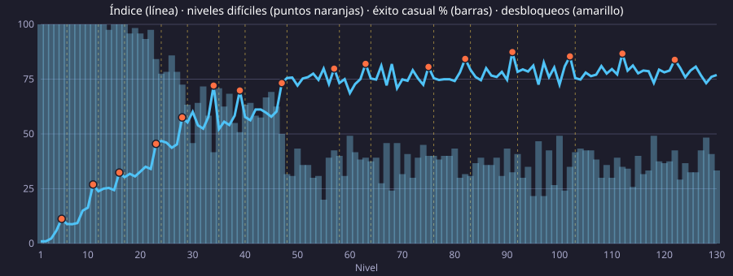

# Análisis de dificultad

Generado con `npm run analizar` (niveles 1–110, 15 niveles por número, 8 partidas
de jugador casual por nivel; semilla fija). No editar a mano: vuelve a ejecutar el script.

## Resumen

- **Resolubles sin habilidades**: 1650/1650 (100 %). Con lluvia, `npm run simular`.
- **Tendencia**: correlación de Spearman nivel ↔ índice **ρ = 0,60** (1 = sube siempre);
  nivel ↔ éxito del jugador casual ρ = -0,61 (negativa = cada vez gana menos).
- **Retrocesos** (el índice baja más de 5 puntos respecto al nivel anterior): 34, 80, 95, 97.
- **Mesetas** (tramos de 10 niveles con pendiente casi nula): 61–70, 81–90, 91–100, 101–110.

Índice = 25 % movimientos de la solución + 15 % esfuerzo de búsqueda + 30 % fracaso del jugador
casual + 15 % niebla + 15 % ritmo de la lluvia (cada medida normalizada entre el mínimo y el máximo
de los niveles analizados).

## Por tramos

| Niveles | Índice (media ± desv.) | Pendiente (puntos/nivel) | Éxito casual | Movimientos |
| --- | --- | --- | --- | --- |
| 1–10 | 10,6 ± 8,5 | 2,69 | 100 % | 9,9 |
| 11–20 | 41,2 ± 7,5 | 2,37 | 98 % | 16,9 |
| 21–30 | 62,1 ± 7,7 | 2,57 | 85 % | 23,3 |
| 31–40 | 73,2 ± 2,2 | 0,42 | 73 % | 27,4 |
| 41–50 | 73,1 ± 2,1 | -0,45 | 73 % | 27,4 |
| 51–60 | 74,6 ± 1,8 | -0,30 | 71 % | 27,8 |
| 61–70 | 73,8 ± 1,7 | -0,06 | 73 % | 27,8 |
| 71–80 | 72,6 ± 1,9 | -0,36 | 75 % | 27,7 |
| 81–90 | 74,2 ± 1,7 | -0,04 | 71 % | 27,8 |
| 91–100 | 73,3 ± 2,8 | -0,21 | 73 % | 27,7 |
| 101–110 | 73,9 ± 2,5 | -0,21 | 70 % | 27,7 |

## Por nivel

| Nivel | Colores | Paleta | Tubos | Fusiones | Lluvia | Intervalo | Movimientos | log₁₀ nodos | Ramificación | Éxito casual | Niebla | Índice |
| --- | --- | --- | --- | --- | --- | --- | --- | --- | --- | --- | --- | --- |
| 1 | 3 | 4 | 6 | 0 | 1 | 5,85 s | 9,1 ± 1,5 | 0,95 | 5,3 | 100 % | 0 % | 2,5 |
| 2 | 3 | 4 | 6 | 0 | 1 | 5,70 s | 8,7 ± 1,2 | 0,94 | 5,4 | 100 % | 3 % | 2,8 |
| 3 | 3 | 4 | 6 | 0 | 1 | 5,55 s | 8,7 ± 1,9 | 0,93 | 5,6 | 100 % | 4 % | 2,9 |
| 4 | 3 | 4 | 6 | 0 | 1 | 5,40 s | 9,7 ± 1,7 | 0,98 | 5,6 | 100 % | 8 % | 6,9 |
| 5 | 3 | 4 | 6 | 0 | 1 | 5,25 s | 8,1 ± 2,2 | 0,89 | 5,5 | 100 % | 17 % | 5,7 |
| 6 | 3 | 5 (+naranja) | 6 | 1 | 1 | 5,10 s | 9,4 ± 1,6 | 0,97 | 4,9 | 100 % | 16 % | 9,1 |
| 7 | 3 | 5 | 6 | 1 | 1 | 4,95 s | 9,9 ± 2,0 | 0,99 | 4,8 | 100 % | 19 % | 11,3 |
| 8 | 3 | 5 | 6 | 1 | 1 | 4,80 s | 10,1 ± 1,6 | 1,00 | 4,5 | 99 % | 19 % | 12,1 |
| 9 | 3 | 5 | 7 | 2 | 2 | 4,65 s | 12,2 ± 1,0 | 1,08 | 7,3 | 100 % | 29 % | 24,7 |
| 10 | 3 | 5 | 7 | 2 | 2 | 4,50 s | 12,9 ± 1,6 | 1,11 | 7,5 | 100 % | 33 % | 27,8 |
| 11 | 3 | 5 | 7 | 2 | 2 | 4,35 s | 11,8 ± 1,8 | 1,07 | 7,6 | 100 % | 31 % | 25,4 |
| 12 | 4 | 6 (+morado) | 8 | 2 | 2 | 4,20 s | 15,5 ± 1,9 | 1,19 | 8,6 | 100 % | 38 % | 35,3 |
| 13 | 4 | 6 | 8 | 2 | 2 | 4,05 s | 16,3 ± 2,1 | 1,21 | 8,1 | 99 % | 46 % | 39,7 |
| 14 | 4 | 6 | 8 | 2 | 2 | 3,90 s | 15,7 ± 2,0 | 1,19 | 7,7 | 98 % | 41 % | 37,7 |
| 15 | 4 | 6 | 8 | 2 | 2 | 3,75 s | 16,7 ± 1,8 | 1,22 | 8,9 | 100 % | 43 % | 40,5 |
| 16 | 4 | 6 | 8 | 2 | 2 | 3,60 s | 15,3 ± 1,9 | 1,18 | 8,3 | 100 % | 41 % | 37,6 |
| 17 | 5 | 7 (+rosa) | 9 | 2 | 2 | 3,45 s | 18,9 ± 2,2 | 1,27 | 9,5 | 98 % | 46 % | 47,0 |
| 18 | 5 | 7 | 9 | 2 | 2 | 3,30 s | 19,5 ± 2,3 | 1,29 | 9,7 | 97 % | 46 % | 49,0 |
| 19 | 5 | 7 | 9 | 2 | 2 | 3,15 s | 20,5 ± 2,4 | 1,31 | 8,5 | 93 % | 42 % | 51,2 |
| 20 | 5 | 7 | 9 | 2 | 2 | 3,00 s | 18,7 ± 2,3 | 1,27 | 9,7 | 97 % | 44 % | 48,5 |
| 21 | 5 | 7 | 9 | 2 | 2 | 2,85 s | 18,3 ± 2,3 | 1,26 | 9,4 | 95 % | 41 % | 48,1 |
| 22 | 5 | 7 | 9 | 2 | 2 | 2,70 s | 20,1 ± 2,1 | 1,30 | 9,0 | 95 % | 42 % | 52,7 |
| 23 | 5 | 7 | 9 | 2 | 2 | 2,55 s | 19,9 ± 2,2 | 1,30 | 9,4 | 87 % | 45 % | 56,4 |
| 24 | 6 | 8 (+cian) | 10 | 2 | 2 | 2,50 s | 22,7 ± 1,7 | 1,35 | 10,4 | 88 % | 44 % | 61,0 |
| 25 | 6 | 8 | 10 | 2 | 2 | 2,50 s | 24,1 ± 3,4 | 1,38 | 10,3 | 81 % | 42 % | 64,6 |
| 26 | 6 | 8 | 10 | 2 | 2 | 2,50 s | 23,0 ± 2,7 | 1,36 | 9,5 | 85 % | 43 % | 62,1 |
| 27 | 6 | 8 | 10 | 2 | 2 | 2,50 s | 24,1 ± 3,2 | 1,38 | 10,8 | 86 % | 44 % | 63,7 |
| 28 | 6 | 8 | 10 | 2 | 2 | 2,50 s | 25,3 ± 2,4 | 1,40 | 10,7 | 86 % | 45 % | 66,1 |
| 29 | 7 | 9 (+lima) | 11 | 2 | 2 | 2,50 s | 28,4 ± 1,8 | 1,45 | 10,6 | 75 % | 41 % | 73,0 |
| 30 | 7 | 9 | 11 | 2 | 2 | 2,50 s | 27,7 ± 2,7 | 1,44 | 11,9 | 72 % | 43 % | 73,4 |
| 31 | 7 | 9 | 11 | 2 | 2 | 2,50 s | 27,2 ± 2,7 | 1,43 | 10,3 | 73 % | 42 % | 72,3 |
| 32 | 7 | 9 | 11 | 2 | 2 | 2,50 s | 26,8 ± 2,3 | 1,43 | 11,2 | 76 % | 44 % | 71,1 |
| 33 | 7 | 9 | 11 | 2 | 2 | 2,50 s | 27,9 ± 1,8 | 1,44 | 11,5 | 72 % | 46 % | 74,8 |
| 34 | 7 | 9 | 11 | 2 | 2 | 2,50 s | 25,7 ± 2,9 | 1,41 | 9,7 | 78 % | 45 % | 69,3 |
| 35 | 7 | 10 (+marron) | 11 | 2 | 2 | 2,50 s | 27,1 ± 2,7 | 1,43 | 9,9 | 73 % | 43 % | 72,2 |
| 36 | 7 | 10 | 11 | 2 | 2 | 2,50 s | 27,3 ± 1,9 | 1,43 | 11,0 | 73 % | 42 % | 72,5 |
| 37 | 7 | 10 | 11 | 2 | 2 | 2,50 s | 27,5 ± 2,2 | 1,44 | 11,5 | 73 % | 47 % | 74,1 |
| 38 | 7 | 10 | 11 | 2 | 2 | 2,50 s | 29,9 ± 3,9 | 1,47 | 10,2 | 68 % | 43 % | 77,8 |
| 39 | 7 | 10 | 11 | 2 | 2 | 2,50 s | 26,5 ± 2,4 | 1,42 | 10,2 | 71 % | 46 % | 73,1 |
| 40 | 7 | 11 (+blanco) | 11 | 2 | 2 | 2,50 s | 28,0 ± 3,2 | 1,44 | 9,5 | 70 % | 45 % | 75,1 |
| 41 | 7 | 11 | 11 | 2 | 2 | 2,50 s | 28,3 ± 3,2 | 1,45 | 10,5 | 64 % | 43 % | 76,6 |
| 42 | 7 | 11 | 11 | 2 | 2 | 2,50 s | 28,1 ± 3,6 | 1,45 | 11,2 | 78 % | 44 % | 72,9 |
| 43 | 7 | 11 | 11 | 2 | 2 | 2,50 s | 27,7 ± 2,4 | 1,44 | 10,3 | 69 % | 46 % | 75,5 |
| 44 | 7 | 11 | 11 | 2 | 2 | 2,50 s | 28,2 ± 3,2 | 1,45 | 11,1 | 73 % | 45 % | 74,4 |
| 45 | 7 | 11 | 11 | 2 | 2 | 2,50 s | 26,7 ± 2,5 | 1,42 | 11,0 | 71 % | 44 % | 72,7 |
| 46 | 7 | 11 | 11 | 2 | 2 | 2,50 s | 26,7 ± 1,4 | 1,43 | 9,9 | 71 % | 42 % | 71,9 |
| 47 | 7 | 11 | 11 | 2 | 2 | 2,50 s | 27,8 ± 3,7 | 1,44 | 10,6 | 76 % | 42 % | 72,0 |
| 48 | 7 | 12 (+azulDivino) | 11 | 2 | 2 | 2,50 s | 26,8 ± 2,5 | 1,43 | 11,0 | 84 % | 43 % | 68,4 |
| 49 | 7 | 12 | 11 | 2 | 2 | 2,50 s | 26,9 ± 3,4 | 1,43 | 10,9 | 72 % | 45 % | 73,1 |
| 50 | 7 | 12 | 11 | 2 | 2 | 2,50 s | 27,2 ± 3,3 | 1,43 | 11,4 | 73 % | 46 % | 73,1 |
| 51 | 7 | 12 | 11 | 2 | 2 | 2,50 s | 27,9 ± 2,9 | 1,44 | 9,9 | 63 % | 46 % | 77,4 |
| 52 | 7 | 12 | 11 | 2 | 2 | 2,50 s | 27,8 ± 3,5 | 1,44 | 11,0 | 75 % | 47 % | 74,0 |
| 53 | 7 | 12 | 11 | 2 | 2 | 2,50 s | 28,5 ± 3,1 | 1,45 | 11,2 | 73 % | 44 % | 74,5 |
| 54 | 7 | 12 | 11 | 2 | 2 | 2,50 s | 28,1 ± 3,6 | 1,45 | 10,2 | 64 % | 43 % | 76,4 |
| 55 | 7 | 12 | 11 | 2 | 2 | 2,50 s | 28,9 ± 3,6 | 1,46 | 11,2 | 77 % | 48 % | 75,5 |
| 56 | 7 | 12 | 11 | 2 | 2 | 2,50 s | 27,3 ± 2,4 | 1,43 | 11,0 | 69 % | 47 % | 74,9 |
| 57 | 7 | 12 | 11 | 2 | 2 | 2,50 s | 26,9 ± 2,9 | 1,43 | 11,4 | 73 % | 48 % | 73,6 |
| 58 | 7 | 13 (+jade) | 11 | 2 | 2 | 2,50 s | 27,1 ± 2,9 | 1,43 | 10,8 | 77 % | 42 % | 70,9 |
| 59 | 7 | 13 | 11 | 2 | 2 | 2,50 s | 27,2 ± 2,5 | 1,43 | 9,6 | 69 % | 42 % | 73,1 |
| 60 | 7 | 13 | 11 | 2 | 2 | 2,50 s | 28,1 ± 2,5 | 1,45 | 10,2 | 67 % | 43 % | 75,6 |
| 61 | 7 | 13 | 11 | 2 | 2 | 2,50 s | 27,3 ± 2,3 | 1,44 | 11,2 | 78 % | 47 % | 72,2 |
| 62 | 7 | 13 | 11 | 2 | 2 | 2,50 s | 26,9 ± 2,4 | 1,43 | 10,3 | 69 % | 44 % | 73,3 |
| 63 | 7 | 13 | 11 | 2 | 2 | 2,50 s | 28,9 ± 3,3 | 1,46 | 11,0 | 76 % | 44 % | 74,3 |
| 64 | 7 | 14 (+plata) | 11 | 2 | 2 | 2,50 s | 27,3 ± 2,6 | 1,43 | 10,7 | 70 % | 46 % | 74,4 |
| 65 | 7 | 14 | 11 | 2 | 2 | 2,50 s | 29,4 ± 3,2 | 1,47 | 9,8 | 70 % | 45 % | 77,4 |
| 66 | 7 | 14 | 11 | 2 | 2 | 2,50 s | 28,4 ± 3,2 | 1,45 | 11,0 | 72 % | 45 % | 75,4 |
| 67 | 7 | 14 | 11 | 2 | 2 | 2,50 s | 27,2 ± 2,9 | 1,43 | 9,9 | 74 % | 44 % | 72,5 |
| 68 | 7 | 14 | 11 | 2 | 2 | 2,50 s | 26,9 ± 3,0 | 1,43 | 10,5 | 78 % | 46 % | 71,1 |
| 69 | 7 | 14 | 11 | 2 | 2 | 2,50 s | 27,1 ± 3,5 | 1,43 | 10,9 | 68 % | 43 % | 73,8 |
| 70 | 7 | 14 | 11 | 2 | 2 | 2,50 s | 28,3 ± 2,8 | 1,45 | 10,9 | 76 % | 43 % | 73,3 |
| 71 | 7 | 14 | 11 | 2 | 2 | 2,50 s | 28,8 ± 2,9 | 1,46 | 10,4 | 73 % | 43 % | 74,7 |
| 72 | 7 | 14 | 11 | 2 | 2 | 2,50 s | 27,3 ± 2,7 | 1,43 | 11,3 | 76 % | 43 % | 71,6 |
| 73 | 7 | 14 | 11 | 2 | 2 | 2,50 s | 28,1 ± 4,0 | 1,44 | 10,2 | 71 % | 45 % | 74,9 |
| 74 | 7 | 14 | 11 | 2 | 2 | 2,50 s | 27,5 ± 2,2 | 1,44 | 10,8 | 78 % | 45 % | 71,7 |
| 75 | 7 | 14 | 11 | 2 | 2 | 2,50 s | 27,6 ± 1,1 | 1,44 | 10,4 | 72 % | 46 % | 74,3 |
| 76 | 7 | 15 (+amatista) | 11 | 2 | 2 | 2,50 s | 27,9 ± 3,2 | 1,44 | 10,3 | 78 % | 44 % | 72,3 |
| 77 | 7 | 15 | 11 | 2 | 2 | 2,50 s | 27,4 ± 2,4 | 1,44 | 10,4 | 72 % | 44 % | 73,5 |
| 78 | 7 | 15 | 11 | 2 | 2 | 2,50 s | 27,4 ± 2,9 | 1,44 | 10,6 | 79 % | 42 % | 70,7 |
| 79 | 7 | 15 | 11 | 2 | 2 | 2,50 s | 28,0 ± 3,0 | 1,44 | 10,2 | 70 % | 40 % | 73,6 |
| 80 | 7 | 15 | 11 | 2 | 2 | 2,50 s | 26,8 ± 3,6 | 1,42 | 11,2 | 83 % | 43 % | 68,6 |
| 81 | 7 | 15 | 11 | 2 | 2 | 2,50 s | 28,1 ± 3,7 | 1,45 | 10,6 | 63 % | 44 % | 76,9 |
| 82 | 7 | 15 | 11 | 2 | 2 | 2,50 s | 27,1 ± 1,8 | 1,44 | 10,9 | 67 % | 45 % | 75,0 |
| 83 | 7 | 16 (+esmeralda) | 11 | 2 | 2 | 2,50 s | 27,9 ± 3,0 | 1,44 | 10,3 | 81 % | 44 % | 71,2 |
| 84 | 7 | 16 | 11 | 2 | 2 | 2,50 s | 28,2 ± 4,5 | 1,45 | 10,8 | 75 % | 43 % | 73,3 |
| 85 | 7 | 16 | 11 | 2 | 2 | 2,50 s | 27,3 ± 2,9 | 1,43 | 11,0 | 72 % | 42 % | 72,8 |
| 86 | 7 | 16 | 11 | 2 | 2 | 2,50 s | 28,1 ± 1,8 | 1,45 | 11,0 | 71 % | 48 % | 76,0 |
| 87 | 7 | 16 | 11 | 2 | 2 | 2,50 s | 28,3 ± 3,6 | 1,45 | 10,8 | 76 % | 41 % | 72,4 |
| 88 | 7 | 16 | 11 | 2 | 2 | 2,50 s | 26,9 ± 1,9 | 1,43 | 10,9 | 67 % | 44 % | 74,1 |
| 89 | 7 | 16 | 11 | 2 | 2 | 2,50 s | 27,8 ± 2,5 | 1,44 | 10,5 | 68 % | 46 % | 75,5 |
| 90 | 7 | 16 | 11 | 2 | 2 | 2,50 s | 28,7 ± 2,1 | 1,46 | 10,4 | 73 % | 42 % | 74,2 |
| 91 | 7 | 16 | 11 | 2 | 2 | 2,50 s | 28,3 ± 2,5 | 1,45 | 11,0 | 74 % | 43 % | 73,6 |
| 92 | 7 | 17 (+carmesi) | 11 | 2 | 2 | 2,50 s | 27,5 ± 3,0 | 1,44 | 11,1 | 64 % | 41 % | 75,0 |
| 93 | 7 | 17 | 11 | 2 | 2 | 2,50 s | 29,4 ± 3,1 | 1,47 | 10,5 | 73 % | 43 % | 76,0 |
| 94 | 7 | 17 | 11 | 2 | 2 | 2,50 s | 28,0 ± 3,2 | 1,44 | 11,1 | 76 % | 46 % | 73,6 |
| 95 | 7 | 17 | 11 | 2 | 2 | 2,50 s | 26,0 ± 2,9 | 1,41 | 11,2 | 81 % | 42 % | 68,0 |
| 96 | 7 | 17 | 11 | 2 | 2 | 2,50 s | 29,0 ± 3,5 | 1,46 | 10,4 | 65 % | 45 % | 78,1 |
| 97 | 7 | 17 | 11 | 2 | 2 | 2,50 s | 26,9 ± 2,4 | 1,43 | 9,4 | 76 % | 42 % | 71,0 |
| 98 | 7 | 17 | 11 | 2 | 2 | 2,50 s | 26,2 ± 2,5 | 1,42 | 10,9 | 78 % | 46 % | 70,3 |
| 99 | 7 | 17 | 11 | 2 | 2 | 2,50 s | 27,5 ± 2,6 | 1,44 | 11,2 | 78 % | 46 % | 72,3 |
| 100 | 7 | 17 | 11 | 2 | 2 | 2,50 s | 27,9 ± 3,0 | 1,44 | 11,1 | 68 % | 43 % | 74,9 |
| 101 | 7 | 17 | 11 | 2 | 2 | 2,50 s | 27,9 ± 2,4 | 1,44 | 10,3 | 68 % | 43 % | 74,7 |
| 102 | 7 | 17 | 11 | 2 | 2 | 2,50 s | 26,9 ± 3,2 | 1,43 | 10,5 | 71 % | 41 % | 71,9 |
| 103 | 7 | 18 (+oro) | 11 | 2 | 2 | 2,50 s | 28,3 ± 3,9 | 1,45 | 10,8 | 66 % | 44 % | 76,4 |
| 104 | 7 | 18 | 11 | 2 | 2 | 2,50 s | 29,2 ± 4,0 | 1,46 | 10,2 | 66 % | 45 % | 78,2 |
| 105 | 7 | 18 | 11 | 2 | 2 | 2,50 s | 28,1 ± 2,7 | 1,45 | 10,9 | 71 % | 44 % | 74,8 |
| 106 | 7 | 18 | 11 | 2 | 2 | 2,50 s | 26,4 ± 2,1 | 1,42 | 10,3 | 73 % | 44 % | 71,4 |
| 107 | 7 | 18 | 11 | 2 | 2 | 2,50 s | 27,3 ± 2,2 | 1,43 | 10,8 | 68 % | 40 % | 73,4 |
| 108 | 7 | 18 | 11 | 2 | 2 | 2,50 s | 26,7 ± 1,7 | 1,43 | 11,0 | 73 % | 39 % | 70,4 |
| 109 | 7 | 18 | 11 | 2 | 2 | 2,50 s | 27,1 ± 3,2 | 1,43 | 11,5 | 74 % | 42 % | 71,5 |
| 110 | 7 | 18 | 11 | 2 | 2 | 2,50 s | 28,6 ± 4,2 | 1,45 | 10,4 | 71 % | 48 % | 76,6 |
